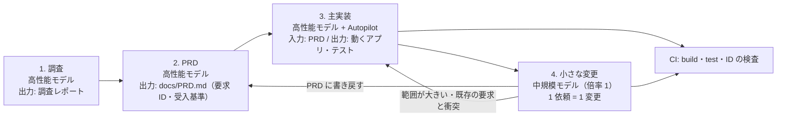

# HVE と EABK の役目は終わったのか — 2 つの動画編集アプリの開発履歴から見た、Coding Agent の進化と「残すべき最小の規律」

**ホワイトペーパー**

- 作成日: 2026-11-08（JST）
- 対象:
  - `C:\GitHub\HubRadio-MovieCreator`（以下 **HubRadio**。2026-08-26 開始、未完成。EABK 0.5.x を 10-06 以降に使用）
  - `C:\GitHub\VideoCreator`（以下 **VideoCreator**。2026-11-07 開始、最初のリリース版。フレームワークなし）
  - `C:\GitHub\HypervelocityEngineering`（以下 **HVE リポジトリ**。EABK の配布元）
- 本書が統合する先行の調査: `work/EABKUnnesessaryAnalyticsRepor.md`（EABK 不要論の検証と EABK Lite 0.6.0 の削減）、`HVE-History/` の各レポート（HVE の歴史、4 方式の比較、開発履歴レポート）
- 集計スクリプトと中間データ: `work/devhist/`（git 管理外）

---

## 要旨

**問い.** 「この規模のアプリでは、EABK がない方が開発効率がよい。HVE や EABK は、かつて GitHub Copilot の Coding Agent に足りなかったものを補うための仕組みだったが、モデルと Coding Agent の機能強化によって、ほぼ不要になった」という仮説は、データで支持されるか。

**方法.** 2 つのアプリの開発履歴（git、Copilot のセッションの全イベント、実行履歴）から、同じ定義で「Prompt 回数・日数・ジョブの所要時間・総待ち時間・モデル・Token」を集計しました。HubRadio は、フレームワークなしの期（期 A）と EABK の期（期 C・D）に分けて、**同じアプリの中での前後比較**もしました。さらに、GitHub の公式の変更履歴で、Coding Agent とモデルの変化の時期を確かめました。

**主な結果.**

| 指標 | VideoCreator（なし） | HubRadio 期 A（なし） | HubRadio 期 C+D（EABK） |
|---|---:|---:|---:|
| Prompt を入力した日数 | **2 日** | 18 日 | 13 日 |
| 人の Prompt 回数 | **28** | 135 | 44 + 約 33（run への介入） |
| 総待ち時間 | **14.3 時間** | 272.6 時間 | 139.0 時間（38.4 + run 100.6） |
| ジョブの中央値 | 20.1 分 | 34.4 分 | 14.7 分（期 C）／run 2.3 時間（期 D） |
| 2 時間を超えたジョブの時間の割合 | **0%** | 81.4% | 66.8%（期 C） |
| 「続けて・残りを全部」の Prompt の時間の割合 | **4%** | **85%** | 33%（期 C） |
| 入力 Token（キャッシュ読込を含む） | **4.1 億** | 82.6 億 | 8.0 億（期 C のみ。期 D は記録なし） |
| 状態 | 最初のリリース版。151 テスト合格 | — | 未完成。要求 98 件のうち 43 件は実装の確認ができていない |

1. **仮説の中心（この規模では、フレームワークなしの方が効率がよい）は支持します。** VideoCreator は、HubRadio の約 1/29 の総待ち時間、約 1/8 の Prompt 回数で、ほぼ同じ数の要求（103 件と 98 件）のアプリを最初のリリースまで作りました。EABK の期の HubRadio は、変更した行の **49% がツールキット**で、アプリのコードは 22% でした。小さな変更の比較実験でも、EABK は素の Coding Agent と同じ合否に、約 15 倍の時間と約 31 倍の AI クレジットをかけました。
2. **ただし、効率の差を生んだのは「フレームワークがないこと」だけではありません。** 同じ HubRadio でも、フレームワークのない期 A が最も非効率でした（総待ち 272.6 時間、待ち時間の 85% が「続けて・残りを全部」）。期 A と VideoCreator の違いは、**モデルの世代**（Claude Opus 5.5 の提供開始は 2026-09-22、期 A の後）と、**範囲の決まった依頼の仕方**（調査 → PRD → 実装 → 1 件ずつの変更）です。
3. **「機能不足を補っていた」は、言い直しが必要です。** Plan mode、Autopilot、サブエージェントの並列、Skills、Custom agents、Hooks、自動の圧縮、メモリは、2026-02-25 の Copilot CLI の一般提供の時点で、すでに製品にありました。HVE と EABK が補っていたのは、主に**モデルの長時間作業の信頼性の不足**（止まる・見失う・偽の完了）と、それを人が回すための手順でした。EABK 自体も、Custom agents・Skills・Hooks という製品の機能の上に作られています。**不要になったのは「製品の機能の代わり」ではなく、「モデルの弱さを前提にした手順（オーケストレーション）」**です。
4. **不要にならないものが 3 つあります。** ①要求の正本（PRD）、②エージェントの外の決定的な検査（テスト・CI）、③複数の人・PC で同じ規則が効くこと。VideoCreator でも、PRD は機能追加に追従せず（シリーズ分割の機能が PRD に 0 語）、要求とコード・テストの対応は 54% でした。HubRadio（EABK あり）の 56% とほぼ同じで、**EABK の高い費用は、最終的な追跡の網羅には表れていません**（矛盾の検出と記録の量では EABK が上です。§6.6）。この 3 つは、フレームワークではなく、`AGENTS.md` の数行と CI で足ります。
5. **あなたのサイクル（調査 → PRD → 主実装は高価なモデル → 小さな変更は中規模のモデル）は、データで支持されます。ただし VideoCreator では、最後の段が実行されていませんでした。** 調査と PRD は待ち時間の 3.5% で済み、その後の全体の方向を決めました。一方、小さな変更は待ち時間の 67%、**費用の 79%** を占め、その 99.5% が Opus 5.5（課金倍率 15）でした。小さな変更を倍率 1 のモデルで行えば、この段の費用は、単純計算で 1/10 以下になります（品質は未検証）。

**結論.** HVE と EABK の**オーケストレーション**は、この規模のアプリでは役目を終えました。残すべきものは「フレームワーク」ではなく、**4 段のサイクル、モデルの使い分け、PRD への書き戻しの 1 行の規則、CI の決定的な検査**という、薄い規律です。これは、HVE の歴史のレポートが 10 月に出した結論（「能力不足を補う足場は外し、能力に依存しない足場だけを残す」）を、別のアプリと 1 か月後のデータで再確認したものです。

---

## 目次

1. 背景と問い
2. 方法
3. 対象と時代背景（フレームワークと Coding Agent の年表）
4. 開発履歴レポート: VideoCreator
5. 開発履歴レポート: HubRadio
6. 徹底比較
7. 仮説の検証
8. これまでの調査の統合（EABK 不要論の検証、EABK Lite）
9. 限界と妥当性への脅威
10. 推奨: ポスト・フレームワークの開発プロセス
11. 結論
- 付録 A: 日別・Prompt 別の明細
- 付録 B: データソースと再現の手順
- 付録 C: 用語

---

## 1. 背景と問い

### 1.1 背景

2026 年の前半、Coding Agent はまだ長い作業を最後までやり切れませんでした。途中で止まる、文脈を失う、テストを通さずに「完了」と言う、といった問題を補うために、私たちは手順とツールを積み上げてきました。

| 世代 | 中身 | 時期 |
|---|---|---|
| HVE v1 | 独自の Workflow フレームワーク `hve`、DAG オーケストレータ ATG、Prompt 約 314 件、Skill 34 件、Python 約 27.7 万行 | 2026-01〜10-03（開発停止） |
| EABK（HVE v2） | conductor（進行役）と作業役、Skills、Hooks、決定的なスクリプト（`verify.py`・`next-id.py`・`ledger.py`）、要求定義書・カタログ・台帳のデータ層 | 2026-10-06〜（0.6.0 で Lite 化） |

### 1.2 あなたの仮説（本書で検証するもの）

| # | 主張 | 本書での扱い |
|---|---|---|
| C1 | この規模のアプリでは、EABK がない方が開発効率がよい（2 つのリポジトリで実証されている） | §6、§7.1 |
| C2 | HVE や EABK は、かつての Coding Agent の機能の不足を補おうとしていた | §3、§7.2 |
| C3 | モデルと Coding Agent の機能強化によって、それらはほぼ不要になった | §7.3 |
| C4 | ただし、「調査 → PRD → 主実装（高価なモデル）→ 小さな変更（中規模のモデル）」のサイクルは重要である | §7.4 |

### 1.3 先に決めた反証の条件

| 主張 | この結果なら主張は反証される |
|---|---|
| C1 | 同程度の範囲で、EABK のある期の方が、待ち時間・Prompt 回数・Token のいずれかで明らかに少ない |
| C2 | フレームワークが提供していた機能の多くが、当時の Coding Agent に存在しなかった |
| C3 | フレームワークなしの開発で、フレームワークが防いでいた問題（止まる・見失う・偽の完了・仕様のずれ）が同じ頻度で起きている |
| C4 | 調査と PRD に時間をかけても、その後の手戻りが減らない／小さな変更を高価なモデルで行わないと品質が落ちる |

---

## 2. 方法

### 2.1 使った生の素材

| 素材 | 範囲 | 取得の方法 |
|---|---|---|
| git の履歴（コミット・差分の行数・作成者・trailer） | 両リポジトリの全期間、HVE リポジトリの 10-06 以降 | `git log --numstat`、`git ls-files` |
| Copilot CLI（Agent Host）のセッションの全イベント | VideoCreator の 11 セッション、HVE の 45 セッション | `~/.copilot/session-state/*/events.jsonl` |
| VS Code Chat のセッションの全イベント | HubRadio の 35 セッション（08-26〜10-14）、HVE の 109 セッション | Copilot のセッション履歴（クラウド）の `events`・`session_usage` |
| EABK の実行履歴 | HubRadio の 34 run（10-08〜11-07） | `docs/run-history.md` |
| 要求とカタログ | HubRadio の要求 98 件、VideoCreator の要求 ID 103 件 | `docs/requirements-definition.md`・`docs/catalog.md`、`docs/PRD.md` |
| 公式の変更履歴 | Copilot CLI の一般提供（2026-02-25）、Claude Opus 5.5 の提供（2026-09-22） | GitHub Changelog |

### 2.2 指標の定義

先行の開発履歴レポート（`HVE-History/2026100515-…`・`20261007…`）と同じ定義です。

| 指標 | 定義 |
|---|---|
| 開始日 | リポジトリの作成日。GitHub が作る「Initial commit」の時刻で代用（`gh` が未認証のため API の `created_at` は未取得） |
| 日数 | 人が Prompt を入力した暦日の数（JST）。1 回でも入力した日を 1 と数える |
| Prompt 回数 | 人が入力した `user.message` だけ。サブエージェントへの依頼（`source = agent-…`）、Autopilot の継続、システム通知、ターミナルの完了通知（`[Terminal …`）は数えない。VS Code の記録の二重化（同じ文が 60 秒以内に 2 回）は 1 回にまとめた（3 件） |
| ジョブの所要時間 | Prompt の時刻から、次の人の Prompt の前の最後のエージェントのイベント（応答・ツールの完了・`task_complete`）までの時間 |
| 総待ち時間 | ジョブの所要時間の合計 |
| Token | API 呼び出しごとの入力 Token（キャッシュ読込を含む）と出力 Token の合計 |
| 費用の単位 | イベントの `cost`（課金倍率の合計。Opus 5.5 = 15、Sonnet 5.5 = 1 など）。HubRadio 期 A の VS Code Chat には記録がない |
| Prompt の分類 | 文面の正規表現による機械的な分類（§6.3）。人による評定ではない |

### 2.3 HubRadio の期の分け方

| 期 | 期間 | 進め方 | 記録 |
|---|---|---|---|
| A | 08-26〜09-14 | フレームワークなし。VS Code Chat。「調査 → 敵対的レビュー → 実装プラン → 全てのタスクを実行」と、計画ファイル（`/work/…-TaskExecutionPlan.md`）を往復 | VS Code Chat 20 セッション |
| B | 09-15〜10-05 | フレームワークなし（ATG を 09-24 に入れ 09-29 に削除）。コミットは 9 日・22 件 | **セッションの記録なし**（別の場所・別の PC で実行。本書の集計から除外） |
| C | 10-06〜10-14 | EABK（`/build` と conductor）。VS Code Chat | VS Code Chat 15 セッション、run 4 件 |
| D | 10-30〜11-07 | EABK 0.5.1〜0.5.2 | **run-history の 30 run だけ**（別の PC の Copilot CLI。Token は記録なし） |

### 2.4 第三者が確かめられる証拠

- VideoCreator の `dotnet test`: **151 件すべて合格**（exit 0、4 分 17 秒、本書の作成時に実行）。
- HubRadio の `python scripts/verify.py --docs-only --no-cache`: **PASS**（errors 0、warnings 52、HEAD `4904a21`）。
- コミットのハッシュと時刻、セッションのイベントの時刻と Token 数、公式の変更履歴の日付。

---

## 3. 対象と時代背景

### 3.1 2 つのアプリ

| | HubRadio | VideoCreator |
|---|---|---|
| 目的 | 企業のトーク・インタビュー動画（Hubらじお）から、長尺版・横長版・縦型ショートなどを自動で編集する | YouTube・TikTok 向けに、長い動画から人気のある型のショート動画・長尺動画を自動で編集する |
| 要求の数 | 98 件（FR 80・NFR 18） | 103 件（FR・NFR の ID） |
| 共通する主な機能 | 取り込み、文字起こし、話者、見どころの抽出、縦型化、字幕・強調テロップ、オープニング／クロージング、BGM・効果音、複数案、プロジェクト管理 | 同左（複数カメラの切替、シリーズ分割、ツッコミテロップ、アップスケールを含む） |
| 形態 | Windows デスクトップ（.NET + WebView の React UI、Python の補助） | ローカルの Web アプリ（.NET の API + Web UI） |
| 製品のコード（行） | C# 190,592 ＋ TS/TSX 93,112 ほか（約 29.8 万行） | C# 9,087 ＋ JS 4,348 ほか（約 1.4 万行） |
| テスト | C# 188,890 行、テストメソッド 3,717 | C# 3,634 行、テスト 151 件 |
| 開始 → 現在 | 08-26 → 11-07（74 暦日。未完成） | 11-07 08:34 → 11-08 20:11（2 暦日。最初のリリース版） |

**要求の数はほぼ同じで、コードの量は約 20 倍違います。** この差の意味は §6.5 で扱います。

### 3.2 Coding Agent とモデルの年表（公式の変更履歴）

| 日付 | 出来事 | 出典 |
|---|---|---|
| 2025-09-25 | Copilot CLI の Public Preview | GitHub Changelog |
| **2026-02-25** | **Copilot CLI の一般提供。** Plan mode、**Autopilot mode**、組み込みの専門エージェント（Explore・Task・Code Review・Plan）と**並列実行**、クラウドの Coding Agent への委譲、**Agent Skills**、**Custom agents**（`.agent.md`）、**Hooks**（`preToolUse` で拒否・変更）、**自動の圧縮**（無限のセッション）、リポジトリのメモリ、セッションをまたぐメモリ | GitHub Changelog「GitHub Copilot CLI is now generally available」 |
| 2026-01〜10 | HVE v1 の開発（ピークは 03 月の 1,630 コミット） | HVE の歴史 |
| 2026-08-26〜09-14 | HubRadio 期 A（主に gpt-5.6-sol-fast、Claude Haiku 4.5、gpt-6-astra） | セッション |
| **2026-09-22** | **Claude Opus 5.5 の提供開始。**「Opus 5 と同等の解決率で、ステップと Token が大幅に少ない。複数ステップの作業で誤りから素早く回復する」 | GitHub Changelog「Claude Opus 5.5 is now available in GitHub Copilot」 |
| 2026-10-03 | HVE v1 の開発停止（EOS） | HVE の歴史 |
| 2026-10-06〜 | EABK の公開と HubRadio への適用（期 C・D。主に Sonnet 5.5 と Opus 5.5） | git、セッション |
| 2026-11-07〜08 | VideoCreator（主に Opus 5.5。Copilot CLI の Autopilot） | セッション |
| 2026-11-08 | EABK 0.6.0（Lite）。conductor・作業役・hook・run を削除 | `work/EABKUnnesessaryAnalyticsRepor.md` §10〜12 |

**この年表から言えること.** HVE v1 が最も大きくなった時期（03〜08 月）には、Autopilot、並列のサブエージェント、Skills、Custom agents、Hooks が、すでに製品にありました。**フレームワークは「製品にない機能」を作ったというより、「当時のモデルでは製品の機能だけでは最後まで進まなかった」ことを、人の手順と独自のオーケストレーションで補っていた**、と見るのが事実に合います（§7.2）。

---

## 4. 開発履歴レポート: VideoCreator

### 4.1 サマリー

| 項目 | 値 |
|---|---|
| 開始日（リポジトリの作成日） | **2026-11-07 08:34 JST**（Initial commit `2d3e6f9`） |
| 最新バージョン | `ca8dd28`（2026-11-08 20:11 JST）。コミット 12 件 |
| 日数（Prompt を入力した日） | **2 日**（11-07、11-08） |
| Prompt 回数 | **28 回**（セッション 11 件。アプリが実行時に LLM として呼んだ 3 セッションと、`spikes/out` の 2 セッションは除外） |
| 使用 LLM モデル | Claude Opus 5.5（1,375 呼び出し・84%）、Claude Sonnet 5.5（181）、GPT-6.1 Sol（68）、GPT-6 Luna（12。探索のサブエージェント）、GPT-6.1 Terra（3） |
| 平均ジョブ実行時間 | **30.6 分**（中央値 **20.1 分**、P90 84.7 分、最大 99.5 分） |
| 総待ち時間 | **14 時間 17 分**（856.6 分） |
| 総 Token 数 | 入力 **412,875,181**（うちキャッシュ読込 401,110,099）＋出力 2,005,926 |
| 費用の単位（課金倍率の合計） | 20,889 |
| 検証 | `dotnet test` 151 件すべて合格（exit 0） |

### 4.2 開発の経過（4 段のサイクル）

| 段 | Prompt | 所要の合計 | 内容 | 主なモデル |
|---|---:|---:|---|---|
| 1. 調査 | 2 | 20.8 分 | SNS で人気のある編集の型・テロップ・字幕のベストプラクティスを調査し `docs/VideoCreator-AnalyticsReport.md` に | Opus 5.5 |
| 2. PRD | 1 | 9.6 分 | 調査レポートから `docs/PRD.md`（要求 ID 103 件、受入基準、KPI、トレーサビリティ）を作成 | Opus 5.5 |
| 3. 主実装 | 6 | 251.3 分 | PRD を基に実装。「いきなり実装せず、小さなプログラムで PRD の要件を満たすかを検証」。決定事項への回答、未実装の完了、起動スクリプト | Opus 5.5（作業の一部は Sonnet 5.5） |
| 4. 小さな変更 | 19 | 574.9 分 | 設定画面の説明、横並び、名前の変更、モデルの変更、シリーズ分割、削除、場面転換の画像、フォルダー選択、進捗バー、複数の書き出し、保存先の変更、複数カメラの同期 | **Opus 5.5（99.5%）** |

- 調査と PRD の 2 段は、総待ち時間の **3.5%** でした（費用は主実装と同じセッションのため分離できません）。
- 主実装（セッション `678beaab`）は費用 4,384（21%）。小さな変更の 10 セッションは費用 **16,505（79%）**で、そのうち 16,425 が Opus 5.5 でした。
- 2 時間を超えたジョブは **0 件**。「続けて」「再開して」の Prompt は 0 件、「未実装を完了させて」は 1 件（#6）だけでした。

### 4.3 気づいた点（事実）

- PRD は主実装の後、ほとんど更新されていません。最後の更新は 11-08 08:13（`b51e7b2`、API 表の 1 行）で、版は「1.1」「Draft（レビュー待ち）」のままです。シリーズ分割、場面転換の画像、進捗バー、複数の書き出し、保存先の変更、複数カメラの同期は、PRD に入っていません（「シリーズ」「前編」「分割数」は 0 件）。
- 主実装の後に追加したテストは、要求 ID を参照していません。現在のテストのうち **13 ファイル・71 メソッドは要求 ID を 1 つも参照せず**、ID を参照するのは主実装の回に作られた 6 ファイルだけです（先行の調査 §3.2 を最新のコミットで再集計）。
- 第三者による盲検の評価（PRD の QG-02/03）は、利用者が「後でやる」とし、まだ行われていません。**「最初のリリース版」は、外部の受入を経たものではありません。**

---

## 5. 開発履歴レポート: HubRadio

### 5.1 サマリー

| 項目 | 期 A（フレームワークなし） | 期 C（EABK） | 期 D（EABK） | 合計（記録のある期） |
|---|---|---|---|---|
| 期間 | 08-26〜09-14 | 10-06〜10-14 | 10-30〜11-07 | 08-26〜11-07 |
| 日数（Prompt を入力した日） | 18 日 | 4 日 | 9 日（run のあった日） | **31 日** |
| Prompt 回数 | 135 | 44 | 約 33（run への人の介入の記録） | **約 212** |
| 平均／中央値 | 121.1 分／34.4 分 | 52.4 分／14.7 分 | run 1 件あたり 3.4 時間／2.3 時間 | — |
| 総待ち時間 | 272.6 時間 | 38.4 時間 | 100.6 時間（run の経過時間の合計） | **411.6 時間** |
| 最長のジョブ | 1,154.7 分（「残作業があればリストアップ」） | 360.8 分 | 33.6 時間（run） | — |
| 入力 Token／出力 Token | 82.6 億／5,189 万 | 8.0 億／252 万 | 記録なし | 90.7 億以上 |
| 費用の単位 | 記録なし（HVE の歴史では 08-26〜10-03 で 66,981 AIU） | 25,370 | run-history は「推定」のみ | — |
| 主なモデル（呼び出し数） | gpt-5.6-sol-fast 25,242、Claude Haiku 4.5 15,140、gpt-6-astra 4,392、gpt-5.6-sol 3,055、ほか 12 種 | Sonnet 5.5 2,455、Opus 5.5 1,496、gpt-5.6-luna 475 | 作業役は既定のモデル | 19 種 |

- 開始日（リポジトリの作成日）: **2026-08-26 22:39 JST**（Initial commit `7e8e7f3`）。最新は `4904a21`（11-07 14:59）。コミット 611 件（マージ 92 件）。
- 期 B（09-15〜10-05、コミット 22 件）はセッションの記録がなく、上の表に入っていません。合計は**下限**です。

### 5.2 期 A: フレームワークなし・旧世代のモデル（08-26〜09-14）

最初の 4 時間は、VideoCreator とよく似た流れでした。

| 時刻（JST） | Prompt | 所要 |
|---|---|---:|
| 08-26 23:13 | 要求定義の動画生成アプリを実現する方法を調査 | 21.2 分 |
| 08-26 23:34 | 調査レポートを敵対的レビュアーとしてレビュー | 32.6 分 |
| 08-27 00:06 | 詳細な実装プランを作成 | 60.8 分 |
| 08-27 01:07 | 全てのタスクを実行（並列、完了ごとに敵対的レビュー） | 48.4 分 |

その後の 18 日間は、次の Prompt の繰り返しになりました（§6.3）。

- 「残作業をリストアップして」「全ての残作業を実行して」: 71 回、**188.3 時間**
- 「作業を再開して」「作業状況を教えて」「Try Again」: 24 回、42.8 時間
- 「ローカルの main 以外のブランチと worktree を削除」など: 11 回

1 回の Prompt が 8〜19 時間続いた例が 6 件あります（`08-28 20:19` の 1,154.7 分など）。**範囲を決めない「全部やって」の依頼と、長い作業を最後まで進められないモデルの組み合わせ**で、人は「再開」と「残りを全部」を打ち続けました。HVE の 4 方式の比較が ① 対話型 Vibe Coding について報告した現象（人の Prompt の約半分が再開・エラー対処、約 44% が打ち直し）と同じです。

### 5.3 期 C・D: EABK（10-06〜11-07）

- 期 C の 44 回の Prompt のうち、21 回は `/build` で始まる機能の依頼、7 回は質問票への回答（Q-011: B など）と承認、5 回は再開でした。期 A に比べて「残りを全部」はほぼ消えました（1 回）。
- 一方、1 回の依頼が長くなりました。期 D の 30 run は、経過時間の合計 100.6 時間、中央値 2.3 時間で、**全件完了は 15 件（50%）**でした。未完了の多くは、UI の System Test が画面ロックやデスクトップの取り合いで実行できない、worktree の編集が拒否される、といった**環境と仕組みの問題**でした。
- 34 run を通して、36 件の要求のうち 20 件（56%）が複数の run で実装し直されています（先行の調査 §4.2）。
- 10-08 には、hook（G-5）の誤拒否と `preToolUse` のエラーで、`task_complete` を含むすべてのツールが拒否されて止まりました。同じ機能は 10-12〜13 に再依頼され、統合の後に異常終了の不具合が見つかりました（先行の調査 §4.5）。

### 5.4 現在の状態

- `verify.py --docs-only` は PASS。最後の run の AC pass 率は 100%（30/30）。
- カタログでは、要求 98 件のうち 55 件に実装ファイルとテストの記載があり、**43 件は「未確認（AU-002）」**です（既存のアプリを EABK に取り込んだときに、実装の有無を確かめられなかったもの）。
- あなたの評価は「未完成」です。

---

## 6. 徹底比較

### 6.1 一覧

| 指標 | VideoCreator | HubRadio（期 A＋C＋D） | 比 |
|---|---:|---:|---:|
| 暦日（開始 → 最新） | 2 日 | 74 日（未完成） | 37 倍 |
| Prompt を入力した日数 | 2 日 | 31 日以上 | 15 倍以上 |
| 人の Prompt 回数 | 28 | 約 212 | 約 7.6 倍 |
| 総待ち時間 | 14.3 時間 | 411.6 時間以上 | **約 29 倍** |
| 入力 Token | 4.1 億 | 90.7 億以上（期 D を除く） | 22 倍以上 |
| 要求の数 | 103 | 98 | ほぼ同じ |
| 製品のコード | 約 1.4 万行 | 約 29.8 万行 | 約 21 倍 |
| テスト | 151 件 | 3,717 メソッド | 約 25 倍 |
| 変更した行（追加＋削除） | 24,836 | 690,000（期 A+B 565,137、EABK 期 124,862） | 約 28 倍 |
| 要求とコード・テストの対応 | 56/103（54%。EABK Studio のコードのモード） | 55/98（56%。カタログ） | ほぼ同じ |

### 6.2 正規化（規模の違いを除いたとき）

| 指標 | VideoCreator | HubRadio |
|---|---:|---:|
| 要求 1 件あたりの総待ち時間 | 8.3 分 | 4.2 時間 |
| 製品のコード 1,000 行あたりの総待ち時間 | 1.07 時間 | 1.45 時間 |
| テスト／製品のコード（1,000 行あたりのテスト数） | 11.2 | 13.1 |

- **コードの行あたりで見ると、生産性の差は 1.4 倍程度です。** 差の大部分は、「同じ数の要求に対して、どれだけの量を作ったか」から来ています。
- これは、プロセスの重さが範囲を膨らませる、という仮説と整合します。HubRadio の `docs/dev/` には、ADR 11 件、敵対的レビュー 20 件、ベンチマークの方針、ライセンスの審査、署名、Azure の資源計画などがあり、期 A の Prompt には毎回「完了ごとに必ず敵対的レビュー」が付いていました。ただし、HubRadio はデスクトップアプリで、演出テンプレート・話者の立ち絵・レイアウトの保存など、VideoCreator にない機能もあります。**「範囲の膨張が原因」は推論で、確定していません。**

### 6.3 人の注意がどこに使われたか（Prompt の分類）

| 分類 | VideoCreator | HubRadio 期 A | HubRadio 期 C |
|---|---|---|---|
| 機能・変更・調査の依頼 | 20 回（10.5 時間） | 20 回（17.5 時間） | 21 回（22.0 時間） |
| 「残りを全部」「未完了を完了」 | 1 回（0.5 時間） | **71 回（188.3 時間）** | 1 回（0.8 時間） |
| 再開・状況確認・Try Again | **0 回** | **24 回（42.8 時間）** | 5 回（11.9 時間） |
| 決定・質問票への回答・承認 | 5 回（3.3 時間） | 0 回 | 7 回（2.8 時間） |
| 敵対的レビュー | 0 回 | 7 回（13.3 時間） | 0 回 |
| 計画の作成 | 0 回 | 2 回（7.8 時間） | 0 回 |
| git の整理（worktree・ブランチ） | 0 回 | 11 回（2.9 時間） | 4 回（0.1 時間） |
| 起動・言語の指定 | 2 回 | 0 回 | 6 回 |

- 期 A では、待ち時間の **85%** が「残りを全部」と「再開」でした。VideoCreator では 4%（#6「未検証・未実装を完了させて」の 1 回）です。
- 分類は文面の正規表現による機械的なものです。VideoCreator の #25（「進捗状況を…プログレスバーで表示」）は「進捗」の語で状況確認に入ったため、手で機能の依頼に直しました。
- 期 C では、EABK がこの問題をほぼ解消しています（「残りを全部」1 回）。**EABK は期 A の問題に対しては効いた**、と言えます。
- しかし、VideoCreator は**フレームワークなしで、同じかそれ以上に解消**しています。違いは、モデルの世代（Opus 5.5）、Autopilot と `task_complete`（「完了」をエージェントが明示する）、範囲の決まった依頼です。

### 6.4 長い裾（2 時間を超えるジョブ）

| | 2 時間超のジョブ | その時間の割合 |
|---|---:|---:|
| VideoCreator | 0 件 | 0% |
| HubRadio 期 A | 37 件 | 81.4% |
| HubRadio 期 C | 7 件 | 66.8% |
| HubRadio 期 D | 30 run のうち 19 件が 2 時間超 | — |

HVE の歴史のレポートの発見（「8 時間超のセッション 18.2% が総時間の 73.6%」）と同じ形が、HubRadio では EABK の後も残りました。VideoCreator では消えています。

### 6.5 作ったものの中身（変更した行の内訳）

| 区分 | VideoCreator | HubRadio 期 A+B | HubRadio EABK 期 |
|---|---:|---:|---:|
| `src` | 14,813（60%） | 289,038（51%） | 27,632（22%） |
| テスト（`tests`） | 3,848（15%） | 186,482（33%） | 10,241（8%） |
| System Test（`tests/system`） | — | — | 10,065（8%） |
| ツールキット・フレームワーク（`scripts`・`.github`・`users-guide`・`EABK-*`・`tools`） | 385（2%。起動スクリプト） | 11,773（2%） | **61,742（49%）** |
| `docs` | 1,833（7%） | 15,515（3%） | 13,383（11%） |
| その他・`work` | 3,957 | 62,329 | 1,799 |
| **合計** | **24,836** | **565,137** | **124,862** |

**EABK の期の HubRadio では、変更の約半分がツールキットの導入・更新・修正でした。** アプリのコードの変更は 22% です。付帯のコミット（System Test・要求定義・運用）は、実装のコミット 1 件につき約 2.4 件ありました（先行の調査 §4.3）。

### 6.6 品質と追跡性

| 観点 | VideoCreator | HubRadio（EABK） |
|---|---|---|
| 自動テスト | 151 件合格（exit 0） | 3,717 メソッド。最後の run の AC pass 30/30 |
| 要求 ↔ コード・テストの対応 | 54%（56/103） | 56%（55/98。43 件は未確認） |
| MUST の FR がテストから辿れる割合 | 25%（48 件中 12 件。先行の調査 §3.1） | 検査（CHK-09）で強制 |
| PRD の追従 | 機能追加 6 件のうち、PRD の更新は API 表の 1 行 × 2 件だけ | `[RD]` コミット 36 件。要求定義書は 267 KB |
| 矛盾・退行の検出 | 仕組みなし | rd-auditor の指摘を反映したコミット 8 件（旧版の条件の復元、FR-033/050 の競合の解消） |
| 完成を妨げた失敗 | 見つからない | hook の誤拒否で停止（10-08）、統合後の異常終了の不具合（10-13） |
| 外部の受入 | 未実施（盲検の評価は保留） | 未完成 |

- EABK は、**記録の量**（要求定義書・台帳・System Test）と**矛盾の検出**では明らかに上です。
- しかし、**最終的な追跡率（54% と 56%）はほぼ同じ**で、EABK の高い費用は、追跡の網羅には変わっていません。
- VideoCreator の弱点（PRD のずれ、要求 ID のないテスト）は、フレームワークがなくても、**規則 1 行と CI の検査**で塞げる種類のものです（§10）。

### 6.7 フレームワーク自体にかかった費用

| | 期間 | 規模・費用 |
|---|---|---|
| HVE v1 の本体 | 2026-01〜10-03 | Python 約 27.7 万行、Prompt 約 314 件、Skill 34 件。本体の開発・保守に 181,055 AIU（約 1,811 USD）。HVE で作ろうとした業務アプリは 85.6 時間・109,547 AIU で**未完成**（HVE の歴史 §1.2） |
| EABK の開発・保守・分析（HVE リポジトリ） | 2026-10-06〜11-08 | コミット 747 件。セッション 154 件（Copilot CLI 45・VS Code Chat 109）、入力 Token 約 19.8 億、費用の単位 約 57,600、Copilot CLI のセッション時間 330.8 時間 |
| 参考: VideoCreator の全体 | 2 日 | 入力 Token 4.1 億、費用の単位 20,889、総待ち時間 14.3 時間 |

**EABK の 1 か月の保守は、VideoCreator を最初のリリースまで作る費用の約 2.8 倍（費用の単位）、約 4.8 倍（Token）でした。** HVE の歴史のレポートが HVE v1 について言った「アプリを作る費用と同じくらいを、アプリを作る仕組みに使った」は、EABK でも繰り返されました。

---

## 7. 仮説の検証

### 7.1 C1: この規模では、EABK がない方が開発効率がよい

**判定: 支持（強い）。ただし「EABK がないこと」が効率の主因ではない。**

| 根拠 | 内容 |
|---|---|
| 支持 1 | VideoCreator は HubRadio の 1/29 の待ち時間、1/8 の Prompt で、ほぼ同数の要求のアプリを最初のリリースまで作った（§6.1） |
| 支持 2 | EABK の期の HubRadio は、変更の 49% がツールキットで、run の半分が完了せず、要求の 56% を作り直した（§5.3、§6.5） |
| 支持 3 | 小さな変更の比較実験（同じアプリ・同じ依頼 6 件）で、EABK は素の Coding Agent と同じ 6/6 合格に、約 15 倍の時間、約 31 倍の AI クレジットをかけた（4 方式の比較 §5.5） |
| 支持 4 | EABK の 1 か月の保守費は、VideoCreator 全体の約 2.8 倍（§6.7） |
| 留保 1 | フレームワークのない HubRadio 期 A が、最も非効率だった（§6.3）。「フレームワークがなければ効率がよい」のではない |
| 留保 2 | コードの行あたりの生産性の差は 1.4 倍程度。差の大部分は作った量の違い（§6.2） |
| 留保 3 | 4 方式の比較（10-08）では、アプリ規模の開発で EABK が加重スコア首位だった。ただし比較対象は Sonnet 5.5 と旧版の EABK、空のリポジトリからの 1 回の実行で、VideoCreator のような「Opus 5.5 ＋ 4 段のサイクル」は比較に入っていなかった |

### 7.2 C2: HVE や EABK は、Coding Agent の機能不足を補っていた

**判定: 部分的に支持。「機能」ではなく「モデルの信頼性」の不足を補っていた。**

| フレームワークの部品 | 当時の Copilot に同じ機能はあったか | 補っていたもの |
|---|---|---|
| ATG（DAG）・Wave・worktree の並列 | **あった**（並列のサブエージェント、2026-02 の一般提供） | モデルが大きな作業を分割・統合できないこと |
| Workflow の連続実行・resume・実行台帳 | **あった**（Autopilot、自動の圧縮、セッションの再開） | モデルが途中で止まる・完了を偽ること |
| 役割（rd-author・implementer・reviewer）と hook による書き込みの制限 | **あった**（Custom agents、Hooks。EABK はこれを**使って**作られている） | 1 つのモデルが自分の作業を自分で甘く評価すること |
| 敵対的レビューの全工程への適用 | あった（Code Review エージェント） | 品質の自己申告を信用できないこと |
| 大量の Prompt・Skill（約 314 件・34 件） | あった（Skills） | モデルが一般的な作法を知らないこと |
| 要求の正本・ID・カタログ・台帳 | **製品の機能の外**（モデルの能力とは独立） | 仕様のずれ、複数の人・PC での衝突 |
| 決定的な検査（`verify.py`・CI） | **製品の機能の外** | 合否をエージェントの外で決めること |

フレームワークの大部分は、**製品の機能を二重化した**か、**製品の機能の上で「モデルの弱さを前提にした運用」を組んだ**ものでした。製品に本当になかったのは、表の下の 2 行（データの規律と外部の判定）だけです。

### 7.3 C3: モデルと Coding Agent の機能強化によって、ほぼ不要になった

**判定: オーケストレーションについては支持。データの規律と外部の判定については支持しない（ただしフレームワークは不要）。**

| 反証の条件（§1.3） | 結果 |
|---|---|
| フレームワークなしで、止まる・見失う問題が同じ頻度で起きているか | **起きていない。** VideoCreator は再開の Prompt 0 回、2 時間超のジョブ 0 件（期 A は 24 回・37 件） |
| 偽の完了が起きているか | **観察されない。** 151 テストが合格。ただし外部の受入は未実施 |
| 仕様のずれが起きているか | **起きている。** PRD はシリーズ分割を含まず、MUST の FR のテストからの追跡は 25%。**これはモデルの能力では解消されない種類の問題**（人やモデルが替わっても効く規則が要る） |

モデルの改善を示す公式の記述（Opus 5.5:「ステップと Token が大幅に少なく、複数ステップの作業で誤りから素早く回復する」）は、期 A → VideoCreator の変化（再開の消失、長い裾の消失）と整合します。

### 7.4 C4: 調査 → PRD → 主実装（高価）→ 小さな変更（中規模）のサイクルは重要

**判定: 前半 3 段は強く支持。最後の段（中規模のモデル）は、データ上は「未実施」で、実施すべき根拠がある。**

| 段 | VideoCreator の実績 | 評価 |
|---|---|---|
| 調査 | 20.8 分（待ち時間の 2.4%） | 安い。PRD の根拠とトレーサビリティ（PRD §19「レポート ↔ 要件」）の出発点になった |
| PRD | 9.6 分（1.1%） | 安い。主実装の Prompt は「PRD を基に、小さなプログラムで要件を満たすかを検証しながら」という 1 文で済んだ |
| 主実装（高価なモデル） | 251.3 分（29%）、費用 4,384（21%） | 1 セッション・6 Prompt で最初の版が動いた。期 A の HubRadio が 18 日かかった段階に相当 |
| 小さな変更 | 574.9 分（67%）、**費用 16,505（79%）、その 99.5% が Opus 5.5** | 1 件あたり中央値 20 分で、止まらずに完了。ただし**高価なモデルのまま**。PRD への書き戻しもない |

- **最も費用がかかったのは、最も易しい段でした。** 小さな変更の呼び出し 1,175 件を倍率 1 のモデルで行えば、この段の費用は 16,505 から約 1,200 に下がる計算です（呼び出しの回数が同じと仮定。品質は未検証）。4 方式の比較の E-4 では、Sonnet 5.5 の素の Coding Agent が、1 文の変更 6 件をすべて合格させています（平均 3.1 分、8.1 AI クレジット）。
- 期 A の HubRadio も、最初の 4 時間は同じサイクル（調査 → レビュー → プラン → 実行）でした。違いは、**PRD という固定の正本がなく、実装プランを何度も作り直した**こと、**依頼が「残りを全部」だった**ことです。サイクルの価値は「段がある」ことより、**各段の出力が次の段の入力として固定される**ことにあります。

---

## 8. これまでの調査の統合

### 8.1 EABK 不要論の検証（`work/EABKUnnesessaryAnalyticsRepor.md` §0〜9）の要約

| # | 仮説 | 判定 | 本書との関係 |
|---|---|---|---|
| H1 | 指示なしで Copilot が PRD を保守した | 部分的に反証（作成と最初の整合は明示的な指示による。以後はほぼ追従なし） | §4.3、§7.3 の「仕様のずれ」 |
| H2 | 要求と System Test の整合は EABK なしでもできる | 技術的には可能だが、自然には起きない（MUST の追跡 25%） | §6.6 |
| H3 | EABK でトークン量と時間が増え、品質に悪影響 | トークン（約 2.8 倍）と時間（約 6 倍）は支持。品質は一部支持・因果は未確定 | §6.5、§7.1 |
| H4 | 複数の人・PC でも、指示なしで PRD と System Test は更新される | 支持しない（振る舞いを決めるものがリポジトリにない） | §10.2 の「規則をリポジトリに入れる」 |
| H5 | EABK Studio はコードの可視化だけに使える | 当時は不可 → 0.6.0 で「コードのモード」を追加し可能に（VideoCreator で要求 103 件・結びつき 56 件を表示） | §6.6 の追跡率の出典 |

### 8.2 EABK Lite（0.6.0）で行った削減（同 §10〜12）

| 削ったもの | 理由 |
|---|---|
| conductor・作業役 4 種・reviewer、skill 5 種、run のスクリプト 8 本 | トークン約 2.8 倍・時間約 6 倍・作り直し 56% |
| hook（役割のゲート G-1〜G-6） | 完成を妨げた実例 |
| run の状態・実行履歴・CPU の配分・自動修復の CI など | 前提のファイルを作る仕組みがない、利用者の環境を上書きする副作用 |
| 旧版からの移行のコード | マニフェストに基づく `--clean` で代替 |

| 量 | 0.5.2 → 0.6.0 |
|---|---|
| `scripts` | 622 KB → 400 KB（−36%） |
| `.github`（agents・skills・hooks・workflows） | 250 KB → 102 KB（−59%） |
| 配布物 | 129 → 102 ファイル |

**本書の結論から見ると、Lite 化は正しい方向でしたが、まだ途中です。** 残っている検査・台帳・Studio のうち、この規模のアプリに本当に要るのは、§10.2 の 3 つだけです。

### 8.3 HVE の歴史（10-13）との一致

HVE の歴史のレポートは、「補助輪」の棚卸しで次のように判定していました。

| 足場 | 当時の判定 | 本書のデータ |
|---|---|---|
| DAG・ATG・Wave の自作 | 外す | 一致（並列は製品の機能で足りる） |
| Workflow の連続実行・resume の自作 | 外す（Autopilot で足りる） | 一致（VideoCreator の再開 0 回） |
| 合否をエージェントの外で決める | 残す | 一致（VideoCreator の 151 テスト。CI は未導入） |
| 要求定義書を唯一の正本にする | 残す | 一致（PRD のずれが VideoCreator の最大の弱点） |
| 要求 ID・catalog・索引 | 残す（薄く） | **「薄く」をさらに進められる**（ID をテスト名に書く規則と CI の検査で足りる） |
| 敵対的レビューの全工程への適用 | 絞る | 一致（期 A の 13.3 時間。VideoCreator は 0 回で同等の結果） |

---

## 9. 限界と妥当性への脅威

| # | 脅威 | 影響の向き | 対処・留保 |
|---|---|---|---|
| T1 | **アプリが違う**（デスクトップと Web、コード量 20 倍、機能の差） | VideoCreator に有利 | 要求の数でそろえた正規化（§6.2）と、HubRadio 内の前後比較（期 A と期 C）を併用 |
| T2 | **時期とモデルが違う**（期 A は Opus 5.5 の前） | 「フレームワークなし」の効果とモデルの効果が分離できない | §7.2〜7.3 で、モデルの効果として明示的に扱った |
| T3 | **学習効果**（VideoCreator は HubRadio の経験の後。同じ人、同じ素材 `C:\Work\HubRadio\…`） | VideoCreator に有利 | 定量化できない。主張を「この規模では」に限定 |
| T4 | **観察期間**（VideoCreator は 2 日。保守の段階を見ていない） | 長期のずれのコストを過小評価 | PRD のずれは 2 日で既に出ている。§10 の E2 で検証 |
| T5 | **記録の欠落**（HubRadio 期 B はセッションなし、期 D は Token なし） | HubRadio の合計は下限 | 合計を「以上」と表記 |
| T6 | **待ち時間に人の不在が含まれる**（承認待ち・PC の停止） | 長いジョブを過大評価 | 中央値も併記。分類は機械的 |
| T7 | **完成の基準が違う**（「最初のリリース版」と「未完成」は利用者の判断） | 方向は不明 | 外部の受入はどちらも未実施と明記 |
| T8 | **n = 1** の比較で、統計的な検定はしていない | — | 4 方式の比較の実験（同じアプリ・同じ依頼）と方向が一致することで補強 |
| T9 | 費用の単位は課金倍率の合計で、実際の請求額ではない。期 A は記録なし | — | AIU は HVE の歴史の値を参照 |

---

## 10. 推奨: ポスト・フレームワークの開発プロセス

### 10.1 4 段のサイクルとモデルの使い分け



| 段 | モデル | 依頼の形 | 完了の条件 |
|---|---|---|---|
| 1. 調査 | 高性能（Opus 5.5 など） | 「実現方法・ベストプラクティス・制約を調査して `docs/…Report.md` に」 | レポートがある |
| 2. PRD | 高性能 | 「調査レポートから PRD を作成。要求には ID と受入基準を付ける」 | 未決事項に人が回答した |
| 3. 主実装 | 高性能 + Autopilot | 「PRD を基に実装。小さなプログラムで要件を満たすか検証しながら」 | テストが通る、起動できる |
| 4. 小さな変更 | **中規模（Sonnet 5.5、GPT-6.1 Sol など）** | 1 依頼 1 変更。範囲が 1 文で言えるもの | テストが通る、PRD に書き戻した |
| 例外 | 高性能に戻す | 既存のセキュリティ・プライバシーの要求に触れる、設計の判断が要る、2 回失敗した | — |

### 10.2 残すもの（フレームワークではなく、リポジトリの数ファイル）

| # | 残すもの | 形 | 理由（証拠） |
|---|---|---|---|
| K1 | **PRD を唯一の正本にし、振る舞いを変えたら書き戻す** | `AGENTS.md` に 1〜2 行 | VideoCreator で PRD がずれた（§4.3）。人・PC・モデルが替わっても効くのはリポジトリの規則だけ（先行の調査 H4） |
| K2 | **テストの名前かコメントに要求 ID を書く** | `AGENTS.md` に 1 行 | 主実装の後のテストが ID を参照しなくなった（先行の調査 §3.2） |
| K3 | **CI で build・test と、ID の検査（未定義の ID、MUST の要求がテストにあるか）** | GitHub Actions 1 本 + 数十〜数百行のスクリプト | 合否をエージェントの外で決める（ATG の偽の合格の教訓）。どの PC から push しても効く |
| K4 | ビルドとテストのコマンド | `AGENTS.md` に数行 | 4 方式の比較の Z1 |
| K5 | 節目（リリース前など）だけ、別のモデルで PRD の監査 | 手動で 1 回 | rd-auditor が本物の矛盾を検出した（§6.6）。毎回は不要 |

### 10.3 退役させるもの

| 対象 | 推奨 |
|---|---|
| HVE v1 | 退役済み（10-03）。そのまま |
| EABK のオーケストレーション（conductor・作業役・hook・run） | 0.6.0 で削除済み。復活させない |
| EABK Lite の残り（`verify.py` の多数の CHK、台帳、`ledger.py`、`adopt.py`、Studio） | **新規のアプリには入れない。** K3 に必要な検査だけを、アプリのリポジトリの小さなスクリプトとして持つ。EABK は「参考実装」として凍結し、保守の費用（§6.7）を止める |
| EABK Studio | 可視化が欲しいときだけ、コードのモード（PRD とソースを読むだけ）で使う任意の道具にする |
| 毎回の敵対的レビュー、「完了ごとに必ずレビュー」の定型文 | やめる。節目の監査（K5）だけにする |

### 10.4 それでも重いプロセスが割に合う条件

この規模（要求 100 件前後、1 人、数日）を超えるときは、改めて測ってから判断します。

| 条件 | 理由 |
|---|---|
| 複数のチームが同じ要求を並行して変える | ID の採番と衝突の検出（`next-id.py` 相当）が要る |
| 規制・監査で、要求 → テスト → 証跡の記録が求められる | 台帳と証跡の形式が要る |
| 無人で数十時間の実行を回す | 再開の手順と範囲の報告が要る（ただしまず製品の機能で試す） |
| 既存のセキュリティ・プライバシーの要求との衝突を毎回検出する必要がある | EABK はこれを毎回検出した（4 方式の比較 E-4 の S03）。ただし K5 の監査や CI の規則で足りるかを先に試す |

### 10.5 確かめるための次の実験

| # | 実験 | 測るもの | 本書の結論を覆す結果 |
|---|---|---|---|
| E1 | VideoCreator で、次の小さな変更 6 件を Opus 5.5 と Sonnet 5.5 で交互に行う | テストの合格、レビューで見つかる問題、時間、費用 | Sonnet の不合格・手戻りが明らかに多い |
| E2 | VideoCreator に K1〜K4 だけを入れ、2 週間運用する | PRD の書き戻し率、CI の検査の失敗件数 | 規則があっても PRD がずれ続ける（→ もっと強い仕組みが要る） |
| E3 | 別の人（あなたのメモリなし）が VideoCreator に機能を 3 件追加する | PRD とテストの更新 | K1〜K4 だけで 3 件とも更新される（→ 結論を強く支持） |
| E4 | HubRadio の要求定義（98 件）から、VideoCreator と同じ 4 段のサイクルで作り直す | 日数、待ち時間、受入基準の充足 | 2〜3 日で HubRadio の現状以上に達しない（→ T1・T3 の影響が大きい） |
| E5 | 四半期ごとに、残した K1〜K5 を 1 つずつ外して測る | 同上 | 外しても何も変わらない部品は捨てる（HVE の歴史の R9） |

---

## 11. 結論

1. **この規模のアプリでは、EABK がない方が効率がよい。** VideoCreator は HubRadio の約 1/29 の待ち時間で、ほぼ同数の要求のアプリを最初のリリースまで作りました。EABK の期の HubRadio は、変更の半分をツールキットに使い、EABK の保守は VideoCreator 全体の約 3 倍の費用でした。
2. **効率を生んだのは「フレームワークがないこと」ではなく、モデルの世代と、範囲の決まった 4 段のサイクルです。** フレームワークのない HubRadio 期 A は最も非効率でした。
3. **HVE と EABK が補っていたのは、Coding Agent の「機能」より「モデルの長時間作業の信頼性」でした。** 製品の機能（Autopilot・並列・Skills・Hooks）は早くからあり、フレームワークはその上で、弱いモデルを前提にした手順を組んでいました。Opus 5.5 以降のモデルでは、その手順は不要で、むしろ費用と失敗の原因になります。
4. **不要にならないのは、モデルの能力に依存しない 3 つ（要求の正本、外部の決定的な検査、リポジトリに入った規則）だけです。** これはフレームワークではなく、`AGENTS.md` の数行と CI 1 本で足ります。
5. **あなたのサイクルは正しい。最後の段（小さな変更は中規模のモデル）を実行すれば、VideoCreator の費用の 79% を占めた段を、1/10 以下にできる見込みがあります。** これを E1 で確かめることを、次の一手として推奨します。

---

## 付録 A: 日別・Prompt 別の明細

### A.1 日別

#### HubRadio 期 A

| 日付（JST） | Prompt 数 | 待ち時間の合計 | 平均（分） | 中央値（分） |
|---|---:|---:|---:|---:|
| 2026-08-26 | 2 | 0 時間 54 分 | 26.9 | 26.9 |
| 2026-08-27 | 21 | 25 時間 20 分 | 72.4 | 33.5 |
| 2026-08-28 | 7 | 38 時間 26 分 | 329.5 | 270.8 |
| 2026-08-29 | 1 | 8 時間 39 分 | 518.7 | 518.7 |
| 2026-08-30 | 6 | 28 時間 46 分 | 287.7 | 170.9 |
| 2026-08-31 | 5 | 18 時間 04 分 | 216.7 | 177.5 |
| 2026-09-01 | 7 | 27 時間 02 分 | 231.7 | 155.0 |
| 2026-09-02 | 15 | 8 時間 56 分 | 35.8 | 10.2 |
| 2026-09-03 | 15 | 8 時間 08 分 | 32.5 | 13.2 |
| 2026-09-04 | 9 | 19 時間 08 分 | 127.5 | 80.4 |
| 2026-09-05 | 4 | 1 時間 40 分 | 25.1 | 2.3 |
| 2026-09-06 | 14 | 17 時間 39 分 | 75.6 | 75.3 |
| 2026-09-07 | 14 | 29 時間 27 分 | 126.2 | 19.1 |
| 2026-09-08 | 5 | 20 時間 15 分 | 242.9 | 226.0 |
| 2026-09-09 | 4 | 18 時間 49 分 | 282.2 | 248.9 |
| 2026-09-10 | 1 | 0 時間 00 分 | 0.0 | 0.0 |
| 2026-09-11 | 4 | 1 時間 22 分 | 20.6 | 3.2 |
| 2026-09-14 | 1 | 0 時間 00 分 | 0.0 | 0.0 |

#### HubRadio 期 C

| 日付（JST） | Prompt 数 | 待ち時間の合計 | 平均（分） | 中央値（分） |
|---|---:|---:|---:|---:|
| 2026-10-06 | 2 | 3 時間 25 分 | 102.4 | 102.4 |
| 2026-10-07 | 11 | 14 時間 20 分 | 78.2 | 42.0 |
| 2026-10-08 | 15 | 4 時間 58 分 | 19.9 | 9.9 |
| 2026-10-13 | 16 | 15 時間 42 分 | 58.9 | 21.9 |

#### HubRadio 期 D（run-history。run の経過時間）

| 期間 | run | 経過時間の合計 | 中央値 | 全件完了 |
|---|---:|---:|---:|---:|
| 10-30〜11-07 | 30 | 100.6 時間 | 2.3 時間 | 15（50%） |

#### VideoCreator

| 日付（JST） | Prompt 数 | 待ち時間の合計 | 平均（分） | 中央値（分） |
|---|---:|---:|---:|---:|
| 2026-11-07 | 14 | 6 時間 51 分 | 29.4 | 18.9 |
| 2026-11-08 | 14 | 7 時間 26 分 | 31.8 | 20.4 |

### A.2 VideoCreator の全 Prompt

| # | 入力（JST） | 所要（分） | 段 | Prompt（冒頭） |
|---:|---|---:|---|---|
| 1 | 11-07 08:48 | 20.3 | 調査 | 動画をYouTubeやTikTokなどのソーシャルメディアに編集する際に…人気がある動画の編集のスタイルとパターンを深く分析 |
| 2 | 11-07 09:47 | 0.5 | 調査 | 日本語で述べてください。 |
| 3 | 11-07 09:50 | 9.6 | PRD | 調査レポートを深く理解して分析して、Software Engineering の詳細な Product Requirement Definition を `/docs/PRD.md` に |
| 4 | 11-07 10:23 | 99.5 | 主実装 | PRD を基にして、アプリケーションを実装してください。…小さなプログラムを作成して、PRD の要件を満たすかを必ず検証 |
| 5 | 11-07 12:24 | 84.7 | 主実装 | 決めていただきたいこと：長尺の絞り込みと品質のトレードオフ…未実装のもの：全て実装を |
| 6 | 11-07 14:54 | 32.8 | 主実装 | 未検証・未実装：完了させてください。 |
| 7 | 11-07 15:29 | 1.8 | 主実装 | 残る制約はそのままで OK。起動用のスクリプトを `/run.cmd` に |
| 8 | 11-07 15:33 | 32.2 | 主実装 | 必要なソフトウェアのインストールや環境設定を行うスクリプトを起動スクリプトに追加 |
| 9 | 11-07 16:32 | 0.4 | 主実装 | 日本語で説明をしてください。 |
| 10 | 11-07 17:55 | 17.5 | 小さな変更 | [設定]画面の[ハイライトを選ぶAI]の選択肢に、適切な情報を提示 |
| 11 | 11-07 19:34 | 9.9 | 小さな変更 | ステップ毎のコンポーネントを全て横並びに |
| 12 | 11-07 21:14 | 10.4 | 小さな変更 | プロジェクト名を変更できるように |
| 13 | 11-07 21:25 | 20.9 | 小さな変更 | Azure のモデルを `gpt-chat-latest` に変更 |
| 14 | 11-07 21:50 | 70.6 | 小さな変更 | 指定した尺の動画を前編／後編のように作る機能 |
| 15 | 11-08 07:01 | 29.5 | 小さな変更 | 分割の本数を固定ではなく選択できるように |
| 16 | 11-08 07:48 | 20.0 | 小さな変更 | プロジェクト一覧でプロジェクトを削除できるように |
| 17 | 11-08 08:13 | 12.1 | 小さな変更 | 対応していない既存の問題：解決を |
| 18 | 11-08 09:07 | 15.7 | 小さな変更 | 素材の選択でエラーが発生。修正を |
| 19 | 11-08 09:47 | 69.3 | 小さな変更 | オープニング・クロージング・シーンチェンジに「突っ込み」の画像を入れる機能 |
| 20 | 11-08 10:58 | 90.3 | 小さな変更 | 720×1280 のサンプルのぼやけ：アップコンバーターで書き直しを |
| 21 | 11-08 12:56 | 2.8 | 小さな変更 | 依存の変更と取得スクリプト：OK |
| 22 | 11-08 13:23 | 53.2 | 小さな変更 | フォルダー選択の OS のコンポーネント、動画から場面転換の画像を作る機能 |
| 23 | 11-08 14:22 | 20.9 | 小さな変更 | フォルダー選択をプログラミング言語の標準のものに |
| 24 | 11-08 14:43 | 14.4 | 小さな変更 | 場面転換の画像を Opening/Closing の動画からも。作る／作らないの選択 |
| 25 | 11-08 14:57 | 21.1 | 小さな変更 | 実行中の画面に、メインタスク・サブタスクのプログレスバー |
| 26 | 11-08 15:18 | 18.9 | 小さな変更 | 候補ごとの承認と、1 つまたは複数の動画の書き出し |
| 27 | 11-08 15:37 | 14.6 | 小さな変更 | 設定画面でプロジェクトの保存先を選択・変更。既存のファイルを移動するか選択 |
| 28 | 11-08 18:24 | 62.9 | 小さな変更 | 複数カメラの開始点の自動同期、画面と解説者の切替・ピクチャーインピクチャー |

### A.3 モデル別の呼び出し

| アプリ・期 | モデル | 呼び出し | 入力 Token | 出力 Token | 費用の単位 |
|---|---|---:|---:|---:|---:|
| VideoCreator | Claude Opus 5.5 | 1,375 | 345,335,136 | 1,644,347 | 20,625 |
| VideoCreator | Claude Sonnet 5.5 | 181 | 61,300,428 | 311,336 | 181 |
| VideoCreator | GPT-6.1 Sol | 68 | 5,762,895 | 35,094 | 68 |
| VideoCreator | GPT-6 Luna | 12 | 349,271 | 13,374 | 12 |
| VideoCreator | GPT-6.1 Terra | 3 | 127,451 | 1,775 | 3 |
| HubRadio 期 A | gpt-5.6-sol-fast | 25,242 | 4,826,884,165 | 26,878,408 | 記録なし |
| HubRadio 期 A | claude-haiku-4.5 | 15,140 | 1,040,380,559 | 11,161,706 | 記録なし |
| HubRadio 期 A | gpt-6-astra | 4,392 | 1,053,867,418 | 8,617,040 | 記録なし |
| HubRadio 期 A | gpt-5.6-sol | 3,055 | 969,854,137 | 3,489,767 | 記録なし |
| HubRadio 期 A | その他 12 種 | 3,105 | 371,578,043 | 1,742,894 | 記録なし |
| HubRadio 期 C | Claude Sonnet 5.5 | 2,455 | 285,336,570 | 1,424,539 | 2,455 |
| HubRadio 期 C | Claude Opus 5.5 | 1,496 | 469,646,721 | 966,234 | 22,440 |
| HubRadio 期 C | gpt-5.6-luna | 475 | 48,296,302 | 129,191 | 475 |

---

## 付録 B: データソースと再現の手順

```powershell
# VideoCreator のセッション（events.jsonl）の集計
python work\devhist\vc.py          # → work\devhist\vc_sessions.json（Prompt ごとの時刻・所要・モデル・Token）
python work\devhist\vc_sum.py      # サマリー

# HubRadio の VS Code Chat（Copilot のセッション履歴）
#   events を「人の Prompt ごとの区間」に分けて集計（user_source が空、かつ [Terminal で始まらない user.message を区切りにする）
#   → work\devhist\hr_human_raw.md
python work\devhist\final.py       # 期ごとの集計、Prompt の分類、VideoCreator の段の集計、run-history の期 D
python work\devhist\tables.py      # 付録 A の表

# git
git -C C:\GitHub\VideoCreator log --numstat --no-merges
git -C C:\GitHub\HubRadio-MovieCreator log --numstat --no-merges --until="2026-10-06 00:00"
git -C C:\GitHub\HubRadio-MovieCreator log --numstat --no-merges --since="2026-10-06 00:00"

# 第三者の検証
cd C:\GitHub\VideoCreator; dotnet test                                   # 151 件合格
cd C:\GitHub\HubRadio-MovieCreator; python scripts\verify.py --docs-only --no-cache   # PASS
```

| 数値 | 出どころ |
|---|---|
| VideoCreator の 28 Prompt・14.3 時間・4.1 億 Token | `~/.copilot/session-state/<11 セッション>/events.jsonl` |
| HubRadio 期 A・C の Prompt・待ち時間・Token | Copilot のセッション履歴の `events`・`session_usage`（35 セッション） |
| HubRadio 期 D の 30 run・100.6 時間 | `C:\GitHub\HubRadio-MovieCreator\docs\run-history.md` |
| 変更した行の内訳 | `git log --numstat --no-merges` |
| 要求とカタログ | `docs/requirements-definition.md`（98 件）、`docs/catalog.md`（実装の記載 55、未確認 43）、VideoCreator の `docs/PRD.md`（103 ID） |
| EABK の保守の費用 | HVE リポジトリの Copilot CLI 45 セッション（`events.jsonl`）と VS Code Chat 109 セッション（`session_usage`）、10-06 以降。両者は重複しないことを確認 |
| HVE v1 の費用・4 方式の比較 | `HVE-History/202610130930-HVE-JourneyStory.md`、`HVE-History/2026100220-3TypeOfFrameworkCompetitiveAnalyticsReport.md` |
| Copilot の機能の時期 | GitHub Changelog: <https://github.blog/changelog/2026-02-25-github-copilot-cli-is-now-generally-available/>、<https://github.blog/changelog/2026-09-22-claude-opus-5-5-is-now-available-in-github-copilot/> |

---

## 付録 C: 用語

| 用語 | 意味 |
|---|---|
| HVE v1 | Hypervelocity Engineering の第 1 世代。独自の Workflow フレームワークと DAG オーケストレータ ATG |
| EABK | Enterprise App Build Kit（HVE v2）。0.5.x までは conductor と作業役による多段のオーケストレーション。0.6.0 で Lite 化 |
| PRD | Product Requirements Definition。要求の正本 |
| 4 段のサイクル | 調査 → PRD → 主実装（高性能モデル）→ 小さな変更（中規模モデル） |
| オーケストレーション | 依頼を工程・作業役・並列の単位に分け、順に実行・統合する仕組み |
| データの規律 | 要求の正本、要求 ID とテストの対応、外部の決定的な検査 |
| 費用の単位 | セッションのイベントの `cost`（課金倍率）の合計。実際の請求額ではない |
