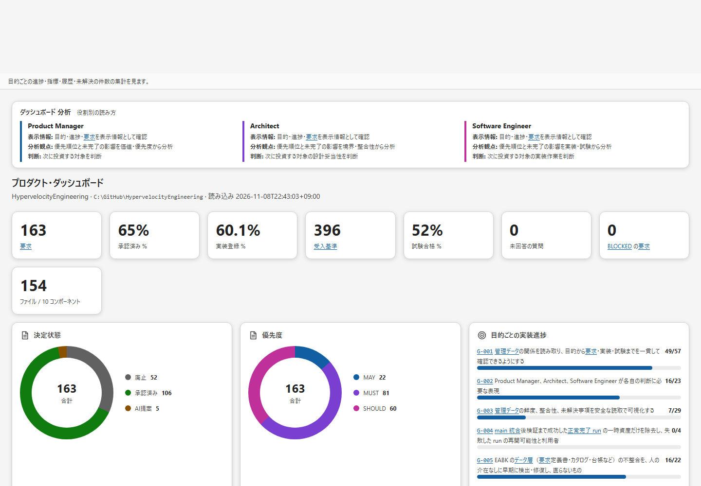

[日本語](README.md) | **English**

# HypervelocityEngineering — Enterprise App Build Kit Lite

A toolkit that adds rules and checks to a repository developed with GitHub Copilot (VS Code, Copilot CLI, the GitHub Copilot app, or the cloud agent) to keep **the requirements definition, the catalog, and the System Tests consistent** (EABK Lite 0.6.0).

- You ask your usual Copilot (the default agent) **as you always do**. No special agent or command is needed.
- Following the rules in the repository's `AGENTS.md`, every change that alters behavior updates the requirements definition, the catalog, and the tests in the same change.
- Checks are not left to LLM judgment; they run as deterministic scripts (scripts that use no LLM and always return the same result for the same input). Locally `python scripts/verify.py`, and on push / PR the CI workflow `ebak-verify`, run the same checks.
- Semantic contradictions (conflicts between requirements, drift from goals) are checked at milestones by asking the read-only auditor `rd-auditor`.
- The data layer can be browsed as diagrams, tables, and search in **HVE Studio** (a local, read-only viewer).
- It also works for applications that already have source code and design documents (brownfield). Start with an inventory: `python scripts/adopt.py scan` ([Adopting an existing app](users-guide/10-adopting-existing-apps.en.md)).

### Why Lite

Up to 0.5.x, development ran as long "runs" in which conductor had worker agents work in parallel in worktrees. Checking real use showed that token volume and elapsed time grew well beyond ordinary requests, and that the per-role write restrictions sometimes stopped the work. On the other hand, the mapping between the requirements definition and the tests was not maintained when people or PCs changed unless the rules lived in the repository, while the deterministic checks and the milestone audits did find real drift and contradictions. So Lite drops the orchestration and keeps only **rules in the repository, the data layer, deterministic checks (local and CI), and manual milestone audits**. Because the rules and checks live in the repository and CI, they apply the same way for many people and many PCs, without relying on personal prompts or memory.

## Getting started (reading guide by reader)

| You are | What you do | Reading order |
|---|---|---|
| **Product Manager** (decides what to build and accepts the results) | Ask Copilot for what you want. Answer pending requirements and the question list. Watch the status in Studio | ① [Why Lite](#why-lite) → ② [Quickstart](#quickstart) → ③ [Writing requests](users-guide/01-writing-requests.en.md) → ④ [Daily workflow](users-guide/02-daily-workflow.en.md) → ⑤ [Studio: Product Manager](users-guide/studio/05-product-manager.en.md) |
| **Architect** (decides design consistency, boundaries, and quality criteria) | Decide the data-layer format and the check scope (check profile). Ask for audits at milestones | ① [Overview](#overview) → ② [Management data format](users-guide/03-requirements-format.en.md) → ③ [Settings and customization](users-guide/04-customization.en.md) → ④ [Checks and audits](users-guide/06-quality-gates.en.md) → ⑤ [Studio: Architect](users-guide/studio/06-architect.en.md) |
| **Software Engineer** (installs and operates the toolkit, verifies implementation and tests) | Install it. Register verify commands. Fix verify and CI failures | ① [Installation](#installation) → ② [Quickstart](#quickstart) → ③ [Scripts reference](users-guide/05-scripts-reference.en.md) → ④ [Troubleshooting](users-guide/07-troubleshooting.en.md) → ⑤ [Studio: Software Engineer](users-guide/studio/07-software-engineer.en.md) |

If you are updating from an older version (such as 0.5.x), read [Updating from an older version (clean install)](#updating-from-an-older-version-clean-install) first.

## Table of contents

- [Why Lite](#why-lite)
- [Getting started (reading guide by reader)](#getting-started-reading-guide-by-reader)
- [Overview](#overview)
- [Installation](#installation)
- [Quickstart](#quickstart)
- [Updating from an older version (clean install)](#updating-from-an-older-version-clean-install)
- [HVE Studio (data-layer viewer)](#hve-studio-data-layer-viewer)
- [Detailed documentation](#detailed-documentation)
- [Glossary](#glossary)
- [Repository structure](#repository-structure)

## Overview

### The problem it solves

When AI repeatedly does requirements definition, implementation, and testing, these problems tend to occur:

- Features are added or changed, but the requirements definition is not updated and drifts from the code.
- It is unclear which requirement or acceptance criterion a new test verifies.
- When several people or PCs assign IDs in parallel, duplicates and gaps appear.
- Contradictions between distant requirements are missed in the author's own self-review.
- Instructions live only in prompts or personal memory, so behavior changes when the person, PC, or model changes.

EABK Lite prevents these with five means.

| Means | Description |
|---|---|
| **Rules in the repository** | Short rules go into `AGENTS.md` and `.github/copilot-instructions.md` (see "Rules" below). Every Copilot, on any person, PC, or client, reads the same rules. |
| **Data layer** | The requirements definition, the catalog, the integration catalog, the ID registry, and the System Test ledger are files at fixed paths managed in git. |
| **Deterministic checks** | `scripts/verify.py` (local) and the CI workflow `ebak-verify` run the same checks. ID assignment (`next-id.py`) and ledger updates (`ledger.py`) are also done by scripts. |
| **Manual milestone audits** | Semantic contradictions are hard to find mechanically, so ask `rd-auditor` for an audit at milestones. It does not run on every request. |
| **Visualization** | HVE Studio shows the state of requirements, the catalog, and tests as diagrams and tables. |

### Rules (the block that goes into `AGENTS.md`)

The installer writes the following block, enclosed in `<!-- ebak-abk:begin -->` … `end`, into `AGENTS.md` and `.github/copilot-instructions.md` (the installed block is in Japanese; translated here).

```text
## Enterprise App Build Kit Lite (consistency of the requirements definition, the catalog, and the System Tests)

- In a change that alters behavior (adding, changing, or removing a feature), update the requirements and acceptance criteria (AC) in `docs/requirements-definition.md` in the same change. Anyone may edit it (procedure: skill `requirement-definition`).
- Assign new IDs only with `python scripts/next-id.py <kind>`. Do not number by hand (so that IDs do not collide even when several people / PCs work in parallel).
- Write the requirement ID and AC ID a test verifies in its name or a comment (e.g. `FR-012 AC-031`). Update the System Test ledger `tests/system/ledger.json` only with `python scripts/ledger.py`, and when removing or weakening a test, record why with `--reason`.
- When adding, renaming, or deleting files, fix the rows in `docs/catalog.md` too (`python scripts/rdfix.py --apply` can follow them).
- Before finishing, run `python scripts/verify.py` and make it exit 0 (CI's `ebak-verify` runs the same checks).
- Put temporary files (logs, evidence, working notes) in `/work` (not tracked by git).
```

These few lines are the only always-loaded instructions. Long procedures live in skills (`requirement-definition`, `rd-audit`, `adopt-existing`) and are loaded only when needed.

### Layout

```text
.github/
  agents/        rd-auditor.agent.md … read-only auditor you choose and ask at milestones
  skills/        requirement-definition (requirements procedure; anyone may use it) / rd-audit / adopt-existing
  workflows/     ebak-verify.yml … runs verify on push and PR (check only; repair locally with rdfix)
scripts/         deterministic scripts (Python 3.9+, standard library only)
  verify.py / verify.ps1 / verify.sh   data-layer checks (check profile) + build / test commands
  rdcheck.py  rdfix.py  next-id.py  ledger.py  summarize.py  adopt.py  entities.py  extpoints.py  ebaklib.py
  ebak.config.json settings (verify commands, check profile, base_branch)
HVE-Studio/     data-layer viewer (local web app, read-only), role guides, and screenshots
docs/            persistent documents (managed in git)
  requirements-definition.md  catalog.md  integrations.md  id-registry.md
tests/system/ledger.json      System Test ledger (persistent)
work/            temporary files (in .gitignore). Audit results go to work/audit/<datetime>/
```

EABK Lite has no hooks and does not add any preamble to requests automatically. The rules reach Copilot through the blocks in `AGENTS.md` and `copilot-instructions.md`, and verify and the CI checks confirm they are followed.

### Checks (verify and check profiles)

| Layer | Implementation | When it runs |
|---|---|---|
| Local | `python scripts/verify.py` (data-layer checks + build / test in `verify.commands`). `--docs-only` for the data layer only | Before finishing (rule in `AGENTS.md`) |
| CI | `.github/workflows/ebak-verify.yml` (`scripts/verify.sh --show-warnings`) | Every push and PR |
| Milestone | `rd-auditor` (semantic audit, read-only) | When you ask |

The check profile is set by `checks.profile` in `scripts/ebak.config.json`.

- `lite` (default): reports only the CHKs in `checks.lite_checks`. The default is `CHK-01, CHK-02, CHK-03, CHK-05, CHK-09, CHK-12, CHK-17, CHK-19, CHK-24` (structure and traceability). Other CHKs affect neither the output nor the exit code.
- `full`: reports all of CHK-00 to CHK-34.
- `--profile lite|full` on `rdcheck.py check` and `verify.py` overrides the setting. The summary line looks like `rdcheck: errors=N warnings=M base=… profile=lite`.
- Format warnings (CHK-13 vague words, CHK-14 hard-coded numbers, CHK-15 forbidden synonyms) and the like appear only in full. To see them, run `python scripts/verify.py --docs-only --profile full --show-warnings` (the rd-auditor audit uses this too).
- The profile applies the same way to `rdcheck.py check`, `verify.py`, and `rdfix.py` (including `--full`). So `rdfix.py --full` passes exactly when `verify.py --docs-only` passes with the same profile (the mechanical repairs themselves run regardless of the profile).

### Data-layer repair (rdfix)

Of the inconsistencies between data-layer files that verify finds (drift in the catalog's decision state, ID registry states, rows duplicated by merges, references to renamed files, and so on), those mechanically determined by the requirements definition can be fixed through the common entry point `python scripts/rdfix.py --full` (check) and `python scripts/rdfix.py --full --apply` (check → repair → re-check). There are two entry points (the installer and manual), and wherever it is called from, the checks, repairs, and results are the same. CI (`ebak-verify`) only checks and never repairs. If it fails, run `python scripts/rdfix.py --full --apply` locally and push the repair in the same change. CI that only reads needs no write permission, and a bot pushing fixes onto someone's PR branch would make the branches of other people and PCs diverge.

- Exit codes: 0 = pass / repaired, 1 = manual items remain / repairs planned, 2 = not run / cancelled (lock wait timeout, everything undone, internal error; anything written is undone). On exit 2, wait for the other apply to finish and run it again.
- Only one apply runs at a time per repository (lock).
- The requirements definition and `docs/integrations.md` are never changed. Items needing judgment (a changed AC text, a reused ID, and so on) are shown as `MANUAL` with the kind of work (`requirements definition`, `System Test ledger`, `code and catalog`, `repository`) and the next action. Example: `MANUAL CHK-11 tests/system/ledger.json AC-001 の本文が…（担当: System Test の台帳）次の行動: …`.

See [Checks and audits](users-guide/06-quality-gates.en.md) for details.

### Working with many people and PCs

- The rules live in the repository (`AGENTS.md`), so everyone's Copilot reads the same rules.
- IDs are assigned with `next-id.py`, and the ID registry is merged with `merge=union` in `.gitattributes`. If IDs assigned at the same time collide, CHK-01 detects it; reassign with `next-id.py`.
- The checks run in CI, so a push from any PC gives the same result.

### Where data is stored

| Location | Contents | git |
|---|---|---|
| `/docs` | Requirements definition, catalog, integration catalog (`docs/integrations.md`, optional), ID registry | Managed |
| `tests/system/ledger.json` | System Test cases and their latest state | Managed |
| `/work` | Logs, evidence, audit results, working notes | Not managed |

---

## Installation

### Prerequisites

| Requirement | How to check | Notes |
|---|---|---|
| git repository | `git status` | If not yet, run `git init -b main` and make the first commit |
| Python 3.9 or later | `python --version` (`python3 --version` on macOS/Linux) | Used by the scripts. Standard library only, no extra packages. On Windows, install a real Python, not the Microsoft Store `python` stub (`winget install Python.Python.3.12`) |
| GitHub Copilot | VS Code, Copilot CLI, the GitHub Copilot app, or the cloud agent | Any of them. Any client that reads `AGENTS.md` and `.github/` applies the same rules |
| MCP servers / plugins (optional) | `MCP: List Servers` in VS Code, `/mcp` in Copilot CLI, and so on | With Work IQ, Microsoft Learn, Azure, etc. configured, Copilot can use them as primary sources. The toolkit does not distribute MCP settings |

### Installation command (recommended)

Run the following one line at the **root** of the target repository. It downloads the toolkit to a temporary folder, runs `tools/install.py`, and deletes the temporary folder.

**Windows (PowerShell)**

```powershell
irm https://raw.githubusercontent.com/dahatake/HypervelocityEngineering/main/tools/install.ps1 | iex
```

With options:

```powershell
& ([scriptblock]::Create((irm https://raw.githubusercontent.com/dahatake/HypervelocityEngineering/main/tools/install.ps1))) -DryRun
```

**macOS / Linux / WSL / Git Bash**

```bash
curl -fsSL https://raw.githubusercontent.com/dahatake/HypervelocityEngineering/main/tools/install.sh | bash
# With options
curl -fsSL https://raw.githubusercontent.com/dahatake/HypervelocityEngineering/main/tools/install.sh | bash -s -- --dry-run
```

To use a specific version (tag, branch, or commit), set the environment variable `EBAK_REF` (e.g. `EBAK_REF=v0.6.0`). To use a fork, set `EBAK_REPO=<owner>/<repo>`.

**If you have cloned the toolkit**

```bash
python tools/install.py --target /path/to/your-repo
```

### Options

| Option (install.py / install.sh) | PowerShell | Behavior |
|---|---|---|
| `--target <dir>` | `-Target` | Install destination (default: current directory) |
| `--dry-run` | `-DryRun` | Writes nothing; only shows the operations it would perform |
| `--check` | `-Check` | Checks whether an update is needed (exit 1 if so; lets CI detect version drift) |
| `--clean` | `-Clean` | Clean install: deletes every file the toolkit installed (including files from older versions and files you modified), `*.ebak-backup-*`, the settings, the blocks, the appended lines and the manifest, then installs this version again. Keeps the management data, `/work`, and your application code and tests. Refuses to run when there are uncommitted changes ([Updating from an older version](#updating-from-an-older-version-clean-install)) |
| `--force` | `-Force` | Also overwrites or removes toolkit files you modified locally (keeps `*.ebak-backup-<datetime>`) |
| `--no-ci` | `-NoCi` | Does not install `.github/workflows/ebak-verify.yml` |
| `--no-repair` | `-NoRepair` | Only shows the data-layer check and repair plan. Toolkit installation and display-data generation still run |
| `--skip-verify` | — | Neither checks nor repairs the data layer; display-data generation still runs |
| `--uninstall` | `-Uninstall` | Removes unmodified toolkit files, the blocks in `AGENTS.md` etc., the manifest, and emptied folders (keeps management data and settings). Also available as `uninstall.ps1` / `uninstall.sh` |
| `--purge` | `-Purge` | In addition to `--uninstall`, removes management data (the requirements definition, catalog, integration catalog, ID registry, etc. under `docs/`, and `tests/system/ledger.json`), `scripts/ebak.config.json`, `/work`, lines appended to `.gitignore` / `.gitattributes`, and `*.ebak-backup-*` |

### Installed files

| Kind | Files | On re-run |
|---|---|---|
| Toolkit files | `.github/agents/rd-auditor.agent.md`, `.github/skills/` (`requirement-definition`, `rd-audit`, `adopt-existing`), `.github/workflows/ebak-verify.yml`, `scripts/*.py`, `verify.ps1`, `verify.sh`, `HVE-Studio/` (the viewer; Studio's tests are not installed), `EABK-docs/` (same content as this repository's `users-guide/`; the HVE Studio guide is `EABK-docs/studio/`; the target's own `users-guide/` is not touched) | Updated to the new version if unmodified. If modified locally, **left as is** (`KEEP-LOCAL`; `--force` overwrites) |
| Management data templates | `docs/requirements-definition.md`, `docs/catalog.md`, `docs/integrations.md` (integration catalog, optional), `docs/id-registry.md`, `tests/system/ledger.json` | Created **only if missing**. Existing files are never overwritten |
| Display data | `.hve-studio/managed-data.json` | Created/synchronized with progress after installation/update. A disposable analysis snapshot, not an authoritative requirements migration. Normal uninstall preserves it; `--purge` removes it |
| Settings | `scripts/ebak.config.json` | Created if missing. If present, only new keys are added; values you set are not changed |
| Appended lines | `/work/` and `/.hve-studio/` in `.gitignore` (header `# Enterprise App Build Kit: temporary files (logs, evidence, notes)`); `docs/id-registry.md merge=union` in `.gitattributes` | Only missing lines are appended |
| Block | The rules enclosed in `<!-- ebak-abk:begin -->` … `end` in `AGENTS.md` and `.github/copilot-instructions.md` ([Rules above](#rules-the-block-that-goes-into-agentsmd)) | Only the inside of the block is replaced. Text outside the block is not changed |
| Manifest | `.github/ebak-toolkit.json` | The version and hashes of installed files (used to decide updates and removals) |

At the end of an install or update, the data-layer common entry point `python scripts/rdfix.py --full --apply` runs once (check → auto-repair → re-check). It shows the repaired items, the remaining manual items (check ID, location, kind of work), and whether the re-check passed. Repairs are not committed but left in the working tree, and the requirements definition and the integration catalog are never changed. With `--no-repair` (`-NoRepair` in PowerShell), it becomes `python scripts/rdfix.py --full` (shows the check and repair plan only; writes nothing), and with `--skip-verify` it neither checks nor repairs. `--dry-run`, `--check`, `--uninstall`, and `--purge` never repair. Even when the repair is cancelled (exit 2) or manual items remain (exit 1), the toolkit files stay and the check and repair commands are shown. The installer's exit code does not depend on the data-layer result.

### Post-installation setup

Display-data synchronization follows with progress, including with `--no-repair` and `--skip-verify`. Sync failures report a reason and return exit 1 while leaving toolkit files installed. Dry-run/check/removal operations do not generate it. The global Studio banner or `studio.py --repo <repo> --sync-data` / `--data-status` / `--delete-data` supports resync, presence checks and generated-only cleanup. See the [Studio guide](HVE-Studio/README.md#表示用管理データの作成同期削除--display-data).

1. Review the diff and commit.
   ```bash
   git add -A && git commit -m "Add Enterprise App Build Kit"
   ```
2. Register build, static analysis, and test commands in `verify.commands` of `scripts/ebak.config.json` (empty `[]` on a new install) ([Settings and customization](users-guide/04-customization.en.md)). If you leave it empty, you can ask Copilot: "register the standard build and test commands for this stack in `verify.commands`".
3. If CI needs the app's toolchain (Node.js, etc.), add setup steps before the verify step in `.github/workflows/ebak-verify.yml`.
4. If you already have a requirements definition, import its IDs into the ID registry.
   ```bash
   python scripts/next-id.py --sync --adopt
   ```
   Then run `python scripts/verify.py --docs-only` and review the findings. To also see format issues, add `--profile full --show-warnings`. To fix them, ask Copilot: "align the existing requirements definition with the format of the skill `requirement-definition`".
5. (Optional) To use internal information or tools for your target technology, configure MCP servers / plugins in the client you use and sign in ([Settings and customization](users-guide/04-customization.en.md)).

### Updating and checking

```bash
# Update (just run the same installation command again)
curl -fsSL https://raw.githubusercontent.com/dahatake/HypervelocityEngineering/main/tools/install.sh | bash

# Only check whether an update is needed
curl -fsSL .../tools/install.sh | bash -s -- --check
```

An update handles only the files this version ships. Files an older version installed that this version no longer ships are kept, and their count is shown as a note. When updating from an older version, use `--clean` ([Updating from an older version (clean install)](#updating-from-an-older-version-clean-install)).

### Uninstalling and cleaning up

As with installation, run one line at the **root** of the target repository.

**Windows (PowerShell)**

```powershell
# Uninstall (removes the toolkit files and blocks. Keeps docs, the ledger, settings, and /work)
irm https://raw.githubusercontent.com/dahatake/HypervelocityEngineering/main/tools/uninstall.ps1 | iex

# Clean up (removes everything the toolkit added, including managed data, settings, /work, and appended lines)
& ([scriptblock]::Create((irm https://raw.githubusercontent.com/dahatake/HypervelocityEngineering/main/tools/uninstall.ps1))) -Purge -DryRun   # preview
& ([scriptblock]::Create((irm https://raw.githubusercontent.com/dahatake/HypervelocityEngineering/main/tools/uninstall.ps1))) -Purge
```

**macOS / Linux / WSL / Git Bash**

```bash
curl -fsSL https://raw.githubusercontent.com/dahatake/HypervelocityEngineering/main/tools/uninstall.sh | bash
curl -fsSL https://raw.githubusercontent.com/dahatake/HypervelocityEngineering/main/tools/uninstall.sh | bash -s -- --purge --dry-run   # preview
curl -fsSL https://raw.githubusercontent.com/dahatake/HypervelocityEngineering/main/tools/uninstall.sh | bash -s -- --purge
```

**If you have cloned the toolkit**

Run these commands from the root of the toolkit clone. Set `--target` to the root of the repository to uninstall from.

```bash
python tools/uninstall.py --target /path/to/your-repo --dry-run          # preview removal
python tools/uninstall.py --target /path/to/your-repo                    # remove while keeping management data and settings
python tools/uninstall.py --target /path/to/your-repo --purge --dry-run  # preview including management data
python tools/uninstall.py --target /path/to/your-repo --purge            # also remove management data
```

`--purge` also removes management data, settings, `/work`, and more. Modified toolkit files and other items are kept by default (see the table below). `python tools/install.py --target ... --uninstall` / `--purge`, `install.ps1 -Uninstall`, and `install.sh --uninstall` use the same implementation.

**It removes EABK installed by any version.** The uninstaller decides with `tools/uninstall-catalog.json`, a catalog of the content hashes of every file that any version of `tools/install.py` shipped (including the versions under the old name "hve"), collected from the git history. Only `uninstall.py` and the catalog are downloaded; no clone of the toolkit is needed. Even without a manifest it removes files of old versions (`hvelib.py`, `hve-verify.yml`, the conductor, etc.), the block markers of old versions (`hve-abk`, `hve-conductor`), the settings and manifests of old versions (`scripts/hve.config.json`, `.github/hve-toolkit.json`), and `*.hve-backup-*`.

| Option (PowerShell) | Effect |
|---|---|
| `--dry-run` (`-DryRun`) | Lists what would be done without changing anything |
| `--purge` (`-Purge`) | Also removes management data, settings, `/work`, the appended lines, and backups (table below) |
| `--force` (`-Force`) | Also removes toolkit files you modified (only at paths recorded in a manifest or shipped by this version) |
| `--runs` (`-Runs`) | Also removes the worktrees the old conductor created (`<repo-name>-run-*`, `work/worktrees/*`) and the `run/*` branches already merged into HEAD. Dependency links inside a worktree are unlinked only. Without it, these are only listed |

| Target | `--uninstall` | `--purge` |
|---|---|---|
| Toolkit files of any version (`.github/agents`, `skills`, `workflows`, `scripts/*.py`, etc.) | Removed if identical to the content of some version (kept as `KEEP-LOCAL` if modified; `--force` removes) | Same |
| A file at a path only old versions used whose content matches no version (e.g. your own `users-guide/README.md`) | Kept as your file (`KEEP-UNKNOWN`; not removed even with `--force`) | Same |
| Blocks in `AGENTS.md` / `.github/copilot-instructions.md` (markers of every version) | Only the block is removed (the file is removed if nothing else remains) | Same |
| Manifests (`.github/ebak-toolkit.json`, `.github/hve-toolkit.json`), emptied folders, `__pycache__` of removed `.py` | Removed | Removed |
| Management data (`docs/requirements-definition.md`, `catalog.md`, `integrations.md`, `id-registry.md`, `manual-tests.md`, `docs/requirements/`, `tests/system/ledger.json`, etc., including the `management_files` paths in the settings) | Kept | Removed |
| Settings (`scripts/ebak.config.json`, `scripts/hve.config.json`), `/work`, `*.ebak-backup-*`, `*.hve-backup-*` | Kept | Removed |
| Sections appended to `.gitignore` / `.gitattributes` (headings of every version) | Kept | Only the appended lines are removed (the file is removed if empty) |
| System Test code (other than the ledger in `tests/system/`), app code, other documents in `docs/` | Kept | Kept |

- Removal happens in the git working tree. Check with `git status` before committing (`git restore` can undo it; `/work` is not tracked by git and cannot be restored). It refuses to run unless the target is the top of a git repository (`--allow-non-git` to continue).
- Exit code: `0` = nothing of EABK remains in the chosen scope, `1` = something remains (listed under `RESIDUE`), `2` = error. Safe to run any number of times (the second run shows `changes=0`).
- After `--purge`, your files (CRLF line endings included) are byte for byte as before the install and `git status --porcelain --ignored` is empty. Installers before 0.6.0, however, rewrote a CRLF `AGENTS.md` / `.gitignore` as LF; that difference remains in `git status` (undo it with `git restore`).

### Why we use an installer instead of a plugin

GitHub Copilot has a standard mechanism for distributing agents, skills, and hooks together: **plugins** (`copilot plugin install OWNER/REPO`, the Agent Plugins specification). This toolkit does not use it, for the following reasons.

| Aspect | Plugin | What this toolkit needs |
|---|---|---|
| Install location | The user's home (the plugin directory). Not in the repository | The rules (`AGENTS.md`), deterministic scripts (`scripts/`), management data templates (`docs/`), the ledger, `.gitignore`, and CI must live **inside the target repository**, managed in git, with CI (GitHub Actions) running the same verify |
| Portability | In Agent Plugins 1.0 only skills and MCP are portable. Custom agents and hooks are per-client extensions | VS Code, Copilot CLI, the Copilot app, and the cloud agent use the same `AGENTS.md` and `.github/` |
| Team sharing | Each user must install it | Cloning the repository gives the whole team and CI the same version of the rules and checks |

So the customizations (`AGENTS.md`, `.github/`) and `scripts/` are placed directly in the repository, and `tools/install.*` and `tools/uninstall.*` install, update, and uninstall them in one command.

### Installation troubleshooting

| Symptom | Fix |
|---|---|
| `Python 3.9 以上が必要です` (Python 3.9 or later is required) | Install Python and confirm `python --version` works |
| `git リポジトリではありません` (not a git repository) | Run `git init -b main` first |
| `KEEP-LOCAL` is shown | Files you modified locally were not updated or removed. Review the diff and, if it is OK to overwrite or remove them, re-run with `--force` |
| A note says that N files this version does not ship remain | They were installed by an older version. An update does not delete them. Reinstall with `--clean` ([Updating from an older version](#updating-from-an-older-version-clean-install)) |
| `--clean` says to commit or stash uncommitted changes first | Check `git status`, commit or `git stash`, and run again |

---

## Quickstart

1. At the root of your repository, run the installation command once and commit ([Installation](#installation)).
   - Windows: `irm https://raw.githubusercontent.com/dahatake/HypervelocityEngineering/main/tools/install.ps1 | iex`
   - macOS / Linux: `curl -fsSL https://raw.githubusercontent.com/dahatake/HypervelocityEngineering/main/tools/install.sh | bash`
2. Register build and test commands in `verify.commands` of `scripts/ebak.config.json`.
3. Then develop with the "Recommended workflow" below.

### Recommended workflow

1. **Ask Copilot as usual.** VS Code, Copilot CLI, the GitHub Copilot app, or the cloud agent, with the default agent (e.g. "add a feature that notifies the borrower and their manager when a loan is more than 3 days overdue").
2. **Copilot updates everything in the same change, following the rules.** Following the rules in `AGENTS.md`, it updates the requirements and acceptance criteria in the requirements definition, the catalog, the tests, and the code in the same change, and makes `python scripts/verify.py` exit 0. New IDs come from `next-id.py`; the ledger is updated with `ledger.py`. Review the diff and approve, in chat, any requirements that need approval.
3. **On push / PR, CI runs the same checks.** `ebak-verify` runs the same checks as locally (check only; it never commits repairs). If the data layer fails, run `python scripts/rdfix.py --full --apply` locally and include the repair in the same change.
4. **Ask rd-auditor for an audit at milestones.** When a group of features is done, before a release, and so on, choose `rd-auditor` as the agent and ask, for example, "audit the diff" or "audit everything 3 times". The diff defaults to the diff against `base_branch` (default `main`). On clients that support subagents, the requested number of runs execute in parallel and are decided by majority. Results go to `work/audit/<datetime>/report.md`. You decide whether to apply the findings, and fix them in a separate change.
5. **Watch the status in HVE Studio** (optional). Use `python HVE-Studio/studio.py --role pm` and the like to see the state of requirements, the catalog, and tests as diagrams and tables ([HVE Studio](#hve-studio-data-layer-viewer)).

For details, see [Daily workflow](users-guide/02-daily-workflow.en.md) and [Writing requests](users-guide/01-writing-requests.en.md).

EABK Lite does not add a preamble to your requests automatically. If you want a standing preamble, put it in your own Copilot instructions.

### Adopting an existing app

Take an inventory with `python scripts/adopt.py scan`, and use `python scripts/adopt.py request` to create, in `work/import/adopt-<datetime>.md`, a request you can paste into Copilot chat as is (with a `<constraints>` section; defaults are "implementation: no" and "approval: strict"). Reverse-engineered requirements enter as "pending approval" and you approve them ([Adopting an existing app](users-guide/10-adopting-existing-apps.en.md)).

---

## Updating from an older version (clean install)

The installer has no migration code for older versions. When updating from an older version (such as 0.5.x), do a clean install with `--clean`. It keeps no per-version removal list: it deletes every file recorded in the manifest (`.github/ebak-toolkit.json`) as installed by the toolkit and then installs again, so the procedure is the same from any version.

```bash
git status                                    # no uncommitted changes (otherwise it refuses)
python tools/install.py --target . --clean --dry-run   # review the list to delete (CLEAN)
python tools/install.py --target . --clean
git diff                                      # review and commit (git restore undoes it)
```

Use `-Clean` in PowerShell and `--clean` with `install.sh`.

| Item | With `--clean` |
|---|---|
| Files the toolkit installed (recorded in the manifest or shipped by this version; includes older conductor, worker agents, hooks, `gate.py`, and files you modified) | Deleted, then this version's files are installed |
| `*.ebak-backup-*`, `scripts/ebak.config.json` | Deleted; the settings are recreated with defaults (check the previous values with `git diff scripts/ebak.config.json` and restore what you need) |
| The blocks in `AGENTS.md` and `.github/copilot-instructions.md`, and the lines the toolkit appended to `.gitignore` and `.gitattributes` | Deleted and reinstalled. Text outside the blocks is kept |
| Management data (requirements definition, catalog, integration catalog, ID registry, `tests/system/ledger.json`), `/work`, your application code and tests | Kept |

- Running it twice in a row changes nothing the second time.
- Data-layer files from older versions (such as `docs/run-history.md` from 0.5.x) are kept as data. Delete them by hand if you do not need them.
- Worktrees and `work/*` branches left by 0.5.x runs are not removed. Check with `git worktree list` / `git branch --list "work/*"` and remove them by hand.
- If you update with the plain installation command instead of `--clean`, files from the older version (including hooks) remain. A leftover old hook calls the deleted `gate.py` and can make Copilot deny tools, so use `--clean` when coming from an older version.

How usage changed from 0.5.x:

| 0.5.x | 0.6.0 (EABK Lite) |
|---|---|
| Asking conductor with `/build`, `<run_options>` | Ask the default agent as usual and approve in chat ([Recommended workflow](#recommended-workflow)) |
| Hooks, the automatic preamble, per-role gates | Gone. Put assumptions you want every time in your own Copilot instructions |
| `run-state.py`, `integrate.py`, `kpi.py`, `watch.py`, `clean-work.py`, etc. | Gone (state and integration are left to git and CI) |
| The data-layer auto-repair workflow `ebak-data-layer.yml` | CI is the check-only `ebak-verify`. Repair locally with `python scripts/rdfix.py --full --apply` and include it in the same change |
| `--run`, `--strict`, `--strict-ledger`, `--no-strict-ledger` of `rdcheck.py check` and `verify.py` | Gone (passing them is an argument error, exit 2). The only knob is the check profile (`checks.profile`, `--profile lite` / `full`) |

For details, see [Version upgrades](users-guide/09-versioning.en.md) and [CHANGELOG.md](CHANGELOG.md).

---

## HVE Studio (data-layer viewer)

**HVE Studio** (Hypervelocity Engineering Studio, `HVE-Studio/`) is a local-only web app for browsing the data layer EABK manages (the requirements definition, the catalog, the System Test ledger, and the ID registry) through **diagrams, tables, and search**. It is part of the toolkit and is installed into the target repository.

- **Browsing and analysis do not change originals**. Management records remain authoritative, supplemented with explicit source references, imports and TODOs. Studio listens only on `127.0.0.1`. Only confirmed maintenance changes the catalog; task edits use Studio-owned storage outside the repository.
- It runs on the Python 3.9+ standard library alone (no extra installs). When data-layer files change, the screen reloads within seconds.
- It is a window for people to understand and judge the state of requirements, the catalog, and tests. To change requirements or the implementation, ask Copilot.



| Role | How to use it | Guide |
|---|---|---|
| Product Manager | Check progress, approvals, and unanswered questions on the dashboard, and decide which goal to invest in next | [S5. For Product Managers](users-guide/studio/05-product-manager.en.md) |
| Architect | Check dependencies, boundaries, placement, and missing layers with the 2D/3D map, diagrams, placement, and structure views | [S6. For Architects](users-guide/studio/06-architect.en.md) |
| Software Engineer | Trace from requirements to implementation files and tests with tables, source mapping, and the detail panel | [S7. For Software Engineers](users-guide/studio/07-software-engineer.en.md) |
| Everyone | Which screen reads what from which file, and how it computes it | [S8. Data reference](users-guide/studio/08-data-reference.en.md) |

The index is [users-guide/studio/](users-guide/studio/README.en.md).

### Start it in your own repository

At the root of a repository where the toolkit is installed, run:

```bash
python HVE-Studio/studio.py --check      # check that the data layer can be read (files found and items parsed)
python HVE-Studio/studio.py --role pm    # opens the browser. --role is pm / architect / swe
```

On Windows you can also use `.\HVE-Studio\start.ps1 -Role pm`, and on macOS / Linux `./HVE-Studio/start.sh . 8765 --role pm`. Details are in [HVE-Studio/README.md](HVE-Studio/README.md); script options are in the [Scripts reference](users-guide/05-scripts-reference.en.md).

### Using Studio without EABK (code mode)

Studio can also show a git repository without EABK (FR-1086). From a clone of this toolkit (HVE), pass the root of the target repository to `--repo`:

```bash
python HVE-Studio/studio.py --repo <any-git-repo> --check   # mode: code (...) requirement-docs=… requirements=… linked-to-code=… code-files=… test-files=… components=…
python HVE-Studio/studio.py --repo <any-git-repo>
```

- Management records remain authoritative and are supplemented with local Git inventory and explicit references. Git analysis requires the `git` command; no additional Python packages are needed.
- If not, Studio derives a read-only model: requirement IDs (`FR-…`, `NFR-…`) from the first column of markdown tables and from headings (`docs/PRD.md` and files whose names contain prd, requirement, 要求 or spec are read first), the code and test files that mention each ID (catalog rows: implementation files / tests), and source files grouped into components (shared parts).
- Existing views remain available; written acceptance criteria are preserved and missing facts are not guessed. Dashboard links to **Repository analysis & tasks** for local file inventory, dependencies, Git history, diagnostics and persistent checklist/TODO tasks.
- Empty and document-only Git repositories are supported. Folders with neither Git nor management records exit 1. Task edits are stored outside the repository, isolated by canonical path. No LLM is used. See the [data reference](users-guide/studio/08-data-reference.en.md) for supported formats and exclusions.
- Without `--repo`, the target is the current folder if it has a data layer or is a git repository showable in code mode, otherwise Studio's own repository. Switching repositories from the repository name at the top right accepts the same.
- Example: on `C:\GitHub\VideoCreator` it showed 103 requirements from `docs/PRD.md`, 56 of them linked to code or tests, 78 code files, and 6 components.

---

## Detailed documentation

Details are in [users-guide/](users-guide/README.en.md).

| # | Document | When to read |
|---|---|---|
| 1 | [Writing requests](users-guide/01-writing-requests.en.md) | You want to know how to write requests, answers, and approvals so the requirements definition is updated correctly |
| 2 | [Daily workflow](users-guide/02-daily-workflow.en.md) | You want the flow request → verify → push / CI → milestone audit → Studio, and how to check results |
| 3 | [Management data format](users-guide/03-requirements-format.en.md) | You want the format of the requirements definition, catalog, ID registry, and System Test ledger |
| 4 | [Settings and customization](users-guide/04-customization.en.md) | You want to adjust build / test commands, the check profile, or CI, or use MCP servers / plugins |
| 5 | [Scripts reference](users-guide/05-scripts-reference.en.md) | You want to know how to use each command in `scripts/` |
| 6 | [Checks and audits](users-guide/06-quality-gates.en.md) | You want the meaning of verify's CHKs and how to fix them, rdfix, and rd-auditor audits |
| 7 | [Troubleshooting](users-guide/07-troubleshooting.en.md) | verify, CI, or a repair failed |
| 8 | [Adoption roadmap](users-guide/08-roadmap.en.md) | You want the steps from trial to production use |
| 9 | [Version upgrades](users-guide/09-versioning.en.md) | Releasing a version (distributor), updating an installed repository (user), clean install from an older version |
| 10 | [Adopting an existing app](users-guide/10-adopting-existing-apps.en.md) | Build the data layer from existing code and design documents: inventory → reverse-engineered requirements (pending approval) → pinning current behavior |
| 11 | [Integration catalog](users-guide/11-integration-catalog.en.md) | Record integrations with external apps / data in `docs/integrations.md` (optional): adding, changing, retiring, and checking |
| Reference | [HVE Studio guide](users-guide/studio/README.en.md) | You want to view the data layer as diagrams and tables, with per-role procedures and the data each screen reads |

## Glossary

| Term | Meaning |
|---|---|
| Rules | The block that goes into `AGENTS.md` and `.github/copilot-instructions.md`. Every Copilot reads it ([Rules](#rules-the-block-that-goes-into-agentsmd)). |
| Management data | The requirements definition (`docs/requirements-definition.md`), the catalog (`docs/catalog.md`), and so on. The single source of truth for requirements and existing assets. |
| Ledger | System Test case definitions and their latest state (`tests/system/ledger.json`). Updated only with `ledger.py`. |
| ID registry | The record of assigned IDs (`docs/id-registry.md`). Updated only with `next-id.py`. |
| Check profile | `lite` (default; only the structure and traceability CHKs) and `full` (all of CHK-00 to CHK-34) in `checks.profile`. |
| Audit | rd-auditor's semantic audit (contradictions, alignment with goals, writing quality). You ask for it at milestones. Results go to `work/audit/<datetime>/`. |
| `/work` | Location for temporary files (not tracked by git): logs, evidence, audit results, working notes. |

## Repository structure

| Content | Location |
|---|---|
| Detailed documentation | [users-guide/](users-guide/README.en.md) |
| Auditor (rd-auditor) | [.github/agents/](.github/agents/) |
| Procedures (skills) | [.github/skills/](.github/skills/) |
| Deterministic scripts | [scripts/](scripts/) |
| CI | [.github/workflows/](.github/workflows/) |
| Data-layer viewer (HVE Studio) | [HVE-Studio/](HVE-Studio/README.md), guide in [users-guide/studio/](users-guide/studio/README.en.md) |
| Management data templates | [docs/](docs/), [tests/system/ledger.json](tests/system/ledger.json) |
| Installation scripts | [tools/](tools/) |
| Toolkit tests | [tests/toolkit/](tests/toolkit/) (`python -m pytest tests/toolkit -q`) |
