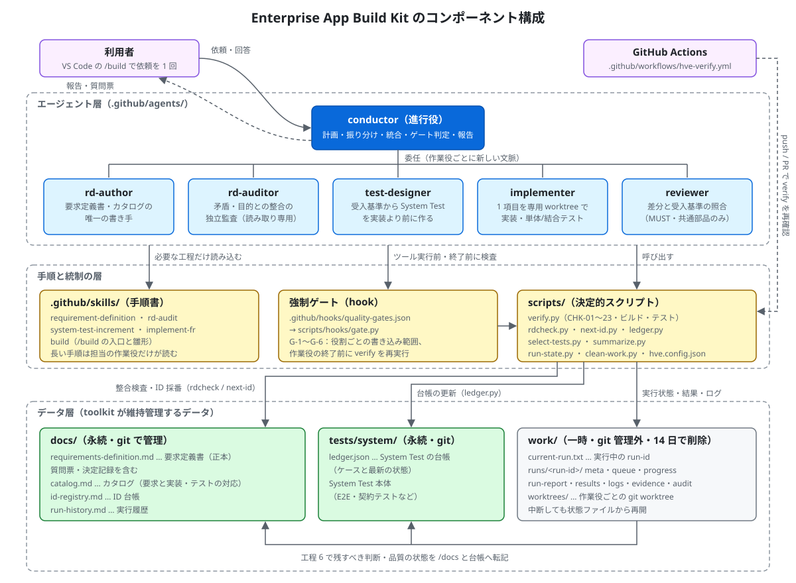
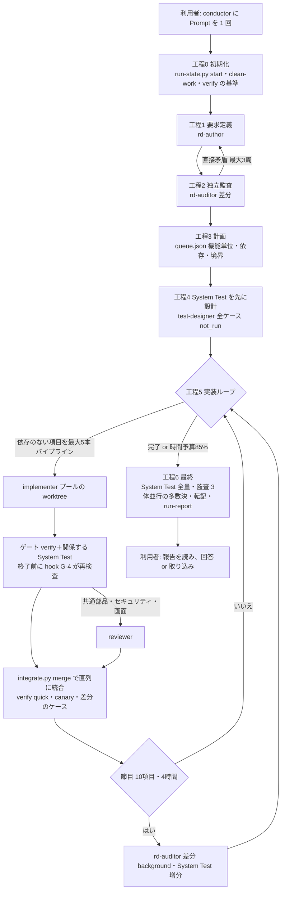
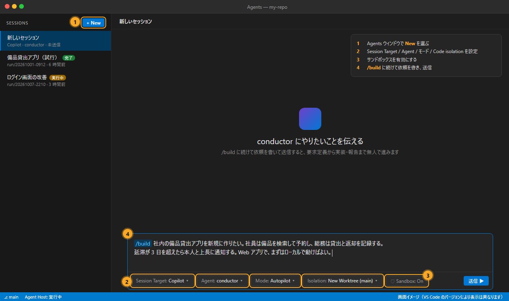
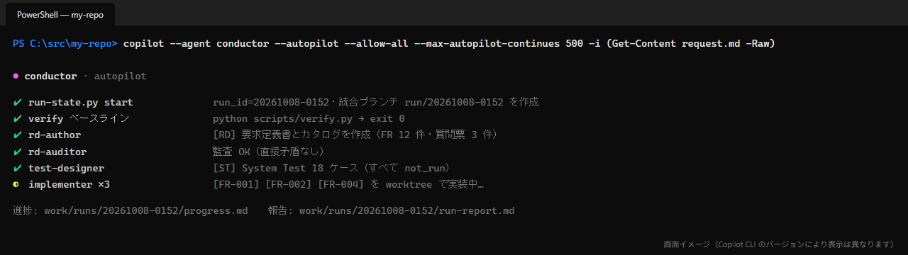
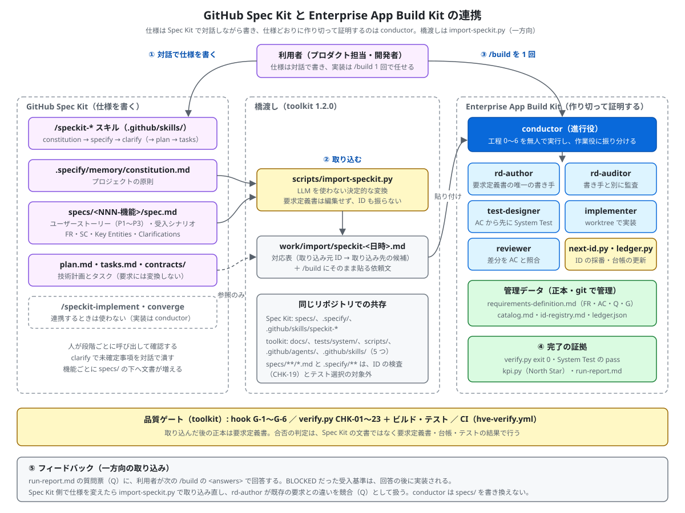
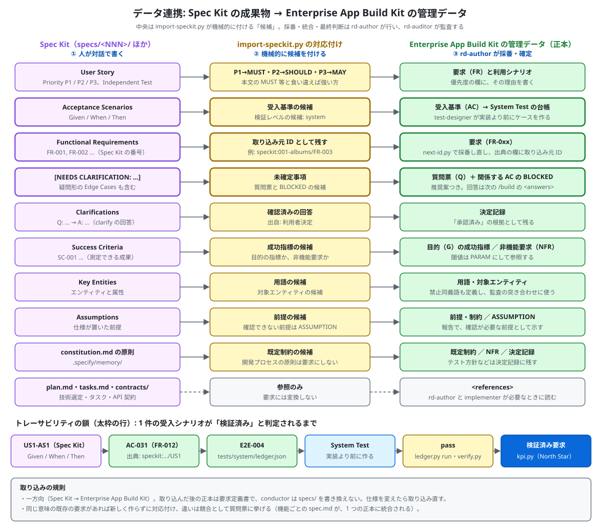

[日本語](README.md) | **English**

# HypervelocityEngineering — Enterprise App Build Kit

A multi-agent development toolkit for GitHub Copilot (the VS Code Agents window / Copilot CLI / GitHub Copilot app). It aims to implement applications with the **highest quality, in the shortest time, using the fewest tokens**, while keeping the requirements definition, the catalog, and the System Tests consistent.

- All you do is send a prompt **once** to the orchestrator agent `conductor`.
- conductor runs requirements definition → independent audit → up-front System Test design → parallel implementation → serial integration → final audit → report for up to 24 to 48 hours, with no human intervention.
- The rules that determine quality are not left to the judgment of an LLM; they are enforced with hooks and deterministic scripts (scripts that do not use an LLM and always return the same result for the same input). Specifically, these four:
  - Only one agent can write the requirements definition
  - Implementers cannot change the System Tests
  - Verification always runs before finishing
  - Dangerous operations are denied
- Many of these rules work only when you start a run with `/build`. For the risks of requesting changes with a prompt other than `/build`, see [Important: Risks of sending a prompt other than `/build`](#important-risks-of-sending-a-prompt-other-than-build).
- You can also import a specification written with [GitHub Spec Kit](https://github.com/github/spec-kit) and leave implementation and verification to conductor ([Integration with GitHub Spec Kit](#integration-with-github-spec-kit)).
- It also works for apps that already have source code and design documents (brownfield). First take an inventory with `python scripts/adopt.py scan`, then build up the data layer from reverse-generated requirement hypotheses (pending approval) and a freeze of current behavior ([Adopting an existing app](users-guide/10-adopting-existing-apps.en.md)).

## Getting started (reading guide by reader)

If you are new, read the documents in the order below for your role. Whatever your role, we recommend trying your first run with a short time budget (`max_hours: 4` to `8`).

| You are | What you do | Reading order |
|---|---|---|
| **Product Manager** (decides what to build and accepts the results) | Write what you want built in the request. Answer the question list. Read the report and decide whether to merge | ① [The problem it solves](#the-problem-it-solves) → ② [Quickstart](#quickstart) → ③ [Writing requests](users-guide/01-writing-requests.en.md) → ④ [During and after a run](users-guide/02-during-and-after-run.en.md) → ⑤ [Studio: Product Manager](users-guide/studio/05-product-manager.en.md) |
| **Architect** (decides design consistency, boundaries, and quality gates) | Understand the rules and the permission mechanism. Decide the settings (verification commands, models, gates). Check the structure of the requirements definition | ① [Overview](#overview) (architecture, agents and permissions, the flow of a run) → ② [Format of managed data](users-guide/03-requirements-format.en.md) → ③ [Settings and customization](users-guide/04-customization.en.md) → ④ [Quality gates and checks](users-guide/06-quality-gates.en.md) → ⑤ [Studio: Architect](users-guide/studio/06-architect.en.md) |
| **Software Engineer** (installs and operates the toolkit, and checks implementation and tests) | Install. Register the verification commands. Start runs, and fix things when a run stops or an operation is denied | ① [Installation](#installation) → ② [Quickstart](#quickstart) → ③ [Script reference](users-guide/05-scripts-reference.en.md) → ④ [Troubleshooting](users-guide/07-troubleshooting.en.md) → ⑤ [Studio: Software Engineer](users-guide/studio/07-software-engineer.en.md) |

If you are adopting the toolkit for an existing app (one that already has source code and design documents), first read [Adopting an existing app](users-guide/10-adopting-existing-apps.en.md). If you are rolling it out to a team in stages, [Adoption roadmap and KPIs](users-guide/08-roadmap.en.md) will help.

## Table of contents

- [Getting started (reading guide by reader)](#getting-started-reading-guide-by-reader)
- [Overview](#overview)
- [Installation](#installation)
- [Quickstart](#quickstart)
- [EABK Studio (data-layer viewer)](#eabk-studio-data-layer-viewer)
- [Integration with GitHub Spec Kit](#integration-with-github-spec-kit)
- [Detailed documentation](#detailed-documentation)
- [Glossary](#glossary)
- [Repository structure](#repository-structure)

## Overview

### The problem it solves

When you have multiple AI agents repeatedly perform requirements definition, implementation, and testing, the following problems tend to occur.

- Requirements are rewritten midway through implementation, and content that was never approved becomes "approved."
- Contradictions between distant requirements go unnoticed in the author's own self-review.
- Tests get rewritten to match the implementation, which changes the meaning of the requirements (a bug in the implementation becomes the "correct answer").
- Parallel work produces duplicate IDs or conflicting requirement meanings.
- Audit results and logs exist only in the chat history and are lost.

Enterprise App Build Kit prevents these with the following four measures.

| Measure | Description |
|---|---|
| **Separation of roles** | Separate agents handle writing requirements, auditing, creating tests, and implementing. No agent can declare its own work product "correct." |
| **Enforced gates** | Hooks and verify enforce each agent's write scope and the verification that must pass before work ends. |
| **Deterministic scripts** | Checks, ID numbering, ledger updates, and log summaries are done by scripts, not by an LLM. The same input always gives the same result. |
| **Persistent data management** | The requirements definition, catalog, ID registry, System Test ledger, and each run's state, results, logs, evidence, and audit results are created and updated as files at fixed paths. Because nothing depends on the chat history, you can trace requirements, tests, and implementation afterward. A run can also be resumed from the middle after an interruption. |

The foundation is the fourth measure, **persistent data management**. Requirements, decisions, and quality state are kept as persistent data in `/docs` and `tests/system/ledger.json` (managed in git). Each run's state, logs, and evidence are kept as temporary data in `/work`. What needs to be retained is transcribed into `/docs` and the ledger at the end of the run ([Where data is stored](#where-data-is-stored)).

### Architecture



The user just hands one request to conductor.

1. conductor assigns work to subagents (workers).
2. Workers do their work using scripts while reading the skills' procedure documents.
3. Hooks and verify enforce the rules. verify is also re-run in CI.
4. The results remain as files in the data layer.

The file layout is as follows.

```text
.github/
  agents/        Definitions of conductor (the orchestrator) and the five workers (*.agent.md)
  skills/        Procedure documents. Only the workers that need them load them (saves tokens)
                 requirement-definition / implement-fr / system-test-increment / rd-audit / adopt-existing
                 build … the entry point for requests that users invoke with /build (manual invocation only)
                 build-template … shows a request template with /build-template (does not start a run)
  hooks/         quality-gates.json … enforced gates shared by all agents (G-1 to G-6)
  workflows/     ebak-verify.yml … re-runs verify in GitHub Actions (external re-check)
                 ebak-data-layer.yml … data-layer checks and automatic repair (see "Data layer workflow (ebak-data-layer)" below)
scripts/         Deterministic scripts (Python 3.9 or later; standard library only)
  verify.py / verify.ps1 / verify.sh   L1 checks (CHK-01 to 27) + build and tests
  rdcheck.py  next-id.py  ledger.py  select-tests.py  summarize.py  clean-work.py  run-state.py
  rdfix.py         Automatically fixes inconsistencies between data-layer files to match the requirements definition
  integrate.py     Handles the worktree pool and integration (merge → verify → System Test → commit) in one command
  kpi.py           KPI aggregation (North Star: verified requirements per human intervention. Also outputs flow metrics)
  import-speckit.py  Converts GitHub Spec Kit artifacts into a /build request
  adopt.py         Adopting an existing app (inventory, freezing evidence, freezing current behavior, creating the request)
  hooks/gate.py   The hook implementation
  ebak.config.json Settings (verification commands, models, gates, retention period)
EABK-Studio/     Data-layer viewer (a local web app; read-only), plus role-based guides and screen images
  studio.py  eabk_model.py  start.ps1 / start.sh  web/  users-guide/  tests/
docs/            Persistent documents (managed in git)
  requirements-definition.md  catalog.md  id-registry.md  run-history.md
tests/system/ledger.json      System Test ledger (persistent)
work/            Temporary files (.gitignore'd; deleted after 14 days)
  current-run.txt  runs/<run-id>/{meta.json, queue.json, progress.md, run-report.md, results.json, logs/, evidence/, audit/}
  worktrees/<run-id>-w<N>/    Pool of workers' git worktrees (reused across items and deleted in step 6)
```

The always-loaded instructions (`AGENTS.md`, `.github/copilot-instructions.md`) are kept to a few lines. Long procedures are placed in skills and loaded only when the responsible worker needs them.

### Agents and permissions

| Agent | Responsibility | Writable scope (enforced by hooks) | Skill loaded |
|---|---|---|---|
| **conductor** | Planning, assigning work, integration, gate decisions, reporting. Does small tasks itself | Only `work/` and `docs/run-history.md` | build (only when the user invokes it with `/build`) |
| **rd-author** | Creating and updating the requirements definition and catalog, the question list, and the decision log. **This is the only agent that can write requirements** | `docs/` (except run-history) | requirement-definition |
| **rd-auditor** | Semantic audit (contradictions, consistency with goals, quality of the writing). Uses a different model family from rd-author | Only `work/` (otherwise read-only) | rd-audit |
| **test-designer** | Creates System Tests and ledger cases from the acceptance criteria **before implementation** | `tests/system/` (the ledger via ledger.py) | system-test-increment |
| **implementer** | Implements one work item (1 to 5 requirements) in a pool worktree, and writes unit tests, integration tests, and catalog rows | Its own worktree (cannot change the requirements definition or System Tests) | implement-fr |
| **reviewer** | Checks the diff against the acceptance criteria. Used only for changes to shared components, contracts, or tables, security, personal information, authentication, and screens | None (read-only) | None |

When adopting an existing app (a request that uses `adopt.py`), conductor, rd-author, rd-auditor, and test-designer also load the skill `adopt-existing`.

No agent restricts its tools in its frontmatter. The MCP servers, plugins, extension tools, and skills that the user has configured in GitHub Copilot can be used as they are. Examples are Work IQ (internal email, meetings, chat, and documents), Microsoft Learn, the Azure MCP Server, and Copilot Studio plugins. rd-author uses these to consult primary sources, and records the facts it obtains in the requirements definition together with their sources. Operations that change external systems (send, create, update, delete, deploy) can be performed only when permitted by `external_write` and `deploy` in run_options (hook G-5). For details, see [Settings and customization 4.4](users-guide/04-customization.en.md#44-using-mcp-servers-plugins-and-extensions).

### The flow of one run



- **Quality foundation (steps 1 to 2)**: Before implementation starts, the number of direct contradictions in the requirements definition is brought to zero. Anything that needs a user decision is raised in the question list. The related acceptance criteria are marked BLOCKED, and the remaining work proceeds first.
- **Test first (step 4)**: test-designer decides the expected values based only on the requirements definition, so that the implementation is never treated as the correct answer (the test oracle problem).
- **Per-item parallel implementation (step 5)**: Only items that have no dependencies and do not touch the same shared components, tables, or boundaries run in parallel. Integration is done serially, one at a time, and verify and canary tests run each time.
- **Final step (step 6)**: A full System Test run and a full audit by rd-auditor (a majority vote of 3 runs) are performed. The information that must be retained is transcribed into `/docs` and the ledger before reporting.

### Two-layer quality gates

| Layer | Implementation | When it fires | Examples |
|---|---|---|---|
| hook | `.github/hooks/quality-gates.json` → `scripts/hooks/gate.py` | **Before** a tool runs, and **before** a worker or conductor **finishes** | Denies anyone other than rd-author who tries to edit the requirements definition (G-1). Runs verify before an implementer finishes and sends the work back if it fails (G-4) |
| verify | `scripts/verify.py` (CHK-01 to 27) | Worker gates, every integration, CI | A ledger case was deleted without a reason (CHK-12). The body of an AC changed but the ledger is still stale (CHK-11) |

VS Code hooks are a preview feature, and behavior may differ by harness (Copilot CLI and the GitHub Copilot app built on top of it read the same `.github/hooks`). For that reason the same rules are also checked in verify, so that work always stops at integration even in environments where hooks do not take effect. For details, see [Quality gates and checks](users-guide/06-quality-gates.en.md).

Of the inconsistencies between data-layer files that verify finds (a drifted decision state in the catalog, the state of the ID registry, lines duplicated by a merge, references to renamed files, and so on), those that are mechanically determined by the requirements definition can be fixed through the common entry point `python scripts/rdfix.py --full` (check) and `python scripts/rdfix.py --full --apply` (check → repair → re-check). There are three entry points (the GitHub Actions workflow, the installer, and manual), and whichever you call, you get the same check, the same repair, and the same result. The exit codes are 0 = passed or repaired, 1 = manual action remains or a repair plan exists, 2 = not run or canceled (a worker's branch, an exclusion wait timeout, a write failure, and so on; everything is rolled back). Only one apply can run at a time in the same repository (exclusive lock). The requirements definition is not changed, and anything that needs a judgment (a change to the body of an AC, reuse of an ID, and so on) is shown as `MANUAL` together with the responsible role ([6.3](users-guide/06-quality-gates.en.md#63-automatic-repair-of-data-layer-inconsistencies-rdfix)).

### State persistence and resuming

It does not depend on conversation summarization (compaction). All state lives in the following files and in git.

- `work/current-run.txt`: the run-id of the run in progress
- `work/runs/<run-id>/meta.json`: start time, run_options, current step, integration branch
- `work/runs/<run-id>/queue.json`: the work queue (per item: requirement IDs, AC, boundary, dependencies, state, attempt count, branch)
- `work/runs/<run-id>/progress.md`: steps, decisions, and open issues (at most 3 lines per item)

When started in a new context, conductor begins with `python scripts/run-state.py start`. If a run is in progress, it prints `RESUME` and the state, and continues. When a run has stopped, send "continue" in the same session, or send the same prompt in a new session, and it resumes.

### Where data is stored

| Location | What goes there | git | Retention |
|---|---|---|---|
| `/docs` | Requirements definition, catalog, ID registry, run history | Managed | Permanent |
| `tests/system/ledger.json` | System Test cases and their latest state | Managed | Permanent |
| `/work` | Queue, progress, report, results, evidence, raw audit data, logs, worktrees | Not managed | 14 days |

So that requirements, decisions, and quality state can be traced from `/docs` and the ledger alone even if `/work` is deleted, they are transcribed in step 6.

### Design to reduce token consumption

| Technique | Implementation |
|---|---|
| Long procedure documents are read only by the workers that need them | `.github/skills/` (long procedures are split into skills, and only the responsible worker loads them) |
| Mechanical checks, numbering, ledger updates, and summaries are done by scripts | `scripts/*.py`. Only summaries are passed to the LLM (`summarize.py`, the short output of `verify.py`) |
| Read only the sections you need | `rdcheck.py show FR-012 AC-031` |
| Resume from a fresh context at each step | `run-state.py status` and progress.md |
| Run tests only for the affected scope; run everything only at milestones and in the final step | `select-tests.py`, `ledger.py run --select changed` |
| Majority-vote audits only in the final step | runs: 1 at milestones, runs: 3 at the end |

---

## Installation

### Prerequisites

| What you need | How to check | Notes |
|---|---|---|
| A git repository | `git status` | If you don't have one yet, run `git init -b main` and make the first commit |
| Python 3.9 or later | `python --version` (`python3 --version` on macOS/Linux) | Used by the scripts and hooks. It runs on the standard library only, so no extra packages are needed. On Windows, install a real Python rather than the Microsoft Store `python` stub (`winget install Python.Python.3.12`) |
| GitHub Copilot | VS Code (Agents window), Copilot CLI, or the GitHub Copilot app | Long runs assume the VS Code Copilot harness (Agent Host) or the GitHub Copilot app, together with Autopilot |
| MCP servers and plugins (optional) | `MCP: List Servers` in VS Code, `/mcp` in Copilot CLI, **Customize** → **MCP** in the GitHub Copilot app | If you configure Work IQ, Microsoft Learn, Azure, and so on, the agents use them automatically. The toolkit does not distribute MCP configuration |

### Installation command (recommended)

Run the following one-liner at the **root** of the repository you are installing into. This command downloads the toolkit to a temporary folder, runs `tools/install.py`, and then deletes the temporary folder.

**Windows (PowerShell)**

```powershell
irm https://raw.githubusercontent.com/dahatake/HypervelocityEngineering/main/tools/install.ps1 | iex
```

To pass options:

```powershell
& ([scriptblock]::Create((irm https://raw.githubusercontent.com/dahatake/HypervelocityEngineering/main/tools/install.ps1))) -DryRun
```

**macOS / Linux / WSL / Git Bash**

```bash
curl -fsSL https://raw.githubusercontent.com/dahatake/HypervelocityEngineering/main/tools/install.sh | bash
# To pass options
curl -fsSL https://raw.githubusercontent.com/dahatake/HypervelocityEngineering/main/tools/install.sh | bash -s -- --dry-run
```

To use a specific version (tag, branch, or commit), set the environment variable `EBAK_REF` (for example, `EBAK_REF=v1.0.0`). To use a fork, set `EBAK_REPO=<owner>/<repo>`.

**If you have already cloned the toolkit**

```bash
python tools/install.py --target /path/to/your-repo
```

### Options

| Option (install.py / install.sh) | PowerShell | Behavior |
|---|---|---|
| `--target <dir>` | `-Target` | Installation target (default: the current directory) |
| `--dry-run` | `-DryRun` | Writes nothing and only shows the operations it would perform |
| `--check` | `-Check` | Checks whether an update is needed (exit 1 if so. Lets CI detect version drift) |
| `--force` | `-Force` | Also overwrites toolkit files you modified locally (leaves `*.ebak-backup-<datetime>`) |
| `--no-ci` | `-NoCi` | Does not install `.github/workflows/ebak-verify.yml` and `ebak-data-layer.yml` |
| `--no-repair` | `-NoRepair` | Does not automatically repair the data layer after installation; only shows the check and the repair plan (writes nothing). `--skip-verify` performs neither the check nor the repair |
| `--uninstall` | `-Uninstall` | Removes unmodified toolkit files, blocks in `AGENTS.md` and similar files, the manifest, and folders that became empty (managed data and settings are kept). It can also be run via `uninstall.ps1` / `uninstall.sh` |
| `--purge` | `-Purge` | In addition to `--uninstall`, also removes managed data (the requirements definition, catalog, ID registry, run history, and manual tests in `docs/`, and `tests/system/ledger.json`), `scripts/ebak.config.json`, `/work`, the lines appended to `.gitignore` and `.gitattributes`, and `*.ebak-backup-*` |

### Installed files

| Type | Files | Handling on re-run |
|---|---|---|
| Toolkit files | `.github/agents/*.agent.md` (6), `.github/skills/*/SKILL.md` (7; including the `/build` and `/build-template` skills), `.github/hooks/quality-gates.json`, `.github/workflows/ebak-verify.yml`, `scripts/*.py`, `verify.ps1`, `verify.sh`, `scripts/hooks/gate.py`, `EABK-Studio/` (the viewer itself and its tests), `EABK-docs/` (the same content as this repository's `users-guide/`. The EABK Studio guides are in `EABK-docs/studio/`. The target's own `users-guide/` is left untouched) | If unmodified, updated to the new version. If modified locally, **left as is** (`KEEP-LOCAL`; overwritten with `--force`) |
| Managed data templates | `docs/requirements-definition.md`, `docs/catalog.md`, `docs/integrations.md` (the external integration catalog; optional), `docs/id-registry.md`, `docs/run-history.md`, `tests/system/ledger.json` | Created **only if they do not exist**. Existing files are not overwritten |
| Settings | `scripts/ebak.config.json` | Created if absent. If present, only new keys are added, and values the user set are not changed |
| Appended lines | `/work/` in `.gitignore`; `docs/id-registry.md merge=union` and `docs/run-history.md merge=union` in `.gitattributes` | Only missing lines are appended |
| Blocks | A few lines enclosed by `<!-- ebak-abk:begin -->` to `end` in `AGENTS.md` and `.github/copilot-instructions.md` | Only the inside of the block is replaced. Text outside the block is not changed |
| Manifest | `.github/ebak-toolkit.json` | The version and the hashes of the installed files (used to decide updates and removal) |

At the end of installation or an update, the common data-layer entry point `python scripts/rdfix.py --full --apply` is run exactly once (check → automatic repair → re-check; `verify.py --docs-only` is not layered on separately). It shows the items repaired, the manual actions that remain (check item ID, location, and responsible role), and whether the re-check passed. Repairs are not committed and are left in the working tree, and the requirements definition and the external integration catalog are not changed. With `--no-repair` it becomes `python scripts/rdfix.py --full` (shows only the check and the repair plan; writes nothing), and `--skip-verify` performs neither the check nor the repair. `--dry-run`, `--check`, `--uninstall`, and `--purge` do not repair. Even if the repair is canceled (exit 2) or manual actions remain (exit 1), the toolkit files remain, and the commands for checking and repairing are shown. The installer's exit code does not change with the data-layer result.

### Post-installation setup

1. Review the diff and commit.
   ```bash
   git add -A && git commit -m "Add Enterprise App Build Kit"
   ```
2. Register your build, static analysis, and test commands in `verify.commands` in `scripts/ebak.config.json` ([Settings and customization](users-guide/04-customization.en.md)). Even if you leave it empty, the implementer registers the standard commands for that technology stack in the first run.
3. If CI needs the app's toolchain (Node.js and so on), add a setup step before the verify step in `.github/workflows/ebak-verify.yml`.
4. If you already have a requirements definition, import its IDs into the ID registry.
   ```bash
   python scripts/next-id.py --sync --adopt
   ```
   Then run `python scripts/verify.py --docs-only --show-warnings` to check for missing structured fields (CHK-20) and so on. You can leave the fixes to rd-author in the first run (write "bring the existing requirements definition into the toolkit's format" in the request).
   If you have a [GitHub Spec Kit](https://github.com/github/spec-kit) specification (`specs/*/spec.md`, `.specify/memory/constitution.md`), create a `/build` request with `python scripts/import-speckit.py` ([Importing from Spec Kit](users-guide/01-writing-requests.en.md#17-importing-github-spec-kit-specifications)).
5. (Optional) If you want to use tools for internal information or for your target technology, configure MCP servers and plugins in the environment where you run the run (VS Code, Copilot CLI, or the GitHub Copilot app) and sign in. Examples: Work IQ for primary sources of requirements, Microsoft Learn and the Azure MCP Server for development on Azure, and Microsoft-provided plugins for development with Copilot Studio. No agent-side configuration is needed ([Settings and customization 4.4](users-guide/04-customization.en.md#44-using-mcp-servers-plugins-and-extensions)).

### Updating and checking

```bash
# Update (just run the same installation command again)
curl -fsSL https://raw.githubusercontent.com/dahatake/HypervelocityEngineering/main/tools/install.sh | bash

# Only check whether an update is needed
curl -fsSL .../tools/install.sh | bash -s -- --check
```

### Uninstalling and cleaning up

As with installation, run one line at the **root** of the repository you installed into.

**Windows (PowerShell)**

```powershell
# Uninstall (removes the toolkit files and blocks. Keeps docs, the ledger, settings, and /work)
irm https://raw.githubusercontent.com/dahatake/HypervelocityEngineering/main/tools/uninstall.ps1 | iex

# Clean up (removes everything the toolkit added, including managed data, settings, /work, and appended lines)
& ([scriptblock]::Create((irm https://raw.githubusercontent.com/dahatake/HypervelocityEngineering/main/tools/uninstall.ps1))) -Purge -DryRun   # check
& ([scriptblock]::Create((irm https://raw.githubusercontent.com/dahatake/HypervelocityEngineering/main/tools/uninstall.ps1))) -Purge
```

**macOS / Linux / WSL / Git Bash**

```bash
curl -fsSL https://raw.githubusercontent.com/dahatake/HypervelocityEngineering/main/tools/uninstall.sh | bash
curl -fsSL https://raw.githubusercontent.com/dahatake/HypervelocityEngineering/main/tools/uninstall.sh | bash -s -- --purge --dry-run   # check
curl -fsSL https://raw.githubusercontent.com/dahatake/HypervelocityEngineering/main/tools/uninstall.sh | bash -s -- --purge
```

If you have already cloned the toolkit, use `python tools/install.py --target /path/to/your-repo --uninstall` (or `--purge`). `install.ps1 -Uninstall` and `install.sh --uninstall` do the same.

| Target | `--uninstall` | `--purge` |
|---|---|---|
| Toolkit files (`.github/agents`, `skills`, `hooks`, `workflows/ebak-verify.yml`, `scripts/*.py`, and so on) and files from older versions | Removed if unmodified (kept as `KEEP-LOCAL` if modified; removed with `--force`) | Same |
| Blocks in `AGENTS.md` and `.github/copilot-instructions.md` | Only the block is removed (the whole file is removed if nothing else is in it) | Same |
| The manifest `.github/ebak-toolkit.json`, folders that became empty, and `__pycache__` of removed `.py` files | Removed | Removed |
| Managed data (`docs/requirements-definition.md`, `catalog.md`, `id-registry.md`, `run-history.md`, `manual-tests.md`, `docs/requirements/`, and `tests/system/ledger.json`). Paths follow `files` in `scripts/ebak.config.json` | Kept | Removed |
| `scripts/ebak.config.json`, `/work`, `*.ebak-backup-*` | Kept | Removed |
| The `/work/` line in `.gitignore` and the `merge=union` lines in `.gitattributes` | Kept | Only the appended lines are removed (the whole file is removed if it becomes empty) |
| System Test code (everything in `tests/system/` other than the ledger), app code, and other documents in `docs/` | Kept | Kept |

- If the manifest has been lost, only files with the same content as this version of the toolkit are removed (a `WARN` is shown).
- Removal is performed on the git working tree. Check the result with `git status` before committing (you can undo it with `git restore`; `/work` is not tracked by git, so it cannot be restored).
- Worktrees and `work/*` branches created by runs are not removed. If needed, check with `git worktree list` and `git branch --list "work/*"` and delete them.
- It is safe to run any number of times (the second run reports `changes=0`).

### Why we use an installer instead of a plugin

GitHub Copilot has a standard mechanism for distributing agents, skills, and hooks together: **plugins** (`copilot plugin install OWNER/REPO`, the Agent Plugins specification). We considered adopting it, but we do not use it to distribute this toolkit. The reasons are as follows.

| Aspect | Plugin | What this toolkit needs |
|---|---|---|
| Install location | The user's home (the plugin directory). It does not go into the repository | The deterministic scripts (`scripts/`), the managed-data templates (`docs/`), the ledger, `.gitignore`, and CI must be placed **inside the target repository** and managed in git, and the same verify must also run in CI (GitHub Actions) |
| Portability | In Agent Plugins 1.0, only skills and MCP are portable. Custom agents and hooks are per-client extensions | The same `.github/agents`, `.github/skills`, and `.github/hooks` are used by the VS Code Copilot harness, Copilot CLI, and the Copilot app |
| Hook scope | A plugin's hooks run in all of the user's repositories and sessions | The gates should run only in repositories where the toolkit is installed |
| Sharing in a team | Each user must install it | Anyone who clones the repository, and CI, uses the same version |

So we chose to place the customizations (`.github/`) and `scripts/` directly in the repository. These are the locations that VS Code, Copilot CLI, the Copilot app, and the cloud agent load by default. To install, update, and uninstall them with a single command, we provide `tools/install.*` and `tools/uninstall.*`.

### Installation troubleshooting

| Symptom | Fix |
|---|---|
| `Python 3.9 以上が必要です` (Python 3.9 or later is required) | Install Python and confirm that `python --version` works |
| `git リポジトリではありません` (not a git repository) | Run `git init -b main` first, then run again |
| `KEEP-LOCAL` is shown | Files you modified locally were not updated. Review the diff, and if it is fine to overwrite, run again with `--force` |
| `python` is not found when a hook runs | Hooks call `python3` (macOS/Linux) or `python` (Windows). Check your PATH |

---

## Quickstart

The overall flow is the following three steps.

1. At the root of your own repository, run the installation command once ([Installation](#installation)).
   - Windows: `irm https://raw.githubusercontent.com/dahatake/HypervelocityEngineering/main/tools/install.ps1 | iex`
   - macOS / Linux: `curl -fsSL https://raw.githubusercontent.com/dahatake/HypervelocityEngineering/main/tools/install.sh | bash`
2. In the VS Code Agents window, select conductor, type `/build` followed by what you want to do in the chat box, and send it ([Run in VS Code](#run-in-vs-code-recommended)). You can send it the same way in the GitHub Copilot app ([Run in the GitHub Copilot app](#run-in-the-github-copilot-app)).
3. When it finishes, read `work/runs/<run-id>/run-report.md`. Then answer the question list or merge the integration branch ([During and after a run](users-guide/02-during-and-after-run.en.md)).

### Run in VS Code (recommended)



*This is a screen image. The numbers correspond to the steps below. The display and the positions of items differ depending on the VS Code version.*

1. Open the repository where you installed the toolkit in VS Code, and select **New** in the **Agents window**.
2. Configure it as follows.

   | Setting | Value | Reason |
   |---|---|---|
   | Session Target | **Copilot** | With the Copilot harness (Agent Host), the session continues even if you close the window. The hooks in `.github/hooks` also run with the same specification as Copilot CLI |
   | Agent | **conductor** | The only agent that the user calls directly |
   | Mode | **Autopilot** | Runs tools without approval, retries on errors, and continues until the work is complete |
   | Code isolation | **New Worktree** (base: main) | Works without polluting the original working tree. If you want to set up the app's dependencies in a container, choose Dev Container |

3. Enable the agent **sandbox**. For the network, allow only the destinations you need, such as package registries (because a worktree is not a security boundary).
4. Type `/build` in the chat box, **continue in the same box** by writing what you want to do, and send it (example: `/build I want to build a new internal equipment-lending app. …`).
   - `/build` is a skill (`.github/skills/build/SKILL.md`). It treats the text you enter as `<request>` and uses default values for `<run_options>` (such as `max_hours: 24`). If you also want to specify answers and run_options, paste the template from [Writing requests](users-guide/01-writing-requests.en.md) after `/build` and edit it. Sending `/build-template` (or `/build template`) displays the template in the chat (it does not start a run).
   - **No input form** such as `<request>` is displayed. Write the request text directly in the chat box.
   - If `/build` does not appear in the suggestions, re-run the installation command to update. Even without updating, if the Agent is conductor, you can edit the template and send it as is, and it works the same way (prompt files are not loaded by Agent Host, so when the Session Target is Copilot it is not shown as `/build`).
5. After sending, you may close the window. However, **do not let the PC sleep** (Agent Host runs on your local PC). You can check progress by opening the session from the session list in the Agents window.

> With New Worktree, files that git does not manage (such as `/work`) are not copied to the new worktree. conductor's `/work` is created inside that session's worktree.

### Run in the GitHub Copilot app

The [GitHub Copilot app](https://docs.github.com/en/copilot/how-tos/github-copilot-app) (a desktop app) is built on top of Copilot CLI and loads the repository's `.github/agents` (custom agents), `.github/skills` (skills, including `/build`), and `.github/hooks` (quality gates) as they are. No additional toolkit-side configuration is needed.

1. **Commit** the toolkit installation (a new working tree is checked out from a commit, so uncommitted files will not be included). If you select the repository from GitHub or use a cloud sandbox, also push.
2. Create a new session with the **+** next to **Projects** in the sidebar, and select the repository where you installed the toolkit.
3. Configure the following below the prompt box.

   | Setting | Value | Reason |
   |---|---|---|
   | Where to run | **New working tree** (recommended) | Each session runs in its own branch and worktree (for example, `<parent of the repository>/copilot-worktrees/<repository name>/<branch name>`), so the original working tree is not polluted. If you choose **Local repository**, it runs in your current checkout, as with Copilot CLI |
   | Session mode | **Autopilot** | Proceeds to the end without waiting for input. The agentStop hook sends back work that finishes too early |
   | Model | A model with strong reasoning | You can leave it to Copilot's automatic selection, such as Copilot Fusion |
   | Agent | **conductor** | Select it in the agent picker, or with `/agent` in the prompt box |

4. Enable the local sandbox (app settings → Projects → **Sandbox** → **New sessions in sandbox**, or `/sandbox on` during a session). With the default policy, you can read and write the worktree, install packages, and connect to local development servers. Hooks also run inside the sandbox.
5. Type `/build` in the prompt box, continue with what you want to do, and send it. The template is displayed with `/build-template` (or `/build template`) (it does not start a run).
6. After sending, keep the app running and **do not let the PC sleep** (local sessions run on your PC). You can check progress from the session in the sidebar.

Notes specific to the GitHub Copilot app:

- **Renaming the branch**: The app may rename the session's branch with an agent tool (`rename_branch`). After a run starts, the integration branch is recorded in `meta.json`, so the hook (G-5) denies this tool. Even if you change the branch name from the app's UI or elsewhere, `python scripts/run-state.py status` re-records the current branch as the integration branch.
- **Merging**: For a run started in a new working tree, the session's branch becomes the integration branch as is, and conductor does not merge into main. After checking `run-report.md`, merge it by creating a pull request in the app (or with `git merge`). With `git_push: しない` (do not push), you do the push yourself using the app.
- **Resuming**: `/work` (the run state) is not managed by git, so it exists only inside that session's worktree. When a run stops, send "continue" in the **same session**. A new session gets a different worktree and cannot take over the run state. Do not archive or delete the session until the run has finished and you have merged the result.
- **Cloud sandbox**: The whole session runs in a GitHub-hosted Linux environment, so it continues even if your PC sleeps. However, note that the repository is fetched from GitHub so the toolkit must already be pushed, that it must be enabled by your organization or Enterprise policy, and that usage-based billing applies. The deliverables are inside the sandbox, so either set `git_push` to "push to the work branch," or push and create a pull request from the app after it finishes. At first, verify [What to check the first time](#what-to-check-the-first-time) with a short run.

### Run in Copilot CLI

The same customizations (`.github/agents`, `.github/skills`, `.github/hooks`) can also be used in Copilot CLI.



*This is a screen image. The display differs depending on the Copilot CLI version.*

```bash
# Prepare a file containing your request (the template is in 1.1 of users-guide/01-writing-requests.md), then run
copilot --agent conductor --autopilot --allow-all --max-autopilot-continues 500 -i "$(cat request.md)"
```

```powershell
copilot --agent conductor --autopilot --allow-all --max-autopilot-continues 500 -i (Get-Content request.md -Raw)
```

- The default value of `--max-autopilot-continues` is 5. For a 24 to 48 hour run, use a large value.
- Configure the sandbox interactively with `/sandbox` (`copilot help sandbox`). Using full permissions (`--allow-all`) in combination with the sandbox is recommended.
- If you want to run on a different branch, first run `git switch -c run/<name>` and then start. Even if you start on main, conductor first creates the integration branch `run/<run-id>`.

### Example of a first request

```text
<request>
I want to build a new internal equipment-lending app. Employees search for equipment and reserve it, and General Affairs records lending and returns.
When an item is more than 3 days overdue, notify the borrower and their manager. It is a web app, and for now it only needs to run locally.
</request>
<answers>
</answers>
<references>
docs/source/備品管理の現状.md
</references>
<run_options>
max_hours: 8
approval_policy: 安全範囲は推奨どおり
parallel_workers: auto
scope: 承認済みすべて
git_push: しない
deploy: しない
external_write: しない
paid_services: 使わない
external_exposure: 公開しない
</run_options>
```

For your first run, we recommend a short `max_hours` (4 to 8 hours) so you can check the format and quality of the report.

The `run_options` values (`approval_policy` onward) are written in Japanese in the original template, and are kept as is here. The meaning of the values in this example: `approval_policy` = follow the recommendations within the safe range; `scope` = everything that has been approved; `git_push` / `deploy` / `external_write` = no; `paid_services` = do not use; `external_exposure` = do not publish.

### What happens in a run

1. conductor starts the run with `run-state.py start`, creates the integration branch, and records the verify baseline.
2. rd-author creates the requirements definition and catalog and raises the question list (the `[RD]` commit).
3. rd-auditor audits independently. If there are direct contradictions, it sends the work back to rd-author.
4. conductor creates the work queue.
5. test-designer creates the System Tests and the ledger cases (the `[ST]` commit; all `not_run`).
6. implementers implement each item in a worktree (the `[FR-xxx]` commits), and conductor integrates them one at a time.
7. Finally, it runs the full System Test suite and a full audit, and writes `work/runs/<run-id>/run-report.md`.

### What to check the first time

The behavior of hooks and subagents can differ depending on the client (VS Code, Copilot CLI, the GitHub Copilot app) and its version. In the first run (or a short trial), check the following items, and record the results in the notes of `docs/run-history.md` or in your team's records (in the adoption plan this is called the "Phase 1 checklist"; see [Adoption roadmap and KPIs](users-guide/08-roadmap.en.md)).

| # | What to check | How to check |
|---|---|---|
| 1 | Can custom agents be called as subagents? | The results of rd-author, test-designer, and implementer are recorded in progress.md |
| 2 | Does the per-custom-agent model setting take effect? | Check each worker's model in Agent Debug Logs or the usage display |
| 3 | Can the hook events identify the calling agent? | `work/.ebak/gate.log` records entries such as `START rd-author` and `DENY`/`BLOCK` |
| 4 | Does processing continue after you close the window? | Close the window, reopen it 30 minutes later, and progress.md has advanced |
| 5 | Do tests and browser automation (Playwright) run inside the sandbox? | The result of `ledger.py run` is recorded as pass/fail (not `TIMEOUT` or a permission error) |
| 6 | How does the completion decision change with or without Advanced Autopilot? | No premature completion declarations occur (the agentStop hook sends work back with `完了条件を満たしていません` ("completion conditions are not met")) |
| 7 | (GitHub Copilot app) Do hooks run inside the sandbox, and does the integration branch stay unchanged? | There are entries in `work/.ebak/gate.log`. The app shows no hook failure warning. `integration:` in `python scripts/run-state.py status` matches the session's branch (`run/<run-id>` if you started on main) |

If check 3 shows that subagents cannot be identified, see the line `[G-5] conductor が編集できるのは…` ("[G-5] conductor can only edit…") under "Denials and send-backs" in [Troubleshooting](users-guide/07-troubleshooting.en.md).

### Important: Risks of sending a prompt other than `/build`

> [!IMPORTANT]
> The quality assurance of this toolkit is designed to work when you start a run with `/build` (conductor). Even in a repository where the toolkit is installed, many gates do not work for ordinary prompts that do not use `/build` (such as requests in Agent mode). **Request changes to requirements, tests, and implementation with `/build`.** We recommend limiting ordinary prompts to read-only uses such as questions and investigation.

Many of the rules in `scripts/hooks/gate.py` apply only while a run is active (the run's state in `work/current-run.txt` is `active`) or while you are on a work branch (`work/<run-id>/…`).

| Category | Rules |
|---|---|
| Denied even outside a run | Directly editing the ledger (`tests/system/ledger.json`) (G-2), directly editing the ID registry (G-3), writing temporary files outside `/work` (G-6), writing outside the working directory, pushing and force-pushing to `main`, git operations that rewrite history, directly deleting `/work` |
| **Not stopped** outside a run | Editing the requirements definition by anyone other than rd-author (G-1), directly committing or merging to `main`, restrictions from `deploy`, `git_push`, and `external_write` in `run_options` (deployment, and changes via external tools such as MCP), changes to the hooks themselves, the completion check before finishing (agentStop), verify before a worker finishes (G-4) |

For this reason, the following can happen with ordinary prompts.

1. **The requirements definition changes without notice**: `docs/requirements-definition.md` is rewritten without going through rd-author's structured fields, the question list, or the decision log. It also does not go through the independent audit (rd-auditor). IDs tend to be assigned by hand without using `next-id.py`. As a result, ID inconsistencies and missing numbering are found only later by verify.
2. **System Tests get adjusted to the implementation**: An ordinary agent can edit `tests/system/`. If it fixes the tests treating the implementation rather than the acceptance criteria as correct, test-designer's independence (the countermeasure to the test oracle problem) is lost.
3. **Unverified changes enter `main`**: There is no isolation through the integration branch and worktrees, no verify and canary at each integration, no automatic rollback on failure, and no reviewer review.
4. **External changes occur**: The restrictions from run_options do not take effect, so deployment and changes to external systems via MCP or plugins are not stopped.
5. **Completion is declared midway**: Without the completion-condition check, work can end without running verification.
6. **Context and tokens bloat**: Without delegation to workers and resuming from state files, long work accumulates in a single conversation, and rules and progress are easily confused when it is compacted.

Conversely, **if an interrupted run remains** (the run is `active`), conductor's restrictions also apply to ordinary prompts. For example, edits to anything other than `/work` and `docs/run-history.md` are denied (G-5). Also, the working tree may still have the integration branch (`run/<run-id>`) checked out, and if you commit unrelated changes there, the preconditions break when the run is resumed. Before using an ordinary prompt, check the state with `python scripts/run-state.py status`, and if you want to continue the run, resume it with `/build`.

If you changed files with an ordinary prompt, run `python scripts/verify.py` before committing and confirm that it exits 0. CI (`.github/workflows/ebak-verify.yml`) runs the same checks.

### Data layer workflow (ebak-data-layer)

`.github/workflows/ebak-data-layer.yml` (ebak-data-layer) runs `python scripts/verify.py --docs-only` on pull requests, on pushes to main, on manual runs (workflow_dispatch), and on a weekly schedule.

- On failure, it automatically repairs with the common entry point `python scripts/rdfix.py --full --apply`, re-checks, and commits the repair only if it passes. It is designed not to change the requirements definition. For a PR in the same repository, the repair goes to that PR's branch; for pushes to main and scheduled runs, it is reflected in the repair branch (`eabk/data-layer-fix`) and a PR.
- If it is still not fixed after repair, it creates an Issue labeled `eabk-data-layer` containing a failure summary and a link to the run (or comments on an existing unresolved Issue with the same content).
- Its permissions are only write on contents, pull-requests, and issues, and for PRs from forks it only performs the check. It does not repair again on the bot's own repair commits.
- To disable it, delete the file or Disable it on the Actions screen (use `--no-ci` at installation). For details, see `users-guide/04-customization.md`.

---

## EABK Studio (data-layer viewer)

**EABK Studio** (`EABK-Studio/`) is a local-only web app for browsing the data layer that EABK manages (the requirements definition, catalog, System Test ledger, ID registry, and run history) through **diagrams, tables, and search**. It is part of the toolkit and goes into the target repository when you install.

- It is **read-only**. It does not open source code, and it listens only on `127.0.0.1`. The only write is to the title and decision state in `docs/catalog.md`, performed after you review the preview in "Consistency maintenance."
- It runs on the Python 3.9+ standard library only (no additional installation). When you update the data-layer files, the screen is reloaded within a few seconds.
- It is a window for people to understand and make decisions about a run's results (requirements, catalog, tests). Changes to requirements and implementation are still requested with `/build`, as before.


| Role | How to use it | Guide |
|---|---|---|
| Product Manager | Check progress, approvals, and unanswered questions on the dashboard, and decide which goal to invest in next | [S5. For Product Managers](users-guide/studio/05-product-manager.en.md) |
| Architect | Check dependencies, boundaries, placement, and missing layers with the 2D/3D map, diagrams, layout, and structure | [S6. For Architects](users-guide/studio/06-architect.en.md) |
| Software Engineer | Trace from a requirement to its implementation files and tests with the tables, source mapping, and detail panel | [S7. For Software Engineers](users-guide/studio/07-software-engineer.en.md) |
| Everyone | Which screen reads what from which file, and how it is calculated | [S8. Data reference](users-guide/studio/08-data-reference.en.md) |

Each guide consists of a 15-minute tutorial (with real screenshots), recommended links, and what that role can decide (the index is [users-guide/studio/](users-guide/studio/README.en.md)).

### Start it in your own repository

At the root of the repository where you installed the toolkit with `tools/install.py` ([Installation](#installation)), run the following.

```bash
python EABK-Studio/studio.py --check      # Check that the data layer can be read (the files found and the number of items parsed)
python EABK-Studio/studio.py --role pm    # Opens the browser. --role is pm / architect / swe
```

You can also start it with `.\EABK-Studio\start.ps1 -Role pm` on Windows, or `./EABK-Studio/start.sh . 8765 --role pm` on macOS / Linux. This start command is also shown at the end of installation. For details, see [EABK-Studio/README.md](EABK-Studio/README.md); for the script options, see the [Script reference](users-guide/05-scripts-reference.en.md#eabk-studio-data-layer-viewer).

---

## Integration with GitHub Spec Kit

You can import a specification written with [GitHub Spec Kit](https://github.com/github/spec-kit) (hereafter Spec Kit) into this toolkit and implement and verify it. The division of labor is: **you write the specification interactively with Spec Kit, and conductor builds it to completion according to the specification and proves it**. The bridge is `scripts/import-speckit.py`, and the import is one-way (Spec Kit → Enterprise App Build Kit).

### Why integrate

Both share the idea of "making the specification the source of truth," but they are good at different stages.

| Aspect | Spec Kit | Enterprise App Build Kit |
|---|---|---|
| Problem it solves | **How to write** a specification (the practices and templates of Spec-Driven Development) | **Building to completion** according to the specification, **and proving it** |
| How people are involved | Call `/speckit-*` stage by stage; a person checks the result and proceeds | Send `/build` just once. Points needing a decision are gathered in the question list, and it proceeds without stopping |
| Handling of undecided items | Resolved on the spot through dialogue with `/speckit-clarify` | Recorded in the question list (Q) and BLOCKED, and answered in `<answers>` of the next `/build` |
| Completion decision | `/speckit-converge` compares the specification, tasks, and code by reading them with an LLM | Decided deterministically by the chain requirement → acceptance criteria → System Test → verify (exit 0) |
| Form of the source of truth | `specs/<NNN-feature>/spec.md` per feature | A single requirements definition (with IDs), the catalog, and the System Test ledger |

From this, we think the following division of labor is reasonable.

1. **The stage of growing the specification suits dialogue.** The intent and priority of requirements become more accurate the more short exchanges you have with a person. Spec Kit's specify, clarify, and constitution were made for this stage. conductor returns its questions in a batch after the run, so it is not suited to refining a specification together.
2. **The stage of building and verifying suits unattended operation and deterministic decisions.** Implementation, testing, and integration involve many steps, and having a person call each stage increases interventions. Also, if "does it match the specification" is decided by an LLM comparing and reading, the decision itself fluctuates. With role-separated workers and hooks and verify, conductor carries this stage forward with a single human action and produces the pass/fail result mechanically.
3. **To connect the two, each element of the specification must be mapped to Enterprise App Build Kit's managed data.** User stories, acceptance scenarios, undecided items, and so on correspond to requirements, acceptance criteria, and the question list, respectively. If you do this mapping by hand each time, omissions and duplicate IDs occur. `import-speckit.py` assigns candidates mechanically, and rd-author does the numbering and makes the final decisions.

**Supporting measurements**: We ran the same 3 tasks twice with each tool ([bench/RESULTS.md](bench/RESULTS.md)). Because the tasks were small and the pass rate hit the ceiling, we have not yet been able to detect a difference in quality. What we do know is the following 4 points.

- The hidden acceptance tests passed 100% for both.
- Human interventions averaged 7.7 for Spec Kit and 1 for conductor.
- conductor's reviewer and final audit found defects that the hidden tests could not measure (test brittleness, a contradiction between acceptance criteria and non-functional requirements).
- On the other hand, conductor took longer (about 40 minutes for a run executed with separated roles, versus about 17 minutes for Spec Kit).

### What integrates, and how



| Stage | Owner | What it does | Main deliverables |
|---|---|---|---|
| ① Write the specification | The user + Spec Kit | `/speckit-constitution` → `/speckit-specify` → `/speckit-clarify` (and `/speckit-plan` and `/speckit-tasks` if needed) | `.specify/memory/constitution.md`, `specs/<NNN-feature>/spec.md`, and others |
| ② Import | `import-speckit.py` (a deterministic script) | Reads the Spec Kit documents and assigns an import destination candidate to each element. It does not edit the requirements definition and does not assign IDs | `work/import/speckit-<datetime>.md` (the mapping table and the `/build` request text) |
| ③ Build to completion | conductor and the workers | Paste the request text into `/build` and send it. rd-author numbers and writes the requirements definition, rd-auditor audits, and it proceeds in the order test-designer → implementer → reviewer | The requirements definition, catalog, System Tests and ledger, and the implementation |
| ④ Prove | hooks, verify, kpi.py | Does not mark it complete until it passes the gates. Produces the KPIs and the report | exit 0 of `verify.py`, `kpi.md`, `run-report.md` |
| ⑤ Answer and update | The user | Answer the question list with `<answers>`. If you change the specification on the Spec Kit side, import again from ② | The decision log and the updated requirements |

```bash
# Run at the repository root after ①
python scripts/import-speckit.py                         # Import all of specs/*/spec.md
python scripts/import-speckit.py --feature 001           # Select features (prefix match; multiple allowed)
python scripts/import-speckit.py --source ../photo-app   # A Spec Kit project in another repository
python scripts/import-speckit.py --implement             # Make the request text do both import and implementation in one run
```

Paste the "request text" from the output `work/import/speckit-<datetime>.md` after conductor's `/build` and send it. The default request text uses `scope: なし` (none) and `approval_policy: 厳格` (strict), and performs **requirements definition only**. After you review and answer the question list in the report, you implement with the next `/build`. If it is fine to proceed without a review in between, create the request text with `--implement`.

**Coexistence in the same repository**: The two tools have separate locations.

| Tool | Location |
|---|---|
| Spec Kit | `specs/`, `.specify/`, `.github/skills/speckit-*` |
| Enterprise App Build Kit | `docs/`, `tests/system/`, `scripts/`, `.github/agents/`, the 5 under `.github/skills/`, `.github/hooks/` |

Spec Kit uses its own numbering (such as `FR-001` and `SC-001`). So that these do not collide with the toolkit's IDs, `specs/**/*.md` and `.specify/**` are excluded from the ID check (CHK-19) and from test selection by impact scope (`select-tests.py`). When integrating, do not use `/speckit-implement` or `/speckit-converge`, so that implementation is not done twice by the two tools. Also, while a run is in progress (the run is `active`), do not use Spec Kit skills; update the specification after the run ends ([Risks of sending a prompt other than `/build`](#important-risks-of-sending-a-prompt-other-than-build)).

### How data is integrated



The import rules are as follows (for the full mapping table, see [users-guide 1.7](users-guide/01-writing-requests.en.md#17-importing-github-spec-kit-specifications)).

- **IDs are renumbered, and the source is kept.** Spec Kit's `FR-003` becomes the import-source ID `speckit:001-albums/FR-003`. rd-author assigns the toolkit's ID (for example, `FR-012`) with `next-id.py` and writes the import-source ID in the requirement's source field. The imported source file is registered as a SRC in the source registry.
- **Acceptance scenarios become acceptance criteria and lead to System Tests.** Given / When / Then becomes an AC (the candidate verification level is system). Before implementation, test-designer creates System Tests and ledger cases from those ACs.
- **Undecided items do not disappear.** `[NEEDS CLARIFICATION: …]` and Edge Cases phrased as questions become questions in the question list (Q). The related ACs are marked BLOCKED and are not implemented until an answer is given. Answers decided in clarify become decision-log entries.
- **The technical plan does not become requirements.** `plan.md`, `tasks.md`, and `contracts/` are only listed in `<references>`, so that what must be satisfied (requirements) and how to build it (design) are not mixed.
- **Per-feature specifications are consolidated into a single source of truth.** If an existing requirement has the same meaning, it is mapped to rather than created anew. If there is a difference, it is raised as a conflict in the question list.
- **The import is one-way.** After import, the source of truth is the requirements definition. conductor does not rewrite `specs/`. To change the specification, fix it on the Spec Kit side and import again (rd-author handles the diff).

### Benefits of the integration

| Benefit | Mechanism | Evidence and how to verify |
|---|---|---|
| You can raise specification quality through dialogue | You settle intent, priorities, and undecided items with Spec Kit's clarify and constitution before handing over | On import, Clarifications become decision-log entries and undecided items become the question list |
| Implementation proceeds to the end with a single human action | A single `/build` runs steps 0 to 6 unattended | In measurement, human interventions were 1 for conductor versus 7 to 9 for Spec Kit ([bench/RESULTS.md](bench/RESULTS.md)) |
| You can prove mechanically that it matches the specification | The chain AC → System Test → ledger → `verify.py`. Pass/fail is determined by test results, not an LLM's judgment | "Verified requirements" and "traceability coverage" in `python scripts/kpi.py run` |
| You can trace the source of the specification afterward | `speckit:<feature>/<original ID>` remains in the requirement's source field | The requirements definition and the source registry (SRC) |
| Undecided items do not slip into the implementation | NEEDS CLARIFICATION → question list + BLOCKED. BLOCKED ACs are not implemented | The unanswered questions in `run-report.md` |
| Someone other than the author verifies | rd-auditor (audit) and reviewer (diff review) are separate workers from the writer | In measurement, 2 reviewer send-backs and 1 contradiction detected by the final audit |
| The specification does not scatter per feature | rd-author cross-checks against existing requirements and consolidates them into a single requirements definition | Conflicts are raised in the question list |

### Good fits and caveats

- **Good fits**: When you want people to refine the specification but delegate implementation and verification. When you want unattended runs, such as overnight, or for teams with few reviewers. Development that needs evidence for audits or traceability.
- **Time and compute**: conductor calls workers many times, so it uses more time and tokens than Spec Kit alone. For quickly building small changes or prototypes, Spec Kit alone (`/speckit-implement`) can be faster.
- **One-way only**: Answers and design decisions made during a run remain in the requirements definition and the decision log. They do not flow back into `specs/`. If you want to keep the Spec Kit documents up to date, look at the decision log and reflect them on the Spec Kit side too.
- **Template assumptions**: `import-speckit.py` reads the headings of Spec Kit's standard templates (User Scenarios, Requirements, Success Criteria, and so on). If a preset changes the headings significantly, the mapping table becomes coarser. However, the full text of the original document goes into the request text, so rd-author can judge. If any parts are still template text (such as `[FEATURE NAME]`), it emits a `WARN`.
- **Scope of measurement**: The measurement above ran 3 small tasks twice each. We have not yet measured quality differences on harder tasks or cost differences (credits) ([bench/README.md](bench/README.en.md)).

---

## Detailed documentation

The details are in [users-guide/](users-guide/README.en.md).

| # | Document | When to read it |
|---|---|---|
| 1 | [Writing requests (/build and run_options)](users-guide/01-writing-requests.en.md) | You want to know how to write good requests and answers, and about approval policies |
| 2 | [During and after a run](users-guide/02-during-and-after-run.en.md) | You want to check progress, resume, read the report, and merge |
| 3 | [Format of managed data](users-guide/03-requirements-format.en.md) | You want to know the formats of the requirements definition, catalog, ID registry, and System Test ledger |
| 4 | [Settings and customization](users-guide/04-customization.en.md) | You want to adjust build and test commands, model assignments, and gates. You want to use MCP servers and plugins (Work IQ, Azure, and so on) |
| 5 | [Script reference](users-guide/05-scripts-reference.en.md) | You want to know how to use each command in `scripts/` |
| 6 | [Quality gates and checks](users-guide/06-quality-gates.en.md) | You want to know the meaning of hooks (G-1 to G-6) and verify (CHK-01 to 27) and how to fix them |
| 7 | [Troubleshooting](users-guide/07-troubleshooting.en.md) | A run stopped, something was denied, or something failed |
| 8 | [Adoption roadmap and KPIs](users-guide/08-roadmap.en.md) | You want to know the steps from diagnosis to production operation, and how to measure the effect |
| 9 | [Version upgrade procedure](users-guide/09-versioning.en.md) | Bump the version (the distributor), or update an already-installed repository (the user) |
| 10 | [Adopting an existing app](users-guide/10-adopting-existing-apps.en.md) | Build up the data layer from existing code and design documents: inventory → reverse-generated requirements (pending approval) → freezing current behavior |
| 11 | [External integration catalog](users-guide/11-integration-catalog.en.md) | Record integrations with external apps and data in `docs/integrations.md` (optional). Procedures for adding, changing, retiring, and checking |
| Reference | [EABK Studio guides](users-guide/studio/README.en.md) | You want to view the data layer in diagrams and tables. You want to know the procedures for each of Product Manager, Architect, and Software Engineer, and the data each screen reads |

The procedures and results of the comparison measurement with GitHub Spec Kit (the same tasks, hidden acceptance tests, and the North Star comparison) are in [bench/](bench/README.en.md). The latest results are in [bench/RESULTS.md](bench/RESULTS.md).

## Glossary

| Term | Meaning |
|---|---|
| conductor (orchestrator) | The only agent the user calls directly. It handles planning, assigning work, integration, gate decisions, and reporting. |
| Worker | A custom agent that conductor calls as a subagent. There are five: rd-author, rd-auditor, test-designer, implementer, and reviewer. |
| Managed data | The requirements definition (`docs/requirements-definition.md`) and the catalog (`docs/catalog.md`). The Single Source of Truth for requirements and existing assets. |
| Ledger | The System Test case definitions and their latest state (`tests/system/ledger.json`). |
| run | One execution of conductor. Identified by `run-id` (the start datetime; for example, `202610080900`). |
| Step (stage) | A phase of a run. There are steps 0 (initialization) through 6 (final) ([The flow of one run](#the-flow-of-one-run)). |
| `/work` | The location for temporary files (not managed by git; deleted after 14 days). It holds the work queue, progress, logs, evidence, and reports. |
| Gate | A mechanism that enforces rules regardless of the model's judgment. It has two layers: hooks (G-1 to G-6) and the deterministic checks of verify (CHK-01 to 27). |
| Blanket approval | Deciding in advance, with `approval_policy` in run_options, that "AI proposals within this scope may be accepted as recommended." |

## Repository structure

| Content | Location |
|---|---|
| Detailed documentation | [users-guide/](users-guide/README.en.md) |
| Agents (conductor + 5 workers) | [.github/agents/](.github/agents/) |
| Procedure documents (skills) | [.github/skills/](.github/skills/) |
| Enforced gates (hooks) | [.github/hooks/quality-gates.json](.github/hooks/quality-gates.json), [scripts/hooks/gate.py](scripts/hooks/gate.py) |
| Deterministic scripts | [scripts/](scripts/) |
| Data-layer viewer (EABK Studio) | [EABK-Studio/](EABK-Studio/README.md); guides are in [users-guide/studio/](users-guide/studio/README.en.md) |
| Managed data templates | [docs/](docs/), [tests/system/ledger.json](tests/system/ledger.json) |
| Installation scripts | [tools/](tools/) |
| Toolkit tests | [tests/toolkit/](tests/toolkit/) (`python -m pytest tests/toolkit -q`) |
| Comparison measurement with GitHub Spec Kit (not distributed) | [bench/](bench/README.en.md); results are in [bench/RESULTS.md](bench/RESULTS.md) |
