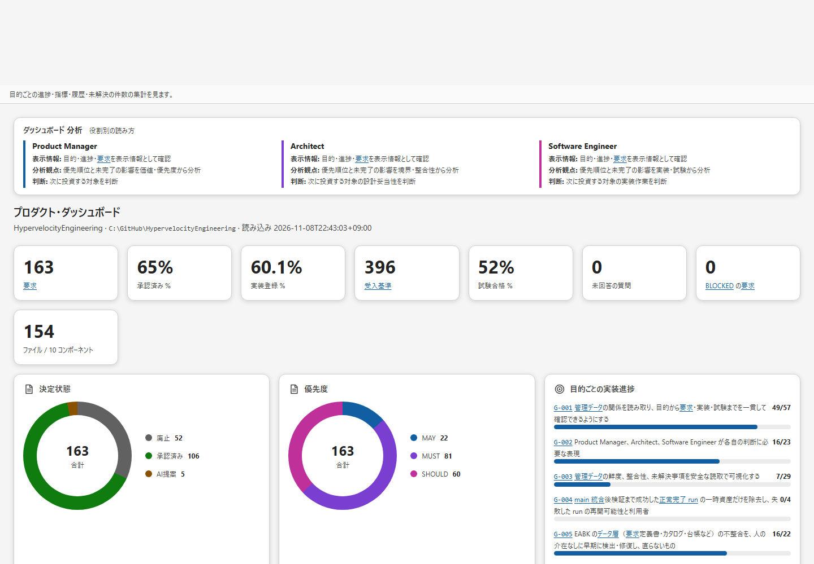

**日本語** | [English](README.en.md)

# HypervelocityEngineering — Enterprise App Build Kit Lite

GitHub Copilot（VS Code・Copilot CLI・GitHub Copilot app・cloud agent）で開発するリポジトリに、**要求定義書・カタログ・System Test の一貫性**を保つための規則と検査を入れる toolkit です（EABK Lite 0.6.0）。

- 利用者は、いつもの Copilot（既定のエージェント）に**ふだんどおり**依頼します。特別なエージェントやコマンドは要りません。
- リポジトリの `AGENTS.md` の規則に従って、振る舞いを変える変更の中で、要求定義書・カタログ・テストが同じ変更として更新されます。
- 検査は LLM の判断に任せず、決定的スクリプト（LLM を使わず、同じ入力から常に同じ結果を返すスクリプト）で行います。手元では `python scripts/verify.py`、push・PR では CI の `ebak-verify` が同じ検査をします。
- 意味の矛盾（要求どうしの衝突・目的とのずれ）は、節目に読み取り専用の監査役 `rd-auditor` に頼んで確かめます。
- データ層は **EABK Studio**（ローカルの読み取り専用ビューアー）で図・表・検索で見られます。
- すでにソースコード・設計書があるアプリ（brownfield）にも使えます。まず `python scripts/adopt.py scan` で棚卸しします（[既存のアプリを導入する](users-guide/10-adopting-existing-apps.md)）。

### なぜ Lite か

0.5.x までは、conductor が作業役を worktree で並行させる長時間の run で開発を進めていました。実際の利用を検証すると、トークン量と経過時間がふだんの依頼より大きく増え、役割ごとの書き込み制限が作業を止める例もありました。一方で、要求定義書とテストの対応は、規則がリポジトリになければ人や PC が変わると保たれず、決定的な検査と節目の監査は本物のずれと矛盾を見つけていました。そこで Lite は、オーケストレーションをやめ、**リポジトリに入る規則・データ層・決定的な検査（手元と CI）・節目の手動監査**だけを残します。規則と検査はリポジトリと CI にあるので、複数の人・複数の PC でも、個人のプロンプトやメモリに依らず同じように効きます。

## はじめに（読者別の読み方）

| あなたは | あなたがすること | 読む順 |
|---|---|---|
| **Product Manager**（何を作るか決め、結果を受け入れる） | 作りたいことを Copilot に依頼する。承認待ちの要求と質問票に答える。Studio で状態を見る | ① [なぜ Lite か](#なぜ-lite-か) → ② [Quickstart](#quickstart) → ③ [依頼の書き方](users-guide/01-writing-requests.md) → ④ [ふだんの進め方](users-guide/02-daily-workflow.md) → ⑤ [Studio: Product Manager](users-guide/studio/05-product-manager.md) |
| **Architect**（設計の整合・境界・品質の基準を決める） | データ層の書式と検査の範囲（検査プロファイル）を決める。節目に監査を頼む | ① [概要](#概要) → ② [管理データの書式](users-guide/03-requirements-format.md) → ③ [設定とカスタマイズ](users-guide/04-customization.md) → ④ [検査項目と監査](users-guide/06-quality-gates.md) → ⑤ [Studio: Architect](users-guide/studio/06-architect.md) |
| **Software Engineer**（toolkit を導入・運用し、実装・テストを確かめる） | インストールする。検証コマンドを登録する。verify と CI の失敗を直す | ① [インストール](#インストール) → ② [Quickstart](#quickstart) → ③ [スクリプトリファレンス](users-guide/05-scripts-reference.md) → ④ [トラブルシューティング](users-guide/07-troubleshooting.md) → ⑤ [Studio: Software Engineer](users-guide/studio/07-software-engineer.md) |

0.5.x から更新する場合は、先に [0.5.x からの移行](#05x-からの移行) を読んでください。

## 目次

- [なぜ Lite か](#なぜ-lite-か)
- [はじめに（読者別の読み方）](#はじめに読者別の読み方)
- [概要](#概要)
- [インストール](#インストール)
- [Quickstart](#quickstart)
- [0.5.x からの移行](#05x-からの移行)
- [EABK Studio（データ層のビューアー）](#eabk-studioデータ層のビューアー)
- [詳細ドキュメント](#詳細ドキュメント)
- [用語](#用語)
- [リポジトリの構成](#リポジトリの構成)

## 概要

### 解決する問題

AI に要求定義・実装・テストを繰り返させると、次の問題が起きがちです。

- 機能を足したり変えたりしても、要求定義書が更新されず、コードとずれていく。
- 新しいテストがどの要求・受入基準を検証しているのか分からない。
- 複数の人・PC で並行して ID を付けると、重複や欠番が起きる。
- 離れた要求どうしの矛盾に、書いた本人のセルフレビューでは気づけない。
- 指示がプロンプトや個人のメモリにしかなく、人・PC・モデルが変わると振る舞いが変わる。

EABK Lite は、次の 5 つでこれらを防ぎます。

| 手段 | 内容 |
|---|---|
| **リポジトリに入る規則** | `AGENTS.md` と `.github/copilot-instructions.md` に短い規則を書きます（下の「規則」）。どの人・PC・クライアントの Copilot も同じ規則を読みます。 |
| **データ層** | 要求定義書・カタログ・外部連携カタログ・ID 台帳・System Test の台帳を、決まったパスのファイルとして git で管理します。 |
| **決定的な検査** | `scripts/verify.py`（手元）と CI の `ebak-verify`・`ebak-data-layer` が、同じ検査をします。ID の採番（`next-id.py`）と台帳の更新（`ledger.py`）もスクリプトで行います。 |
| **節目の手動監査** | 意味の矛盾は機械では見つけにくいので、節目に `rd-auditor` に監査を頼みます。毎回の依頼では動かしません。 |
| **可視化** | EABK Studio で、要求・カタログ・試験の状態を図と表で見ます。 |

### 規則（`AGENTS.md` に入るブロック）

インストーラは、`AGENTS.md` と `.github/copilot-instructions.md` に `<!-- ebak-abk:begin -->`〜`end` で囲んだ次のブロックを書きます。

```text
## Enterprise App Build Kit Lite（要求定義書・カタログ・System Test の一貫性）

- 振る舞いを変える変更（機能の追加・変更・削除）では、同じ変更の中で `docs/requirements-definition.md` の要求と受入基準（AC）を更新します。誰が編集してもかまいません（手順は skill `requirement-definition`）。
- 新しい ID は `python scripts/next-id.py <種別>` でだけ採番します。手で番号を振りません（複数の人・PC で並行しても重複させないため）。
- テストの名前かコメントに、検証する要求 ID と AC ID を書きます（例: `FR-012 AC-031`）。System Test の台帳 `tests/system/ledger.json` は `python scripts/ledger.py` でだけ更新し、テストを消す・弱めるときは `--reason` で理由を残します。
- ファイルを足す・名前を変える・消すときは、`docs/catalog.md` の行も直します（`python scripts/rdfix.py --apply` で追従できます）。
- 完了の前に `python scripts/verify.py` を実行して exit 0 にします（CI の `ebak-verify` も同じ検査をします）。
- 一時ファイル（ログ・証跡・作業メモ）は `/work` に置きます（git の管理対象外）。
```

常に読み込まれる instructions はこの数行だけです。長い手順は skills（`requirement-definition`・`rd-audit`・`adopt-existing`）に置き、必要なときだけ読み込まれます。

### 構成

```text
.github/
  agents/        rd-auditor.agent.md … 節目に利用者が選んで頼む、読み取り専用の監査役
  skills/        requirement-definition（要求定義の手順。誰が使ってもよい）/ rd-audit / adopt-existing
  workflows/     ebak-verify.yml … push・PR で verify を実行
                 ebak-data-layer.yml … データ層の検査と自動修復（下の「データ層ワークフロー（ebak-data-layer）」）
scripts/         決定的スクリプト（Python 3.9 以上。標準ライブラリだけを使用）
  verify.py / verify.ps1 / verify.sh   データ層の検査（検査プロファイル）＋ビルド・テストのコマンド
  rdcheck.py  rdfix.py  next-id.py  ledger.py  summarize.py  adopt.py  entities.py  extpoints.py  ebaklib.py
  ebak.config.json 設定（検証コマンド、検査プロファイル、base_branch）
EABK-Studio/     データ層のビューアー（ローカルの Web アプリ。読み取り専用）と、役割別ガイド・画面画像
docs/            永続のドキュメント（git で管理）
  requirements-definition.md  catalog.md  integrations.md  id-registry.md
tests/system/ledger.json      System Test の台帳（永続）
work/            一時ファイル（.gitignore 対象）。監査の結果は work/audit/<日時>/
```

EABK Lite には hook も、依頼への定型文の自動付与もありません。規則は `AGENTS.md`・`copilot-instructions.md` のブロックで伝わり、守れているかは verify と CI の検査で確かめます。

### 検査（verify と検査プロファイル）

| 層 | 実装 | 動くタイミング |
|---|---|---|
| 手元 | `python scripts/verify.py`（データ層の検査＋ `verify.commands` のビルド・テスト）。`--docs-only` でデータ層だけ | 完了の前（`AGENTS.md` の規則） |
| CI | `.github/workflows/ebak-verify.yml`（`scripts/verify.sh --show-warnings`） | push・PR のたび |
| CI | `.github/workflows/ebak-data-layer.yml`（検査と自動修復） | PR・push・手動・毎週 |
| 節目 | `rd-auditor`（意味の監査。読み取り専用） | 利用者が頼んだとき |

検査プロファイルは `scripts/ebak.config.json` の `checks.profile` で決めます。

- `lite`（既定）: `checks.lite_checks` の CHK だけを報告します。既定は `CHK-01, CHK-02, CHK-03, CHK-05, CHK-09, CHK-12, CHK-17, CHK-19, CHK-24`（構造と追跡性）です。ほかの CHK は出力にも終了コードにも影響しません。
- `full`: CHK-00〜34 をすべて報告します。
- `rdcheck.py check` と `verify.py` に `--profile lite|full` を付けると、設定より優先します。要約行は `rdcheck: errors=N warnings=M base=… run=… profile=lite` の形です。
- 書式の警告（CHK-13 曖昧語、CHK-14 数値の直書き、CHK-15 禁止同義語）などは full でだけ出ます。見たいときは `python scripts/verify.py --docs-only --profile full --show-warnings` を実行します（rd-auditor の監査もこれを使います）。
- プロファイルは `rdcheck.py check`・`verify.py`・`rdfix.py`（`--full` を含む）に同じように効きます。そのため `rdfix.py --full` は、同じプロファイルの `verify.py --docs-only` が合格するときに合格します（カタログの同期などの機械的な修復は、どのプロファイルでも同じように行います）。

### データ層の修復（rdfix）

verify が見つけたデータ層のファイル間の不整合（カタログの決定状態のずれ、ID 台帳の状態、マージで重複した行、名前が変わったファイルの参照など）のうち、要求定義書から機械的に決まるものは、共通の入口 `python scripts/rdfix.py --full`（確認）と `python scripts/rdfix.py --full --apply`（検査→修復→再検査）で直せます。入口は 3 つ（GitHub Actions のワークフロー・インストーラ・手動）で、どこから呼んでも同じ検査・同じ修復・同じ結果です。

- 終了コードは 0 = 合格・修復済み、1 = 手動対応が残る・修復の計画あり、2 = 実行しなかった・取り消した（排他の待ち時間切れ・書き込み失敗・0.5.x の名残の作業ブランチ `work/…/…` の上での実行など。すべて元に戻します）。exit 2 のときは、既定のブランチで実行し直します。
- 同じリポジトリでは、適用を同時に 1 つだけ実行します（排他）。
- 要求定義書と `docs/integrations.md` は変更しません。判断が要るもの（AC の本文の変更、ID の再利用など）は `MANUAL` として、作業の種類（`要求定義書`・`System Test の台帳`・`コードとカタログ`・`リポジトリ`）と次の行動とともに示します。例: `MANUAL CHK-11 tests/system/ledger.json AC-001 の本文が…（担当: System Test の台帳）次の行動: …`。

詳しくは [検査項目と監査](users-guide/06-quality-gates.md) を参照してください。

### 複数の人・複数の PC で使う

- 規則はリポジトリ（`AGENTS.md`）にあるので、誰の Copilot も同じ規則を読みます。
- ID は `next-id.py` で採番し、ID 台帳は `.gitattributes` の `merge=union` でマージします。同時に採番した ID が衝突したら CHK-01 が検出するので、`next-id.py` で採番し直します。
- 検査は CI で動くので、どの PC から push しても同じ結果になります。

### データの置き場所

| 置き場所 | 置くもの | git |
|---|---|---|
| `/docs` | 要求定義書、カタログ、外部連携カタログ（`docs/integrations.md`。任意）、ID 台帳 | 管理する |
| `tests/system/ledger.json` | System Test のケースと最新の状態 | 管理する |
| `/work` | ログ、証跡、監査の結果、作業メモ | 管理しない |

---

## インストール

### 前提条件

| 必要なもの | 確認方法 | 備考 |
|---|---|---|
| git リポジトリ | `git status` | まだなら `git init -b main` して最初の commit を作ります |
| Python 3.9 以上 | `python --version`（macOS/Linux は `python3 --version`） | スクリプトが使います。標準ライブラリだけで動くので、追加パッケージは不要です。Windows では Microsoft Store の `python` スタブではなく、実体の Python をインストールします（`winget install Python.Python.3.12`） |
| GitHub Copilot | VS Code、Copilot CLI、GitHub Copilot app、または cloud agent | どれでもかまいません。`AGENTS.md` と `.github/` を読むクライアントなら同じ規則が効きます |
| MCP Server・plugin（任意） | VS Code の `MCP: List Servers`、Copilot CLI の `/mcp` など | Work IQ、Microsoft Learn、Azure などを設定しておくと、Copilot が一次情報の参照に使えます。toolkit は MCP の設定を配布しません |

### インストールコマンド（推奨）

インストール先のリポジトリの**ルート**で、次の 1 行を実行します。このコマンドは toolkit を一時フォルダーにダウンロードし、`tools/install.py` を実行してから一時フォルダーを削除します。

**Windows（PowerShell）**

```powershell
irm https://raw.githubusercontent.com/dahatake/HypervelocityEngineering/main/tools/install.ps1 | iex
```

オプションを付ける場合:

```powershell
& ([scriptblock]::Create((irm https://raw.githubusercontent.com/dahatake/HypervelocityEngineering/main/tools/install.ps1))) -DryRun
```

**macOS / Linux / WSL / Git Bash**

```bash
curl -fsSL https://raw.githubusercontent.com/dahatake/HypervelocityEngineering/main/tools/install.sh | bash
# オプションを付ける場合
curl -fsSL https://raw.githubusercontent.com/dahatake/HypervelocityEngineering/main/tools/install.sh | bash -s -- --dry-run
```

特定のバージョン（タグ・ブランチ・commit）を使う場合は、環境変数 `EBAK_REF` を指定します（例: `EBAK_REF=v0.6.0`）。フォークを使う場合は `EBAK_REPO=<owner>/<repo>` を指定します。

**toolkit を clone 済みの場合**

```bash
python tools/install.py --target /path/to/your-repo
```

### オプション

| オプション（install.py / install.sh） | PowerShell | 動作 |
|---|---|---|
| `--target <dir>` | `-Target` | インストール先（既定: カレントディレクトリ） |
| `--dry-run` | `-DryRun` | 何も書き込まず、実行する操作だけを表示します |
| `--check` | `-Check` | 更新が必要かどうかを確認します（必要なら exit 1。CI でバージョンのずれを検出できます） |
| `--force` | `-Force` | ローカルで変更した toolkit のファイルも上書き・削除します（`*.ebak-backup-<日時>` を残します） |
| `--no-ci` | `-NoCi` | `.github/workflows/ebak-verify.yml` と `ebak-data-layer.yml` をインストールしません |
| `--no-repair` | `-NoRepair` | 導入後のデータ層の自動修復をせず、検査と修復の計画だけを表示します（書き込みません） |
| `--skip-verify` | — | 導入後のデータ層の検査も修復も行いません |
| `--uninstall` | `-Uninstall` | 変更していない toolkit のファイル、`AGENTS.md` などのブロック、マニフェスト、空になったフォルダーを削除します（管理データと設定は残します）。`uninstall.ps1` / `uninstall.sh` でも実行できます |
| `--purge` | `-Purge` | `--uninstall` に加えて、管理データ（`docs/` の要求定義書・カタログ・外部連携カタログ・ID 台帳など、`tests/system/ledger.json`）、`scripts/ebak.config.json`、`/work`、`.gitignore`・`.gitattributes` に追記した行、`*.ebak-backup-*` も削除します |

### インストールされるファイル

| 種類 | ファイル | 再実行時の扱い |
|---|---|---|
| toolkit のファイル | `.github/agents/rd-auditor.agent.md`、`.github/skills/`（`requirement-definition`・`rd-audit`・`adopt-existing`）、`.github/workflows/ebak-verify.yml`・`ebak-data-layer.yml`、`scripts/*.py`・`verify.ps1`・`verify.sh`、`EABK-Studio/`（ビューアー本体・テスト）、`EABK-docs/`（このリポジトリの `users-guide/` と同じ内容。EABK Studio のガイドは `EABK-docs/studio/`。導入先の `users-guide/` は触りません） | 変更していなければ新しいバージョンに更新します。ローカルで変更していれば**そのまま残します**（`KEEP-LOCAL`。`--force` で上書き） |
| 管理データの雛形 | `docs/requirements-definition.md`、`docs/catalog.md`、`docs/integrations.md`（外部連携カタログ。任意）、`docs/id-registry.md`、`tests/system/ledger.json` | **存在しない場合だけ**作成します。既存のファイルは上書きしません |
| 設定 | `scripts/ebak.config.json` | なければ作成します。あれば新しいキーだけを追加し、利用者が設定した値は変更しません |
| 追記 | `.gitignore` に `/work/`、`.gitattributes` に `docs/id-registry.md merge=union` など | 足りない行だけを追記します |
| ブロック | `AGENTS.md`、`.github/copilot-instructions.md` に `<!-- ebak-abk:begin -->`〜`end` で囲んだ規則（[上の「規則」](#規則agentsmd-に入るブロック)） | ブロックの中だけを置き換えます。ブロック外の記述は変更しません |
| マニフェスト | `.github/ebak-toolkit.json` | バージョンと、インストールしたファイルのハッシュ（更新・削除の判定に使います） |

インストール・更新の最後に、データ層の共通の入口 `python scripts/rdfix.py --full --apply` を 1 回だけ実行します（検査→自動修復→再検査）。修復した項目・残った手動対応（検査項目 ID・位置・作業の種類）・再検査の合否を表示します。修復は commit せず作業ツリーに残し、要求定義書と外部連携カタログは変更しません。`--no-repair`（PowerShell では `-NoRepair`）を付けると `python scripts/rdfix.py --full`（検査と修復の計画の表示だけ。書き込まない）になり、`--skip-verify` では検査も修復も行いません。`--dry-run`・`--check`・`--uninstall`・`--purge` では修復しません。修復が取り消された（exit 2）・手動対応が残った（exit 1）場合も toolkit のファイルは残り、確認と修復のコマンドを表示します。インストーラの終了コードはデータ層の結果で変わりません。

### インストール後の設定

1. 差分を確認して commit します。
   ```bash
   git add -A && git commit -m "Add Enterprise App Build Kit"
   ```
2. `scripts/ebak.config.json` の `verify.commands` に、ビルド・静的解析・テストのコマンドを登録します（[設定とカスタマイズ](users-guide/04-customization.md)）。空のままでも、Copilot に「この技術スタックの標準的なビルドとテストのコマンドを `verify.commands` に登録して」と頼めます。
3. CI でアプリのツールチェーン（Node.js など）が必要な場合は、`.github/workflows/ebak-verify.yml` の verify ステップの前にセットアップのステップを追加します。
4. 既存の要求定義書がある場合は、その ID を ID 台帳に取り込みます。
   ```bash
   python scripts/next-id.py --sync --adopt
   ```
   続けて `python scripts/verify.py --docs-only` を実行し、指摘を確認します。書式まで見る場合は `--profile full --show-warnings` を付けます。直すときは Copilot に「既存の要求定義書を skill `requirement-definition` の書式に合わせて」と頼みます。
5. （任意）社内の情報や対象の技術のツールを使う場合は、利用するクライアントに MCP Server・plugin を設定し、サインインしておきます（[設定とカスタマイズ](users-guide/04-customization.md)）。

### 更新・確認

```bash
# 更新（同じインストールコマンドをもう一度実行するだけ）
curl -fsSL https://raw.githubusercontent.com/dahatake/HypervelocityEngineering/main/tools/install.sh | bash

# 更新が必要かどうかだけを確認する
curl -fsSL .../tools/install.sh | bash -s -- --check
```

0.5.x から更新するときの変化は [0.5.x からの移行](#05x-からの移行) を参照してください。

### アンインストール・クリーンアップ

インストールと同じように、インストール先のリポジトリの**ルート**で 1 行を実行します。

**Windows（PowerShell）**

```powershell
# アンインストール（toolkit のファイルとブロックを削除します。docs・台帳・設定・/work は残します）
irm https://raw.githubusercontent.com/dahatake/HypervelocityEngineering/main/tools/uninstall.ps1 | iex

# クリーンアップ（管理データ・設定・/work・追記した行も含めて、toolkit が加えたものをすべて削除します）
& ([scriptblock]::Create((irm https://raw.githubusercontent.com/dahatake/HypervelocityEngineering/main/tools/uninstall.ps1))) -Purge -DryRun   # 確認
& ([scriptblock]::Create((irm https://raw.githubusercontent.com/dahatake/HypervelocityEngineering/main/tools/uninstall.ps1))) -Purge
```

**macOS / Linux / WSL / Git Bash**

```bash
curl -fsSL https://raw.githubusercontent.com/dahatake/HypervelocityEngineering/main/tools/uninstall.sh | bash
curl -fsSL https://raw.githubusercontent.com/dahatake/HypervelocityEngineering/main/tools/uninstall.sh | bash -s -- --purge --dry-run   # 確認
curl -fsSL https://raw.githubusercontent.com/dahatake/HypervelocityEngineering/main/tools/uninstall.sh | bash -s -- --purge
```

toolkit を clone 済みの場合は `python tools/install.py --target /path/to/your-repo --uninstall`（または `--purge`）です。`install.ps1 -Uninstall`、`install.sh --uninstall` でも同じです。

| 対象 | `--uninstall` | `--purge` |
|---|---|---|
| toolkit のファイル（`.github/agents`・`skills`・`workflows/ebak-*.yml`、`scripts/*.py` など）と旧版のファイル | 変更していなければ削除（変更していれば `KEEP-LOCAL` で残す。`--force` で削除） | 同じ |
| `AGENTS.md`・`.github/copilot-instructions.md` のブロック | ブロックだけを削除（ほかに記述がなければファイルごと削除） | 同じ |
| マニフェスト `.github/ebak-toolkit.json`、空になったフォルダー、削除した `.py` の `__pycache__` | 削除 | 削除 |
| 管理データ（`docs/requirements-definition.md`・`catalog.md`・`integrations.md`・`id-registry.md`・`manual-tests.md`・`docs/requirements/`、0.5.x から残る `run-history.md`、`tests/system/ledger.json`）。パスは `scripts/ebak.config.json` の `management_files` に従います | 残す | 削除 |
| `scripts/ebak.config.json`、`/work`、`*.ebak-backup-*` | 残す | 削除 |
| `.gitignore` の `/work/`、`.gitattributes` の `merge=union` の行 | 残す | 追記した行だけを削除（空になればファイルごと削除） |
| System Test のコード（`tests/system/` の台帳以外）、アプリのコード、`docs/` のほかの文書 | 残す | 残す |

- マニフェストが失われている場合は、この版の toolkit と同じ内容のファイルだけを削除します（`WARN` を表示します）。
- 削除は git の作業ツリーに対して行います。結果を `git status` で確認してから commit します（`git restore` で戻せます。`/work` は git の管理対象外なので戻せません）。
- 何度実行しても安全です（2 回目は `changes=0`）。

### plugin ではなくインストーラーを使う理由

GitHub Copilot には、agents・skills・hooks をまとめて配布する標準の仕組みとして **plugin**（`copilot plugin install OWNER/REPO`、Agent Plugins 仕様）があります。この toolkit の配布には使っていません。理由は次のとおりです。

| 観点 | plugin | この toolkit に必要なこと |
|---|---|---|
| インストール先 | 利用者のホーム（plugin のディレクトリ）。リポジトリには入らない | 規則（`AGENTS.md`）、決定的スクリプト（`scripts/`）、管理データの雛形（`docs/`）、台帳、`.gitignore`、CI を**対象リポジトリの中**に置いて git で管理し、CI（GitHub Actions）でも同じ verify を実行する必要がある |
| 可搬性 | Agent Plugins 1.0 で可搬なのは skills と MCP だけ。custom agents と hooks はクライアントごとの拡張 | VS Code・Copilot CLI・Copilot app・cloud agent で、同じ `AGENTS.md` と `.github/` を使う |
| チームでの共有 | 利用者ごとにインストールが必要 | リポジトリを clone すれば、チーム全員と CI が同じバージョンの規則と検査を使える |

そこで、customizations（`AGENTS.md`・`.github/`）と `scripts/` をリポジトリに直接置く方式にしました。そのインストール・更新・アンインストールを 1 コマンドで行うために `tools/install.*`・`tools/uninstall.*` を用意しています。

### インストール時のトラブル

| 症状 | 対処 |
|---|---|
| `Python 3.9 以上が必要です` | Python をインストールし、`python --version` が通ることを確認します |
| `git リポジトリではありません` | `git init -b main` してから実行します |
| `KEEP-LOCAL` が表示された | ローカルで変更したファイルは更新・削除していません。差分を確認し、上書き・削除してよければ `--force` を付けて再実行します |
| `WARN-HOOK  <パス>` が表示された | 旧版の hook のファイル（`.github/hooks/*.json`）をローカルで変更していたので残しました（`KEEP-LOCAL`）。このファイルは削除された `scripts/hooks/gate.py` を呼びます。hook がエラーになると Copilot がすべてのツールの呼び出しを拒否するので、このファイルを削除してから Copilot のセッションを開き直します |

---

## Quickstart

1. 自分のリポジトリのルートで、インストールコマンドを 1 回実行し、commit します（[インストール](#インストール)）。
   - Windows: `irm https://raw.githubusercontent.com/dahatake/HypervelocityEngineering/main/tools/install.ps1 | iex`
   - macOS / Linux: `curl -fsSL https://raw.githubusercontent.com/dahatake/HypervelocityEngineering/main/tools/install.sh | bash`
2. `scripts/ebak.config.json` の `verify.commands` にビルドとテストのコマンドを登録します。
3. あとは、次の「推奨の進め方」で開発します。

### 推奨の進め方

1. **ふだんどおり Copilot に依頼します**。VS Code・Copilot CLI・GitHub Copilot app・cloud agent のどれでも、既定のエージェントのままでかまいません（例: 「延滞が 3 日を超えたら本人と上長に通知する機能を追加して」）。
2. **Copilot が規則に従って同じ変更で更新します**。`AGENTS.md` の規則に従い、要求定義書の要求と受入基準・カタログ・テスト・コードを同じ変更の中で更新し、`python scripts/verify.py` を exit 0 にします。新しい ID は `next-id.py`、台帳は `ledger.py` で更新します。差分を確認し、承認が必要な要求はチャットで承認します。
3. **push・PR で CI が同じ検査をします**。`ebak-verify` と `ebak-data-layer` が、手元と同じ検査を実行します。
4. **節目に rd-auditor に監査を頼みます**。機能のまとまりが終わったとき・リリースの前などに、Agent に `rd-auditor` を選んで「差分を監査して」「全量を 3 回で監査して」などと頼みます。差分の既定は `base_branch`（既定 `main`）との差分です。サブエージェントを使えるクライアントでは指定の回数を並行して多数決します。結果は `work/audit/<日時>/report.md` に出ます。指摘を反映するかは利用者が判断し、別の変更で直します。
5. **状況は EABK Studio で見ます**（任意）。`python EABK-Studio/studio.py --role pm` などで、要求・カタログ・試験の状態を図と表で確かめます（[EABK Studio](#eabk-studioデータ層のビューアー)）。

詳しくは [ふだんの進め方](users-guide/02-daily-workflow.md) と [依頼の書き方](users-guide/01-writing-requests.md) を参照してください。

EABK Lite は依頼に定型文を自動で付けません。毎回伝えたい前提があれば、自分の Copilot の instructions に書きます。

### 既存のアプリに導入する

`python scripts/adopt.py scan` で棚卸しし、`python scripts/adopt.py request` で Copilot のチャットにそのまま貼れる依頼文（`<constraints>` の節つき。既定は「実装: しない」「承認: 厳格」）を `work/import/adopt-<日時>.md` に作ります。逆生成した要求は「承認待ち」で入り、利用者が承認します（[既存のアプリを導入する](users-guide/10-adopting-existing-apps.md)）。

### データ層ワークフロー（ebak-data-layer）

`.github/workflows/ebak-data-layer.yml`（ebak-data-layer）は、プルリクエスト、main への push、手動実行（workflow_dispatch）、毎週 1 回の定期実行（schedule）で `python scripts/verify.py --docs-only` を実行します。

- 不合格のとき、共通の入口 `python scripts/rdfix.py --full --apply` で自動修復して再検査し、合格した場合だけ修復を commit します。要求定義書は変更しない設計です。同一リポジトリの PR では当該 PR のブランチへ、main への push と定期実行では修復用ブランチ（`eabk/data-layer-fix`）と PR に反映します。
- 修復後も直らないときは、ラベル `eabk-data-layer` つきで失敗の要約と実行へのリンクを含む Issue を作成します（同じ内容の未解決 Issue があればコメント）。
- 権限は contents・pull-requests・issues の write だけで、fork からの PR では検査だけを行います。bot の修復 commit では再修復しません。
- 無効化するには、ファイルを削除するか Actions 画面で Disable します（インストール時は `--no-ci`）。詳細は `users-guide/04-customization.md`。

---

## 0.5.x からの移行

0.6.0（EABK Lite）では、オーケストレーション（conductor と作業役、worktree の run、`/build`、役割ごとのゲート）を撤去しました。同じインストールコマンドで更新すると、次のようになります。

| 0.5.x | 0.6.0 での扱い |
|---|---|
| `/build` で conductor に依頼 | 既定のエージェントにふだんどおり依頼します（[推奨の進め方](#推奨の進め方)） |
| `<run_options>`（`max_hours`・`approval_policy`・`parallel_workers`・`scope` など） | 不要です。包括承認（`approval_policy`）の代わりに、チャットで承認します |
| conductor・rd-author・test-designer・implementer・reviewer、`build`・`build-template`・`implement-fr`・`system-test-increment`・`dedupe` の skill | 利用者が変更していなければ削除します（`REMOVE`）。変更していれば残します（`KEEP-LOCAL`。`--force` で削除） |
| hook（`.github/hooks/quality-gates.json`・`.github/hooks/prompt-prefix.json`・`scripts/hooks/gate.py`）と定型文の自動付与 | 0.6.0 には hook がありません。変更していなければ削除します（`REMOVE`）。変更した hook の設定が残ると（`KEEP-LOCAL`）、`WARN-HOOK  <パス>` を表示します。削除された `gate.py` を呼ぶので hook がエラーになり、Copilot がすべてのツールを拒否します。そのファイルを削除し、Copilot のセッションを開き直します。導入先の `.github/ebak-prompt-prefix.md` はそのまま残りますが、もう読みません |
| `run-state.py`・`integrate.py`・`kpi.py`・`watch.py`・`clean-work.py` など | 削除します。代わりはありません（状態と統合は git と CI に任せます） |
| 設定のキー `gates`・`limits`・`credits`・`worktree_share`・`prompt_prefix` | 削除します（`PRUNE` と表示） |
| `docs/run-history.md` | 残っていれば読み取り専用の記録です（Studio で表示でき、`rdfix.py` は重複行を従来どおり直します）。新しい導入では作りません |
| 0.5.x の run が残した worktree と `work/*` ブランチ | 自動では消しません。`git worktree list`・`git branch --list "work/*"` で確認し、手で削除します |

要求定義書・台帳・カタログは更新で変更しません。詳しくは [バージョンアップの手順](users-guide/09-versioning.md) と [CHANGELOG.md](CHANGELOG.md) を参照してください。

---

## EABK Studio（データ層のビューアー）

**EABK Studio**（`EABK-Studio/`）は、EABK が管理するデータ層（要求定義書・カタログ・System Test の台帳・ID 台帳、0.5.x から残る実行履歴）を、**図・表・検索**で見て回る、ローカル専用の Web アプリです。toolkit の一部として、インストールすると対象リポジトリに入ります。

- **読み取り専用**です。ソースコードは開かず、`127.0.0.1` だけで待ち受けます。唯一の書き込みは、「整合性保守」でプレビューを確認して実行した、`docs/catalog.md` の題名・決定状態だけです。
- Python 3.9 以上の標準ライブラリだけで動きます（追加のインストールなし）。データ層のファイルを更新すると、数秒で画面が読み直されます。
- 要求・カタログ・試験の状態を、人が理解し、判断するための窓です。要求や実装の変更は、Copilot に依頼します。



| 役割 | 使い方 | ガイド |
|---|---|---|
| Product Manager | ダッシュボードで進捗・承認・未回答の質問を確認し、次に投資する目的を決める | [S5. Product Manager 向け](users-guide/studio/05-product-manager.md) |
| Architect | 2D/3D マップ・図式・配置・構造で、依存・境界・置き場所と層の欠けを確かめる | [S6. Architect 向け](users-guide/studio/06-architect.md) |
| Software Engineer | 表・ソース対応・詳細パネルで、要求から実装ファイルとテストまでをたどる | [S7. Software Engineer 向け](users-guide/studio/07-software-engineer.md) |
| 全員 | どの画面が、どのファイルの何を読み、どう計算するか | [S8. データリファレンス](users-guide/studio/08-data-reference.md) |

索引は [users-guide/studio/](users-guide/studio/README.md) です。

### 自分のリポジトリで起動する

toolkit を入れたリポジトリのルートで、次を実行します。

```bash
python EABK-Studio/studio.py --check      # データ層が読めるか（見つかったファイルと解析できた件数）を確認
python EABK-Studio/studio.py --role pm    # ブラウザーが開く。--role は pm / architect / swe
```

Windows では `.\EABK-Studio\start.ps1 -Role pm`、macOS / Linux では `./EABK-Studio/start.sh . 8765 --role pm` でも起動できます。詳細は [EABK-Studio/README.md](EABK-Studio/README.md)、スクリプトのオプションは [スクリプトリファレンス](users-guide/05-scripts-reference.md) です。

---

## 詳細ドキュメント

詳細は [users-guide/](users-guide/README.md) にあります。

| # | ドキュメント | 読むタイミング |
|---|---|---|
| 1 | [依頼の書き方](users-guide/01-writing-requests.md) | 要求定義書を正しく更新させる依頼・回答・承認の書き方を知りたい |
| 2 | [ふだんの進め方](users-guide/02-daily-workflow.md) | 依頼 → verify → push・CI → 節目の監査 → Studio の流れと、結果の確かめ方を知りたい |
| 3 | [管理データの書式](users-guide/03-requirements-format.md) | 要求定義書・カタログ・ID 台帳・System Test の台帳のフォーマットを知りたい |
| 4 | [設定とカスタマイズ](users-guide/04-customization.md) | ビルド・テストのコマンド、検査プロファイル、CI を調整したい。MCP Server・plugin を使いたい |
| 5 | [スクリプトリファレンス](users-guide/05-scripts-reference.md) | `scripts/` の各コマンドの使い方を知りたい |
| 6 | [検査項目と監査](users-guide/06-quality-gates.md) | verify の CHK の意味と直し方、rdfix、rd-auditor の監査を知りたい |
| 7 | [トラブルシューティング](users-guide/07-troubleshooting.md) | verify・CI・修復が失敗した |
| 8 | [導入ロードマップ](users-guide/08-roadmap.md) | 試行から本番運用までの段取りを知りたい |
| 9 | [バージョンアップの手順](users-guide/09-versioning.md) | 版を上げる（配布元）、導入済みのリポジトリを更新する（利用者）。0.5.x からの移行 |
| 10 | [既存のアプリを導入する](users-guide/10-adopting-existing-apps.md) | 既存のコード・設計書から、棚卸し → 逆生成の要求（承認待ち）→ 現状の挙動の固定でデータ層を整える |
| 11 | [外部連携カタログ](users-guide/11-integration-catalog.md) | 外部アプリ・データとの連携を `docs/integrations.md`（任意）に記録する。追加・変更・廃止・検査の手順 |
| 参考 | [EABK Studio のガイド](users-guide/studio/README.md) | データ層を図・表で見たい。役割別の手順と、各画面が読むデータを知りたい |

## 用語

| 用語 | 意味 |
|---|---|
| 規則 | `AGENTS.md` と `.github/copilot-instructions.md` に入るブロック。どの Copilot も読みます（[規則](#規則agentsmd-に入るブロック)）。 |
| 管理データ | 要求定義書（`docs/requirements-definition.md`）とカタログ（`docs/catalog.md`）など。要求と既存資産の Single Source of Truth です。 |
| 台帳（ledger） | System Test のケース定義と最新の状態（`tests/system/ledger.json`）。`ledger.py` でだけ更新します。 |
| ID 台帳 | 採番済みの ID の記録（`docs/id-registry.md`）。`next-id.py` でだけ更新します。 |
| 検査プロファイル | `checks.profile` の `lite`（既定。構造と追跡性の CHK だけ）と `full`（CHK-00〜34 すべて）。 |
| 監査 | rd-auditor による意味の監査（矛盾・目的との整合・記述の質）。節目に利用者が頼みます。結果は `work/audit/<日時>/`。 |
| `/work` | 一時ファイルの置き場所（git の管理対象外）。ログ・証跡・監査の結果・作業メモを置きます。 |

## リポジトリの構成

| 内容 | 場所 |
|---|---|
| 詳細ドキュメント | [users-guide/](users-guide/README.md) |
| 監査役（rd-auditor） | [.github/agents/](.github/agents/) |
| 手順書（skills） | [.github/skills/](.github/skills/) |
| 決定的スクリプト | [scripts/](scripts/) |
| CI | [.github/workflows/](.github/workflows/) |
| データ層のビューアー（EABK Studio） | [EABK-Studio/](EABK-Studio/README.md)、ガイドは [users-guide/studio/](users-guide/studio/README.md) |
| 管理データの雛形 | [docs/](docs/)、[tests/system/ledger.json](tests/system/ledger.json) |
| インストールスクリプト | [tools/](tools/) |
| toolkit のテスト | [tests/toolkit/](tests/toolkit/)（`python -m pytest tests/toolkit -q`） |
