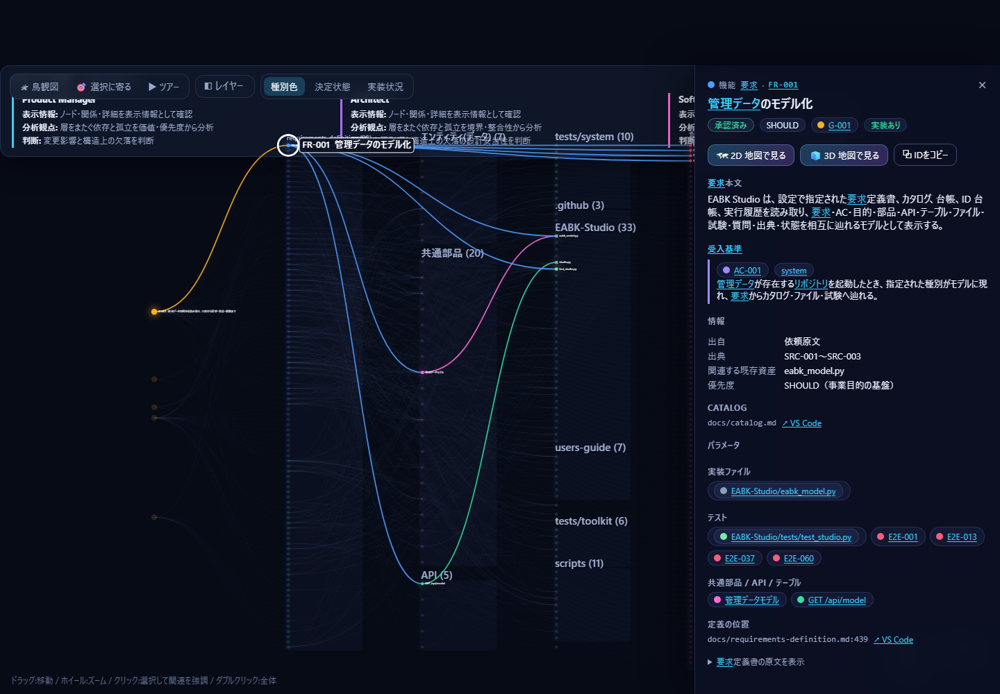
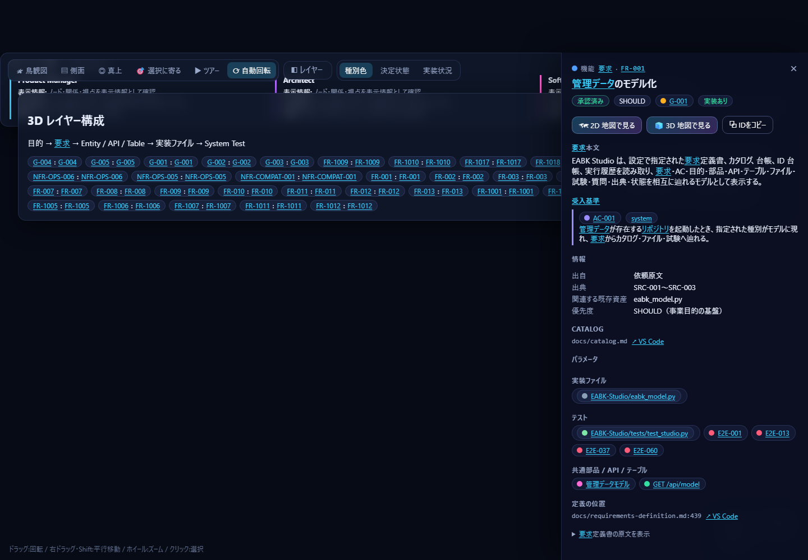
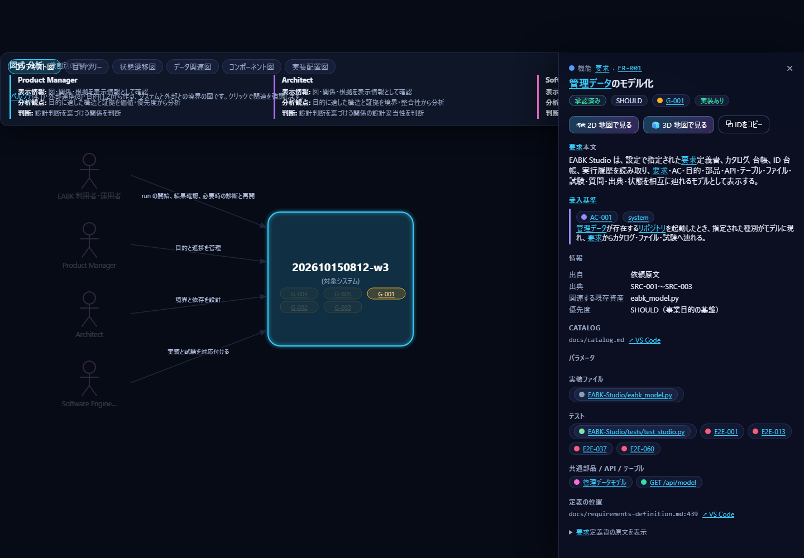
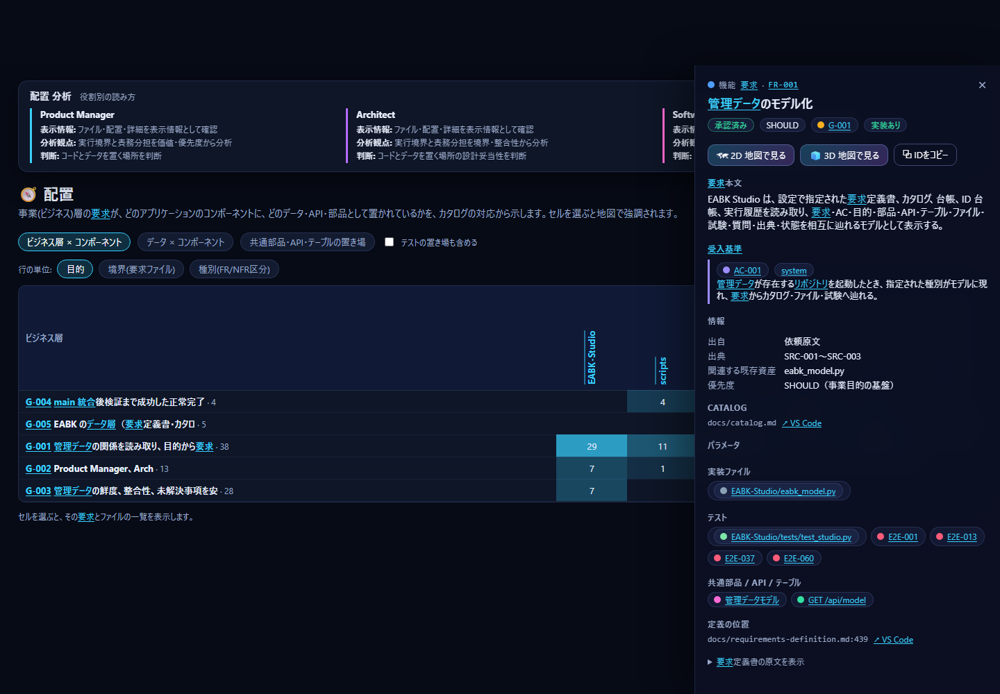
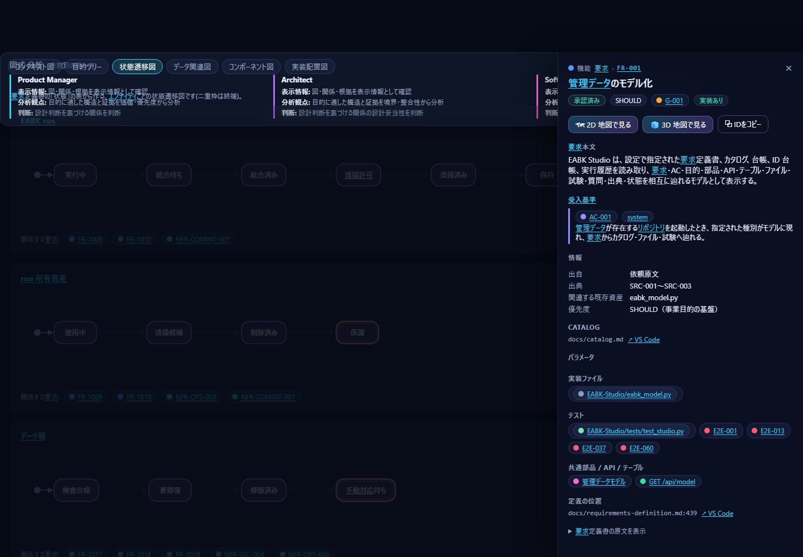

# S2 画面の見かた

上部のタブで切り替えます。どの画面でも、**選んだ項目と、それに関連する項目が強調**されます（検索・図・表で共通）。各画面が読むデータと計算は [08-data-reference.md](08-data-reference.md) にあります。

## 実画面の例

以下は同じコミットの管理データを読み取り、Playwright 検証で保存した実画面です。
採取条件と SHA-256 は [screen-images.json](screen-images.json) に記録しています。

| 画面 | 実画面 |
|---|---|
| ダッシュボード |  |
| 2D マップ |  |
| 3D マップ |  |
| 図式 |  |
| 配置 |  |
| ソース対応 |  |
| 表 |  |

## ダッシュボード
要求・承認・実装登録・受入基準・試験合格・未回答の質問・BLOCKED の数。決定状態、優先度、目的ごとの進捗、要求の境界（要求を分けたファイル）ごとの実装、受入基準の検証レベル、System Test の結果、実行履歴。**グラフや数字をクリックすると、該当する要求が 2D マップで強調されます。**

## 2D マップ
左から右へ「目的 → 要求 → データ・共通部品・API・テーブル → ソースファイル → 試験ケース」の順に並べた全体図です。

| 操作 | 結果 |
|---|---|
| ホイール／ドラッグ | 拡大縮小／移動 |
| 点にポイント | 直接つながる項目を強調 |
| 点をクリック | 2 段先まで強調し、右に詳細 |
| ダブルクリック／「鳥観図」 | 全体を見渡す |
| 「ツアー」 | 目的ごとに自動でカメラが巡る |
| 「レイヤー」 | 受入基準・パラメータ・質問などの表示を追加 |
| 色の切替 | 種別／決定状態／実装状況（赤＝未実装）で要求を色分け |

左下のミニマップをクリックすると、その場所へ飛べます。

## 3D マップ
2D と同じ関係を、層にして立体で見ます。ドラッグで回転、右ドラッグか Shift+ドラッグで平行移動、ホイールでズームです。選ぶとカメラが寄り、関連する線に光が流れます。「側面」で層の積み重なり、「真上」で配置の広がり、「自動回転」で何もしないときのゆっくりした回転を切り替えます。

## 図式
要求定義でよく使う図を、データ層の内容だけから作ります。

| 図 | 分かること |
|---|---|
| コンテキスト図 | システムと、利用者（ペルソナ）・外部連携の境界 |
| 目的ツリー | 目的ごとの要求の数と、実装の有無（色） |
| 状態遷移図 | 申請・実行などの対象が取る状態と遷移 |
| データ関連図 | 要求で一緒に扱われるデータ（エンティティ）のつながり |
| コンポーネント図 | アプリの部品（コンポーネント）、その中のモジュール、置かれた共通部品・API・テーブル |

## エンティティ
`#/entities`。行がエンティティ、列が要求と利用シナリオの対応表です。セルには、そのユースケースがエンティティを **作成・参照・更新・削除** のどれで使うかを、記号（C・R・U・D）と語で示します（色だけには頼りません）。使い方が書かれていない関連は「使用（使い方未記載）」、関係のない組は空です。どのユースケースからも使われないエンティティは「未使用」、エンティティを持たない要求は「エンティティなし」と示します。行・列の絞り込み、行の並べ替え、CSV の保存、テキスト表示ができ、すべてキーボードで操作できます。エンティティの見出しを選ぶと詳細（説明、状態と遷移の条件、使う要求、利用シナリオ、管理テーブル、使うコンポーネント・API・共通部品、出典の位置）に移り、そこから ER 図・実装配置図へ、また図のエンティティの詳細パネルからこの詳細へ戻れます。表示は JA / EN で切り替わります。

### 意味的ズーム（関係と列）
`#/entities` の下部、および 2D マップ・3D マップ（モデルに関係か列があるとき最初に開き、「関係グラフ（従来）」で従来の図に切り替えられます）で、エンティティの関係と列を、倍率に応じた 3 つの粒度で見られます。倍率は、全体がちょうど収まる状態を 1 とします。

| 倍率（既定） | 粒度 | 内容 |
|---|---|---|
| 1 以上 2 未満（PARAM-017） | 全体 | クラスター（関係でつながったエンティティのまとまり）と件数。関係のないエンティティは単独のクラスター。クラスターを選ぶとそこへ拡大します |
| 2 以上 8 未満（PARAM-018） | 中 | エンティティと関係線。種別は 外部キー（◆・実線）／参照（◇・破線）／使用（▫・点線）の線種・印・語で区別。エンティティを選ぶと関係先が強調されます |
| 8 以上 | 大 | 列の一覧（キー・名前・型・参照先）。参照先の列は線と「→」で辿れます。列がないエンティティは「列未記載」 |

操作: ホイール・ピンチ・ボタン（＋ − ⤢ と 全体／中／大）・キーボード（＋ − で拡大縮小、矢印で移動、0 で全体、1・2・3 で粒度、n・p で次・前のエンティティ、. ・ , で列、Enter で参照先へ、Esc で解除）。3D は ⟲ ⟳ ⤒ ⤓（Q・E・R・F）で回転・傾けます。2D と 3D を切り替えても、選択・倍率・絞り込みは保たれます。「表で見る（代替表現）」にクラスター・関係・列が表で出ます。画面に収まらない分は描画を省き（その旨が表示されます）、データは欠けません。

## 配置
「事業の要求が、アプリのどこに作られているか」の表（ヒートマップ）です。

- **ビジネス層 × コンポーネント**: 行は目的・境界・種別から選びます。数字は、その行の要求のうち、そのコンポーネントに実装があるものの数です。
- **データ × コンポーネント**: 要求の「対象エンティティ」（扱うデータ）が、どこで実装されているか。
- **共通部品・API・テーブルの置き場**: それぞれの定義ファイルがあるコンポーネント。

セルを選ぶと、要求とファイルの一覧が出て、地図でも強調されます。

`#/placement?kind=runtime` では、PC、ブラウザー、Studio サーバー、対象リポジトリ、
管理データ、実装ファイル、明示されたクラウド/外部境界の位置と読取・書込・外部送信方向を確認できます。

## 構造・一貫性・保守

URL で開くページです（`#/structure`・`#/consistency` は上部のタブには出ません）。

- `#/structure`: 全データ層を、現状・理想・差分・適用規則・判定理由・根拠で比較します。

  
- `#/consistency`: 要求 → AC → System Test → カタログ → 実装ファイルを要求 ID ごとに追跡します。

  
- `整合性保守 / Maintenance`: 要求正本と異なるカタログ行をプレビューし、確認後に題名と決定状態だけを更新します。

  

### そのほかの実画面

| 画面 | 実画面 |
|---|---|
| 配置（実行環境。`#/placement?kind=runtime`） |  |
| 表の試験ケース（`#/tables?tab=cases`） |  |
| 状態遷移図（`#/diagrams?kind=states`） |  |

各画面が読むデータと計算は [08-data-reference.md](08-data-reference.md)、役割別の使い方は [05](05-product-manager.md)・[06](06-architect.md)・[07](07-software-engineer.md) にあります。

## ソース対応
カタログに書かれたファイルの名前を、面積で見る図（ツリーマップ）です。面積は結び付く要求の数で、青は実装、緑はテストです。ファイルを選ぶと、そのファイルが満たす要求・使っている部品・テストが分かります。**ソースコードの中身は読みません。**

## 表
全レコードの一覧です（要求・受入基準・試験ケース・共通部品・API/テーブル・ファイル・パラメータ・質問票・用語・ペルソナ・外部連携・決定記録・監査指摘・出典・実行履歴）。見出しで並べ替え、上の欄で絞り込み、「選択に関連する行だけ」で、地図で選んだものに関係する行だけを表示、CSV で書き出せます。

## 右の詳細パネル
項目を選ぶと出ます。要求なら本文、受入基準、決定状態、優先度、上位の目的、扱うデータ、パラメータ、実装ファイル、テスト、BLOCKED の質問が分かります。「VS Code」リンクで、定義の位置やファイルをエディターで開けます。「2D／3D 地図で見る」で画面を移れます。
