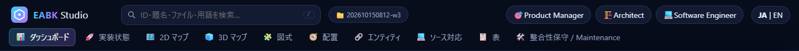
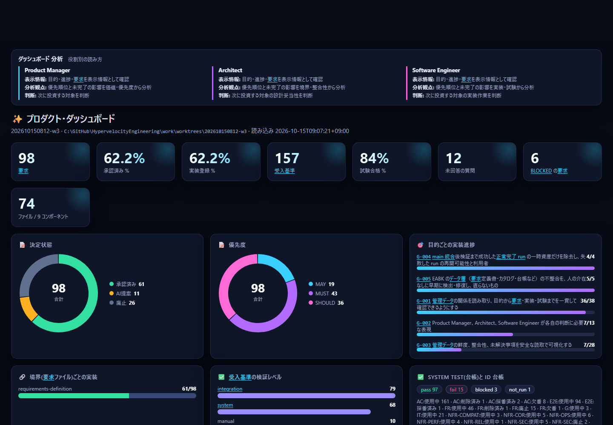
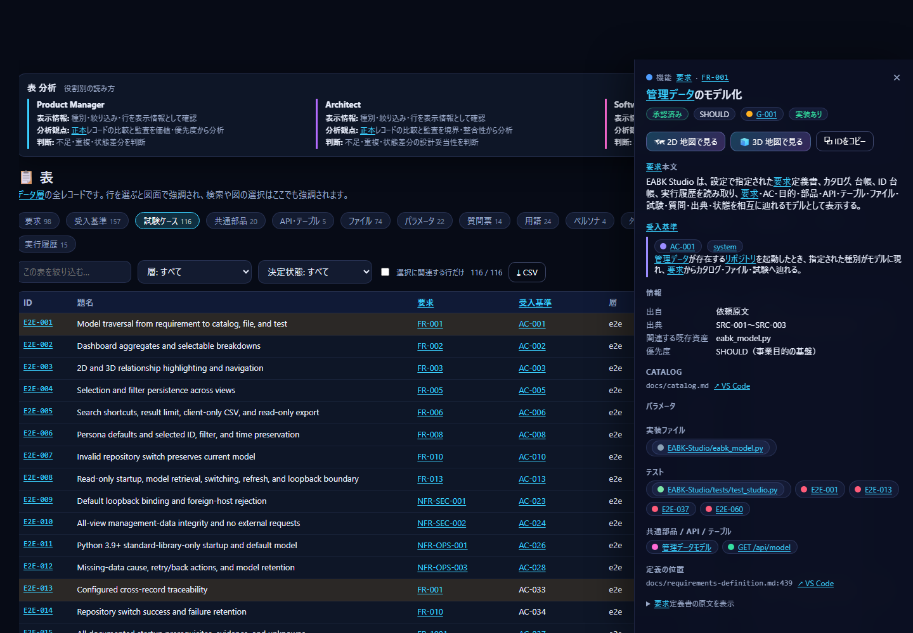
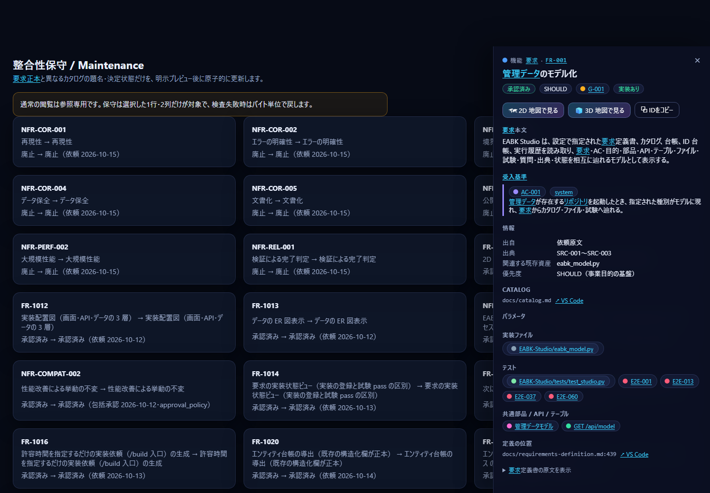

[日本語](05-product-manager.md) | **English**

# S5 Guide for Product Managers

This guide shows you how to judge "what we decided to build," "how far along we are," and "what to invest in next" without reading any code. It takes about 15 minutes.

Click `🎯 Product Manager` at the top right of the screen to open the dashboard. Launching with `--role pm` also opens this screen first.



> The images are an example based on the data of the repository that built this tool. In your repository, the numbers and IDs will differ.

## S5.1 Screens to view and the data they read

| Screen | What the PM looks at | Data read (details in [08](08-data-reference.en.md)) |
|---|---|---|
| Dashboard | Number of requirements, approval rate, implementation registration rate, test pass rate, unanswered questions, BLOCKED | Requirements definition, catalog, ledger, questionnaire |
| Progress by goal | Share of requirements with registered implementations, per business goal (G) | Goals, the `上位` (parent) field of requirements, catalog |
| Tables → questionnaire, decision log, sources | Questions awaiting answers, what was decided and when, and on what basis | Tables in the requirements definition |
| 2D map | Which goals, data, and components each requirement connects to | Requirements definition, catalog |
| Consistency maintenance | Mismatches in titles and states between requirements and catalog | Requirements definition, catalog |

## S5.2 15-minute tutorial

1. **Launch** (about 1 minute). Run the following in the repository folder. A browser opens.
   ```powershell
   python EABK-Studio/studio.py --role pm
   ```
   If it does not open properly, first run `python EABK-Studio/studio.py --check` to confirm that the data layers are found.
2. **Read the overall numbers** (2 minutes). Read the numbers in the top row of the dashboard from left to right.

   

   | Number | How to read it |
   |---|---|
   | Requirements | All requirements, regardless of decision state |
   | Approved % | Share of requirements approved by a person. When low, there are still many "AI proposals" |
   | Implementation registered % | Share of requirements that have implementation files written in the catalog (whether they are **registered**, not whether they were built) |
   | Test pass % | Share of System Tests that are pass. `not_run` is not included |
   | Unanswered questions | Items waiting for your answer |
   | BLOCKED requirements | Requirements that have acceptance criteria that cannot proceed because a question is unanswered |
3. **Look inside a number** (2 minutes). Click the `Implementation registered %` card. The requirements included in that number are highlighted on the 2D map. Every chart and number on the dashboard is clickable.
4. **Look at progress by goal** (2 minutes). In "Implementation progress by goal" on the dashboard, click the bar of a goal that is progressing slowly. The requirements belonging to that goal light up on the map. Set the **color switch** to `Implementation status` to see unregistered requirements in red.
5. **Prepare to answer pending questions** (2 minutes). Open `Tables` → `Questionnaire` and, in the `state` filter, choose any state other than "answered." The questions, options, and recommendations are listed. You can identify BLOCKED requirements in the "BLOCKED" column of `Tables` → `Requirements`. Pass your answers to the conductor as `<answers>`, following the EABK workflow ("How to write a request" in the main README). You cannot answer from Studio.
   
6. **Review how decisions were made** (2 minutes). In `Tables` → `Decision log` and `Sources`, check the date, subject, decision, rationale, and run. Pressing each card in "Design and development history and progress" at the bottom of the dashboard shows the supporting file and line on the right.
7. **Check the content of a requirement** (2 minutes). Enter a term of interest in the search box at the top (the `/` key) and select a result. The detail panel on the right shows the requirement's body, acceptance criteria, priority, parent goal, and implementation files.
8. **Check for mismatches** (1 minute). Open `Consistency maintenance`. Any rows where the requirement's title or decision state differs from the catalog appear as candidates. See S5.4 for whether to fix them.

   
9. **Switch the language** (1 minute). Switch with `JA | EN` at the top right, and you can show the screens as they are to executives and overseas members.

## S5.3 Recommended links

Open them by appending the following to the URL shown at launch (`http://127.0.0.1:8765/`) in the browser address bar.

| Purpose | Link |
|---|---|
| Overall progress | `#/dashboard` |
| See around a specific requirement | `#/map2d?q=<requirement ID>` (partial match highlighting; opens with the term already in the search box) |
| Questions awaiting answers | `#/tables?tab=questions` |
| Decision log | `#/tables?tab=decisions` |
| List of requirements (filter by approval and priority) | `#/tables?tab=reqs` |
| Breakdown of goals | `#/diagrams?kind=goals` |
| Boundary of users and external integrations | `#/diagrams?kind=ctx` |

> A link with `?select=<ID>` shows the screen in screenshot mode (the top menu and search are hidden). Use `?q=` for everyday use.

## S5.4 What a PM can decide

| Decision | Screen to base it on | Next action |
|---|---|---|
| Decide which goal to invest in next | Implementation progress by goal on the dashboard, priority pie chart | Put the MUST requirements of the slowest goal into the `scope` of the next run |
| Advance approvals | Approved %, `Tables` → `Requirements` (status = proposed; AI proposals) | Pass approval, rejection, or hold to the conductor via `<answers>` |
| Get stalled requirements moving | BLOCKED requirements, unanswered questions | Answer the questionnaire |
| Report on quality status | Test pass %, `Tables` → `Test cases` | When there are many `not_run`, request that a run be executed |
| Fix mismatches between requirements and catalog | `Consistency maintenance` | Review the preview and execute (only the catalog's titles and decision states change) |

## S5.5 Notes when reading

- "Implementation registered" means whether a path is written in the catalog. It does not check whether the file actually exists or works. Judge whether it works by "test pass" and the result of `python scripts/verify.py`.
- When `Test pass %` is 0, either there is no ledger or the cases are `not_run`. You can check whether the ledger is found with `python EABK-Studio/studio.py --check`.
- You cannot add or change requirements in Studio. Request them with `/build` (main README).

Next, proceed to [06-architect.en.md](06-architect.en.md) (view design consistency) or [08-data-reference.en.md](08-data-reference.en.md) (the basis for the numbers).
