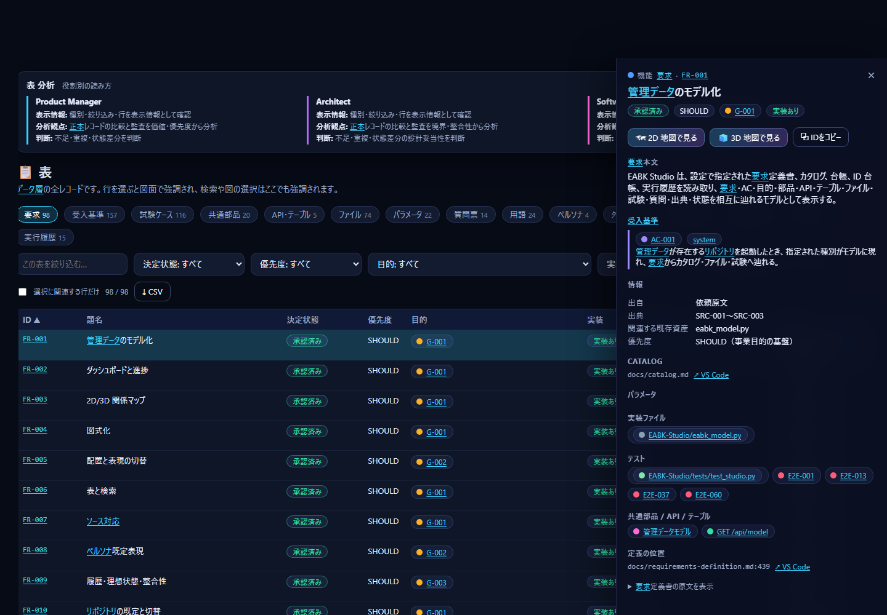
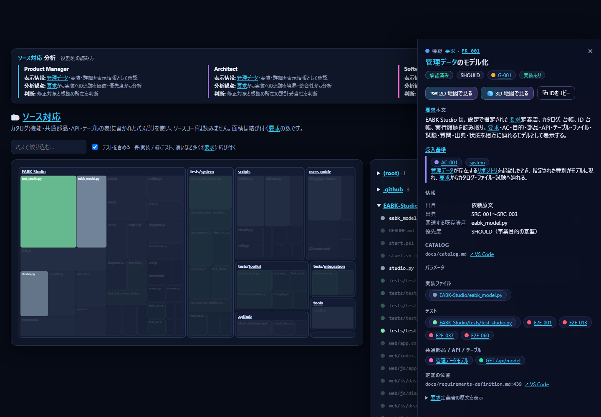
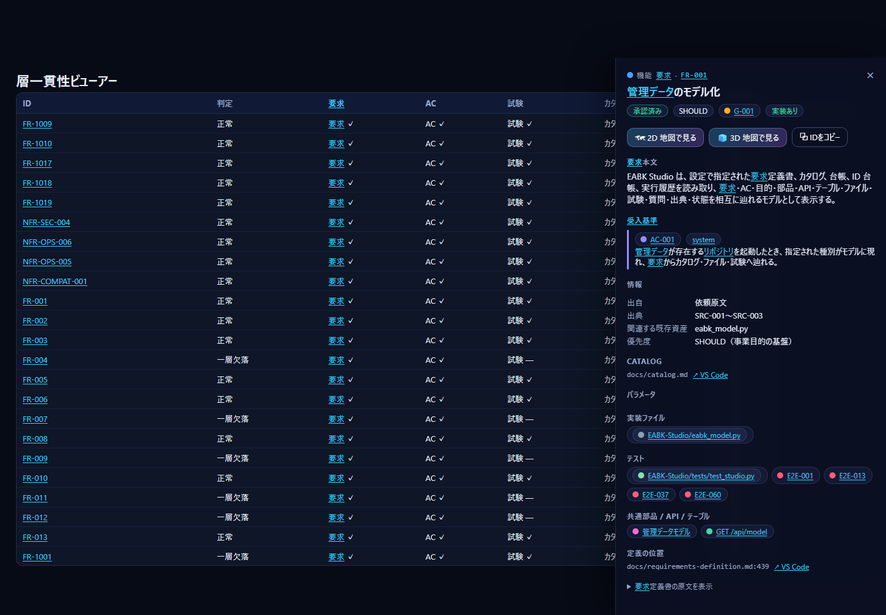

[日本語](07-software-engineer.md) | **English**

# S7 Guide for Software Engineers

This guide shows you how to decide "where are the implementation and tests that satisfy this requirement" and "which file to fix next" by tracing from a requirement **all the way to the file**. It takes about 15 minutes.

Click `💻 Software Engineer` at the top right of the screen to open the tables screen. Launching with `--role swe` also opens this screen first.

## S7.1 Screens to view and the data they read

| Screen | What the Software Engineer looks at | Data read (details in [08](08-data-reference.en.md)) |
|---|---|---|
| Tables → requirements, acceptance criteria | Requirement body, acceptance criteria, verification level, BLOCKED, whether an implementation exists | Requirements definition, catalog |
| Tables → test cases | Case layer, status, last run, run command | Ledger |
| Tables → files | Implementation and test paths, and the number of requirements tied to them | Catalog, `command` in the ledger |
| Source mapping | Per-file mapping to requirements, shared components, and tests | Catalog paths |
| Detail panel | Requirement → implementation files, tests, components, APIs, tables | Catalog |
| Consistency | Gaps in requirement → AC → test → catalog → implementation | Requirements, ledger, catalog |

## S7.2 15-minute tutorial

1. **Launch** (1 minute).
   ```powershell
   python EABK-Studio/studio.py --role swe
   ```
2. **Choose a requirement to work on** (2 minutes). Open `Tables` → `Requirements`. In the `status: all` filter choose `approved`, and in the `impl` filter choose `none` (implementation files empty) or `unlisted` (no row in the catalog). Look at priority starting from `MUST`.

   
3. **Read the requirement** (2 minutes). Click a row. The detail panel on the right shows the body, acceptance criteria (verification level: system / integration / unit / manual), and BLOCKED. Acceptance criteria marked BLOCKED cannot proceed because a question is unanswered.
4. **List only the acceptance criteria** (1 minute). In `Tables` → `Acceptance criteria`, use the verification level filter. You can separate the targets of the unit and integration tests you write (unit / integration) from the targets of System Tests (system).
5. **Check existing tests and commands** (2 minutes). Open `Tables` → `Test cases`. The layer (`layer`), status (`status`), and last run are listed.

   

   Selecting a row shows the run command (`command`), the last commit, and the evidence in the detail panel. You can run that case locally with the command written here. The System Test ledger is updated only with `python scripts/ledger.py` (do not edit it directly).
6. **Jump to where the implementation is** (2 minutes). From the chips for "Implementation files," "Tests," and "Shared components, APIs, tables" in the requirement's detail panel, you can jump to the related files. Pressing the `↗ VS Code` link opens the file or definition line in VS Code (it uses `vscode://file/…`, so it works on a PC with VS Code installed).
7. **Trace back from a file to requirements** (2 minutes). Open `Source mapping` and enter a file name in the path filter. A file with a large area is tied to many requirements. This gives a rough measure of how large the impact is when you change it.

   
8. **Look for missing layers** (2 minutes). Open `#/consistency`. A requirement judged "one layer missing" lacks one of requirement, AC, test, catalog, or implementation file. The missing layer is the entry point of your work.

   
9. **Take the data out** (1 minute). With `CSV` on `Tables`, you can export all rows of the displayed tab (UTF-8, also openable in Excel).

## S7.3 Recommended links

| Purpose | Link |
|---|---|
| List of requirements | `#/tables?tab=reqs` |
| List of acceptance criteria | `#/tables?tab=acs` |
| Test cases and run commands | `#/tables?tab=cases` |
| Implementation and test files | `#/tables?tab=files` |
| Shared components, APIs, tables | `#/tables?tab=parts`, `#/tables?tab=apis` |
| Parameters (thresholds, periods) | `#/tables?tab=params` |
| Terms (phrasings that must not be used) | `#/tables?tab=terms` |
| File → requirement mapping | `#/source` |
| A specific requirement | `#/map2d?q=<requirement ID>` |
| Missing layers | `#/consistency` |

## S7.4 What a Software Engineer can decide

| Decision | Screen to base it on | Next action |
|---|---|---|
| Which requirement to implement next | `Tables` → `Requirements` (approved, MUST, impl is none/unlisted), presence of BLOCKED | Specify the requirement ID in the `scope` of the `/build` request |
| Which files to change | Implementation files and shared components in the detail panel, area in source mapping | Run the tests of the affected requirements |
| Which tests to run | `command`, layer, and status in `Tables` → `Test cases` | Run and record with `python scripts/ledger.py` |
| Whether it can be called implemented | Consistency (5 layers) and the test `status` | Fill in the missing layers |
| Basis of a value | `Tables` → `Parameters`, `{PARAM-nnn}` in the AC body | When changing a value, request that the PARAM decision be updated |
| Which terms to use | `Tables` → `Terms` (phrasings that must not be used) | Reflect them in naming of identifiers and messages |

## S7.5 Notes when reading

- "Has implementation" means whether a path is written in the catalog. The existence and contents of the file are not read. If you suspect a mismatch, run `python scripts/verify.py`.
- A test case's `status` is the result last recorded in the ledger. Studio does not run tests.
- Studio is read-only (except for the catalog's titles and decision states in consistency maintenance). Request both implementation and requirements via `/build`.
- The contents of code and the details of test results (logs) are not displayed. The location of evidence is in the evidence column of `Test cases`.

See [06-architect.en.md](06-architect.en.md) for how to read the design, and [08-data-reference.en.md](08-data-reference.en.md) for the basis of each screen.
