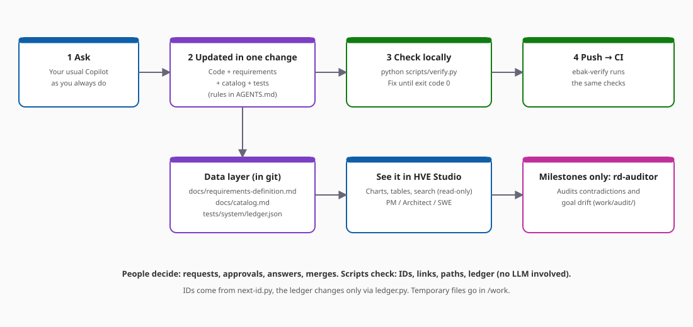
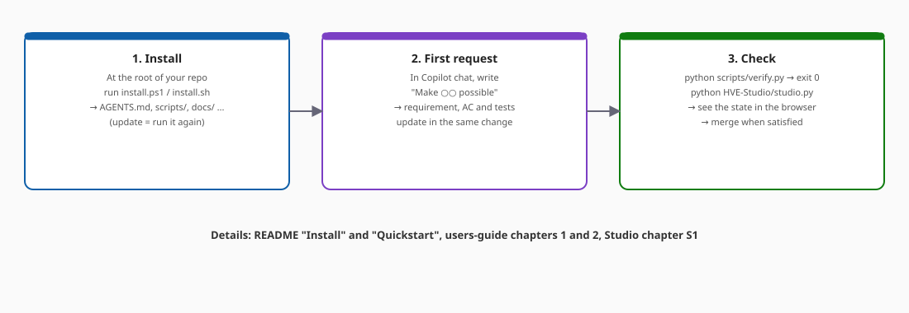
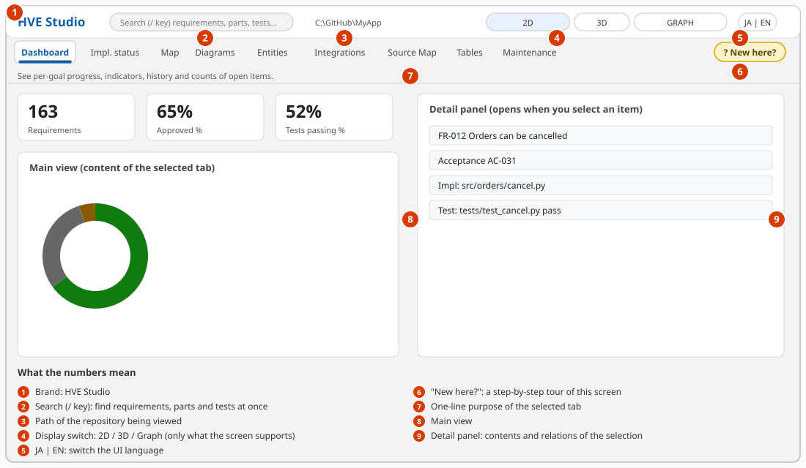
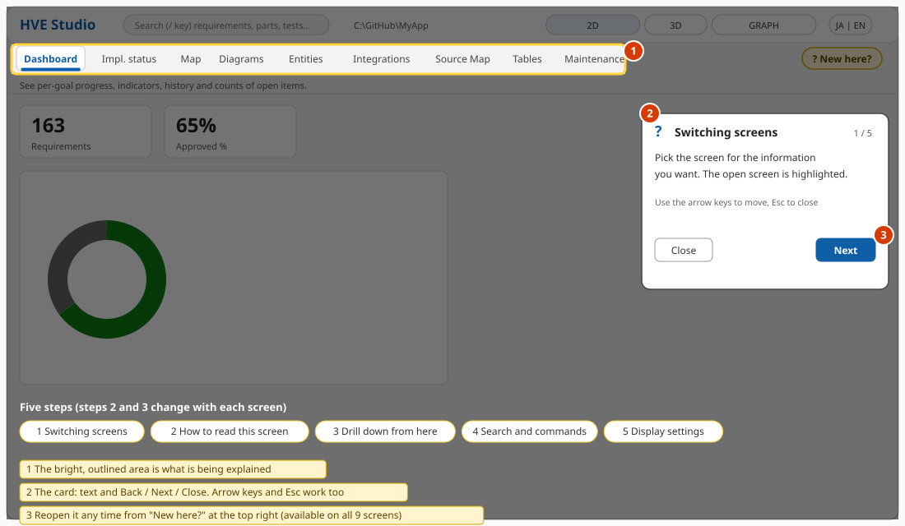
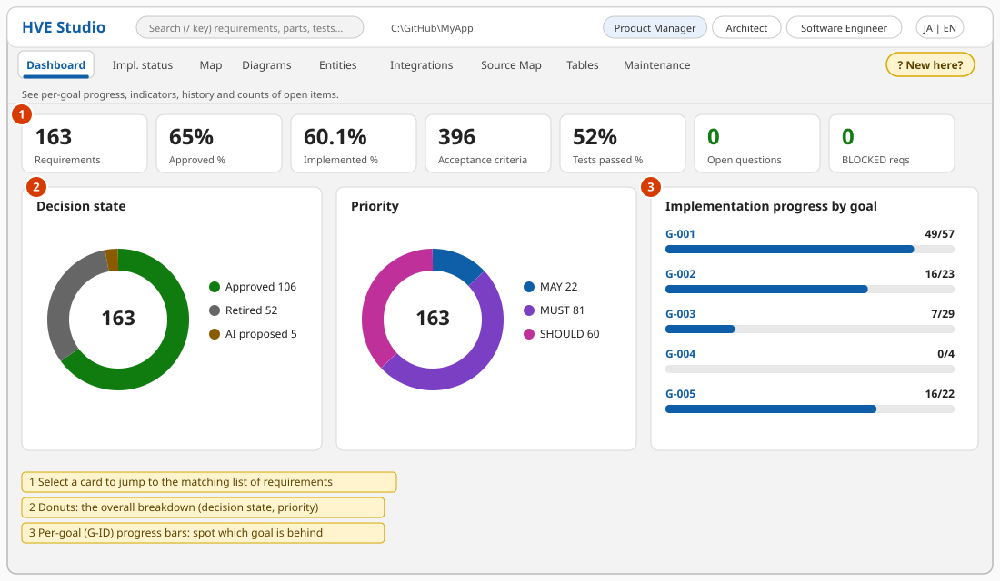
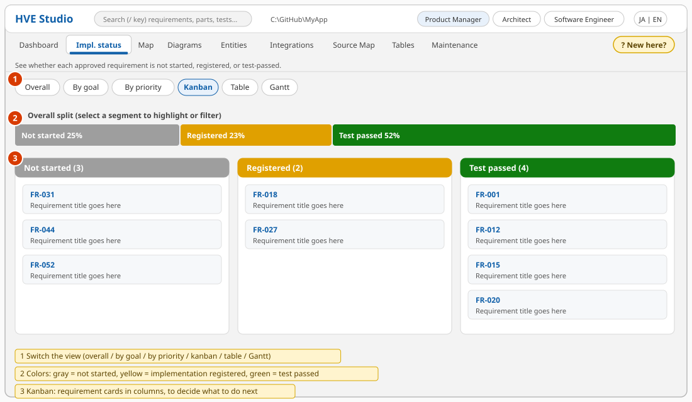
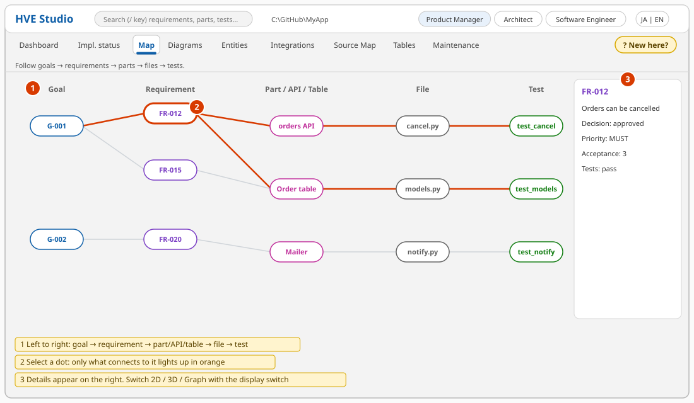
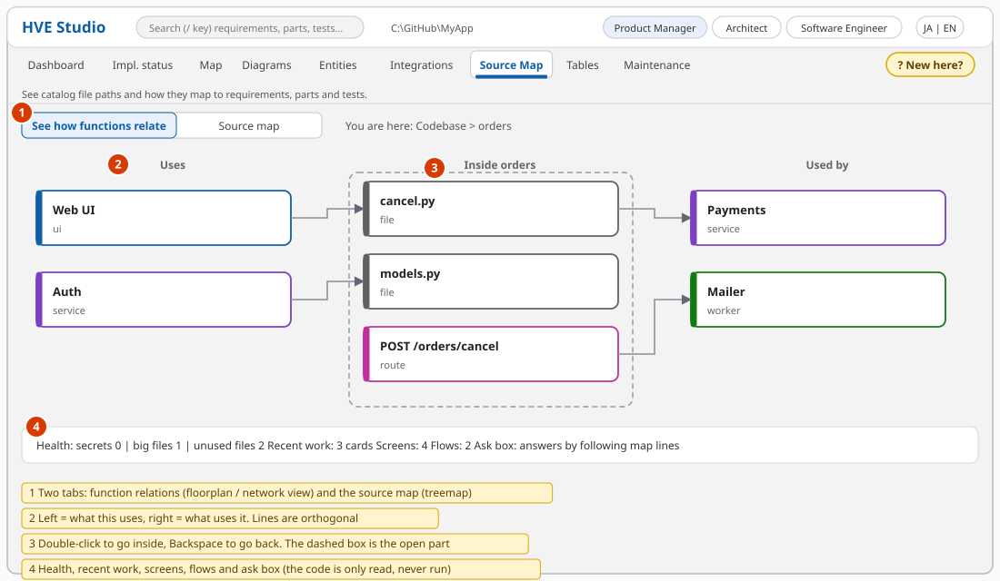
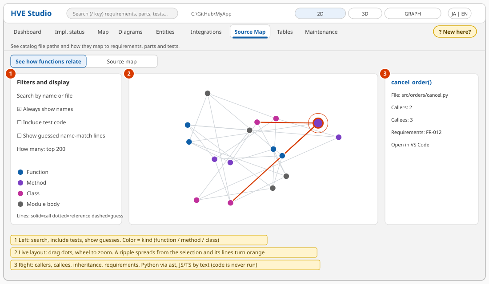
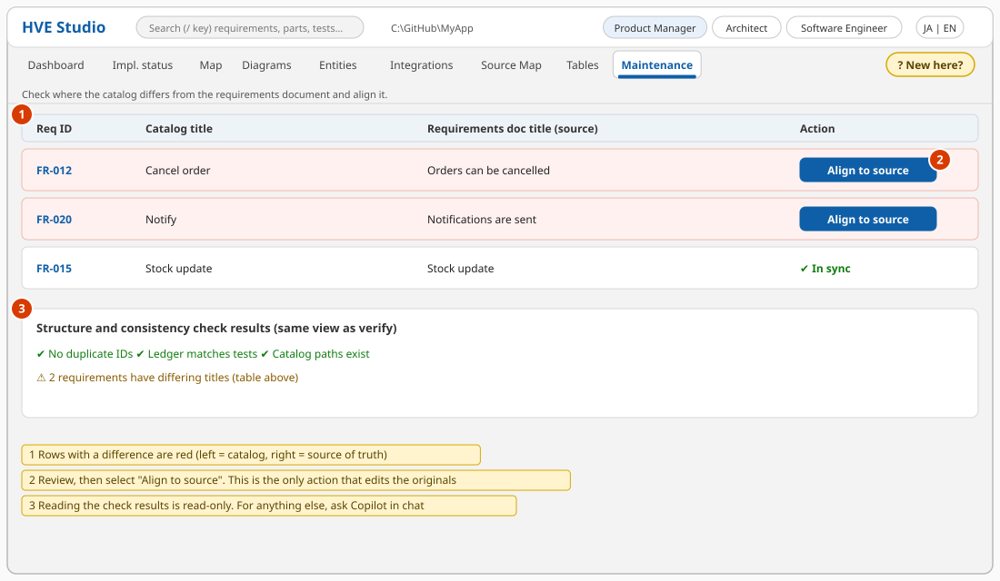

[日本語](09-visual-tour.md) | **English**

# S9 Visual tour — for first-time users

This chapter explains **the layout and each screen of HVE Studio, one screen at a time, with figures (SVG)**. The figures are explanatory illustrations of the screen layout (numbers are examples); real screenshots are in [S2 Reading the screens](02-screens.en.md). The numbers ① ② ③ in each figure match the numbers in the text.

> Navigation: [← HVE Studio index](README.en.md) · [← User guide contents](../README.en.md) · [← Repository README](../../README.en.md) · Next: [S1 First steps](01-first-steps.en.md) / [S2 Reading the screens](02-screens.en.md)

## 0. The big picture in 3 minutes

Studio is a **view-only** app. To change requirements or implementation, ask Copilot in chat, not Studio.



1. Ask Copilot as you normally would.
2. Copilot updates the requirements, catalog and tests in the same change as the code.
3. `python scripts/verify.py` and CI check the rules mechanically.
4. **You confirm the updated data layer in Studio, with charts and tables.** That is the subject of this chapter.

If you are new, finish the README [Quickstart](../../README.en.md#quickstart) first, then try these three steps.



```bash
python HVE-Studio/studio.py --check      # can the data layer be read?
python HVE-Studio/studio.py              # opens the browser (from work step 1)
```

## 1. The screen layout (common to every screen)



| No. | Place | What it is for |
|---|---|---|
| 1 | Top-left brand | The "HVE Studio" name. |
| 2 | Search box | Type a word to search requirements, parts, tests and more at once. The `/` key jumps here, and `Ctrl+K` opens commands (go to a screen, etc.). |
| 3 | Target repository | The path of the repository you are viewing; switch it from the menu at the top right. |
| 4 | Role | `Product Manager`, `Architect`, `Software Engineer`. It decides the first screen (PM: Dashboard, Architect: 2D map, SWE: Tables). You can switch at any time. |
| 5 | `JA \| EN` | Switches the UI language (requirement text stays as written). |
| 6 | **New here?** | A step-by-step tour of the current screen ([section 2](#2-the-new-here-tour-wizard)). |
| 7 | Screen description | One line on the purpose of the selected tab. |
| 8 | Main view | The content of the selected tab. |
| 9 | Detail panel | Opens when you select a dot, row or card; shows its contents and the related requirements, parts and tests. |

There are nine screen tabs, from the left: **Dashboard, Impl. status, Map, Diagrams, Entities, Integrations, Source Map, Tables, Maintenance**. Pick by what you want to know.

| I want to know | Open |
|---|---|
| Overall progress, approval rate, open questions | Dashboard |
| Where each approved requirement is: not started, registered, test-passed | Impl. status |
| How a goal connects to requirements, parts, files and tests | Map |
| Context, goal tree, state, data relation, component, placement diagrams | Diagrams |
| Kinds of business data and who creates / reads / updates / deletes them | Entities |
| Integrations with external apps and data | Integrations |
| How files map to requirements, parts, tests; how functions relate | Source Map |
| The raw rows: requirements, test cases, questions, terms | Tables |
| Differences between the catalog and the requirements document | Maintenance |

## 2. The "New here?" tour (wizard)

Press the yellow **"New here?"** button at the top right. The page dims, **only the area being explained is outlined brightly**, and a card walks you through the screen. It is available on all nine screens.



- 1: The bright outlined area is what is being explained.
- 2: The card holds the text and Back / Next / Close. **The ← → keys move and Esc closes.** The last step shows "Done".
- 3: There are five steps: "Switching screens" → "How to read this screen" → "Drill down from here" → "Search and commands" → "Display settings". Steps 2 and 3 change with the open screen.
- Reopen it any time. Switching the language (JA / EN) switches the tour text too.
- The floorplan (section 7) has its own tour of the same name that explains the map.

## 3. Dashboard (the first screen for Product Managers)



- 1: **Number cards**: requirements, approved %, implemented %, acceptance criteria, tests passed %, open questions, BLOCKED requirements. Select a card to jump to the matching list. **Open questions** and **BLOCKED** should ideally be 0.
- 2: **Donuts**: the overall breakdown (decision state, priority); the center number is the total.
- 3: **Per-goal progress bars**: for each goal (G-ID such as `G-001`), implemented requirements / total. **A short bar is a goal that is behind.**
- How to read it per role is written at the top of the screen. Details: [S5 For Product Managers](05-product-manager.en.md).

## 4. Impl. status



- 1: **Switch the view**: overall, by goal, by priority, kanban, table, Gantt.
- 2: **Colors**: gray = not started, yellow = implementation registered, green = test passed. **Registration and test results are judged separately.** Select a segment to highlight or filter.
- 3: **Kanban**: requirement cards in three columns; use it to decide what to do next.
- Requirements that are pending, on hold, rejected or retired are out of scope here.

## 5. Map (the first screen for Architects)



- 1: Left to right: **goal → requirement → part / API / table → file → test**.
- 2: Select a dot and **only what connects to it lights up in orange**: you can see which files and tests a change to this requirement affects.
- 3: The detail panel shows the title, decision state, priority, acceptance criteria and test status.
- Switch 2D, 3D and Graph with the display switch. Steps: [S6 For Architects](06-architect.en.md).

## 6. Diagrams, Entities, Integrations, Tables (one-line guides)

| Screen | How to read it | Details |
|---|---|---|
| Diagrams | Choose the diagram kind with the top tabs (context, goal tree, state transition, data relation, component, placement); select an element to jump to its requirement. | [S2 Diagrams](02-screens.en.md) |
| Entities | Rows are entities; columns are requirements and scenarios. A cell symbol shows Create / Read / Update / Delete. | [S2 Entities](02-screens.en.md) |
| Integrations | Partner, direction, method and data class; select one for details. Reads `docs/integrations.md`. | [Integration catalog](../11-integration-catalog.en.md) |
| Tables | Switch kinds with tabs, sort with headings, export CSV. The first screen for Software Engineers. | [S2 Tables](02-screens.en.md) · [S7](07-software-engineer.en.md) |

## 7. Source Map — function relations, floorplan, network view

This screen has two tabs: **"See how functions relate"** (the floorplan and the network view) and **"Source map"** (a treemap by file size, mapped to requirements, parts and tests).

### 7.1 Floorplan



- 1: The two tabs switch between function relations (floorplan / network view) and the source map.
- 2: **The left column is what the middle card uses; the right column is what uses it.** Lines are orthogonal.
- 3: **Double-click (Enter) to go inside; Backspace, the breadcrumb or the browser Back goes back.** The dashed box is the part that is open. The place can be shared by URL (`#/floorplan?v=&s=`).
- 4: Bottom area: **Health** (a quick check for secrets, big files and unused files; not a security audit), **Recent work** (uncommitted git changes and recent commits), **what is behind each screen**, **flows**, and an **ask box** (answers by following map lines, not by AI).
- Zooming hides descriptions and enlarges titles. `/` and `Ctrl+K` search. Part boundaries come from `floorplan/architecture.json` if present, otherwise from folders.
- **The code is only read, never run.**

### 7.2 Network view (function calls)



- 1: Left: search by name or file, include test code, show guessed name-match lines, show reference lines, how many to show. Dot color is the kind (function, method, class, module body).
- 2: Center: the live layout. Drag dots and zoom with the wheel. A ripple spreads from the selected dot and **its lines turn orange**.
- 3: Right: callers, callees, inheritance, requirements referenced by the same file, and "Open in VS Code".
- Python is read with `ast`, JS/TS by body text without strings and comments; **only resolved relations** become lines. Name matches when a method name is unique are "guess" lines (hidden by default); dynamic calls are never guessed. There is also a keyboard-selectable list.

## 8. Maintenance



- 1: Rows where the catalog title or decision state differs from the requirements document (the source of truth) are red.
- 2: Review, then select **"Align to source"**. **This confirmed action is the only time Studio edits an original.**
- 3: Reading the structure and consistency check results is read-only. For anything else, ask Copilot in chat or use `python scripts/rdfix.py --full --apply` ([Quality gates](../06-quality-gates.en.md)).

## 9. A suggested first 10 minutes

1. Run `python HVE-Studio/studio.py --check` to confirm the data layer can be read.
2. Open with `python HVE-Studio/studio.py`.
3. Press **"New here?"** and go through the tour to the end.
4. On the Dashboard, check that "open questions" and "BLOCKED" are 0.
5. Pick a goal (G-ID) that concerns you and look at its not-started requirements in **Impl. status**.
6. Select one requirement on the **Map** and check the connected parts, files and tests.
7. If you get lost, type a requirement ID (e.g. `FR-012`) in the search box (`/` key).

If something does not work, see [S4 Troubleshooting and glossary](04-troubleshooting.en.md).

## Related documents

| Goal | Where |
|---|---|
| See real screenshots | [S2 Reading the screens](02-screens.en.md) |
| Task-based steps (reporting, impact analysis, checking pending approvals) | [S3 In this situation, how do I look at it?](03-tasks.en.md) |
| Which screen reads which file | [S8 Data reference](08-data-reference.en.md) |
| Install and Quickstart | [README.en.md](../../README.en.md#installation) · [Quickstart](../../README.en.md#quickstart) |
| The whole user guide | [users-guide/README.en.md](../README.en.md) |
