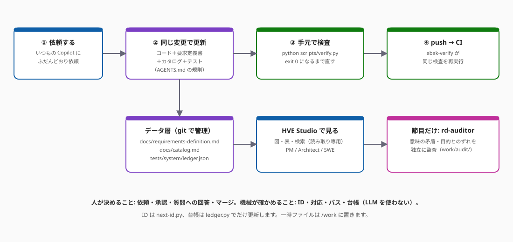
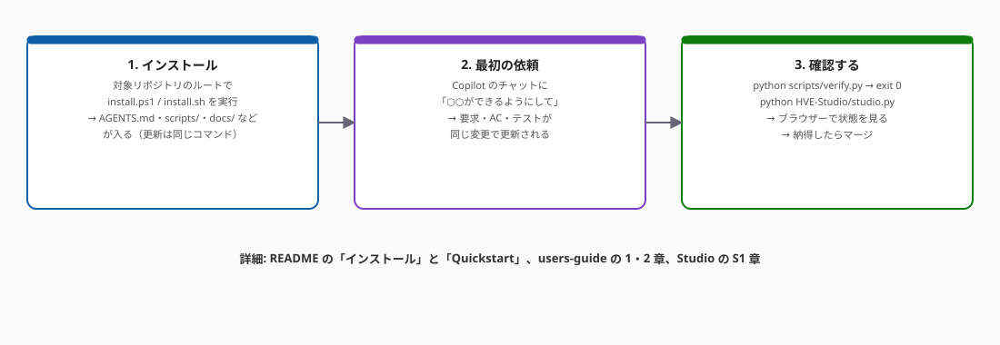
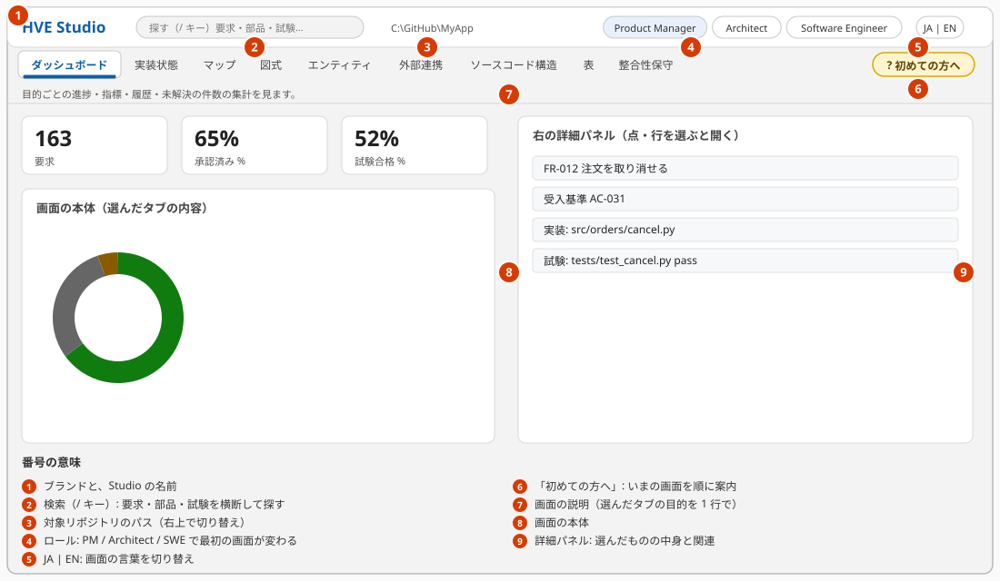
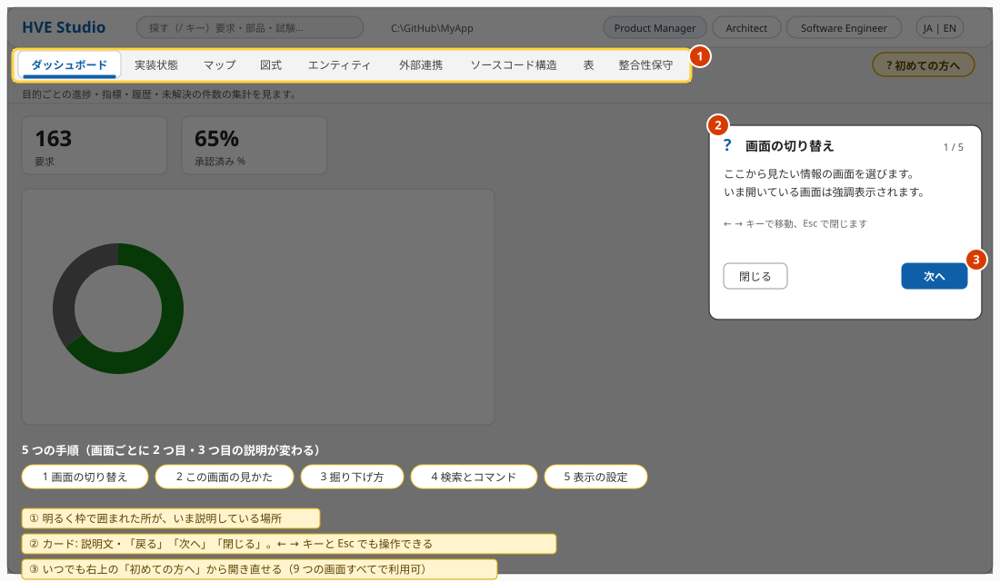
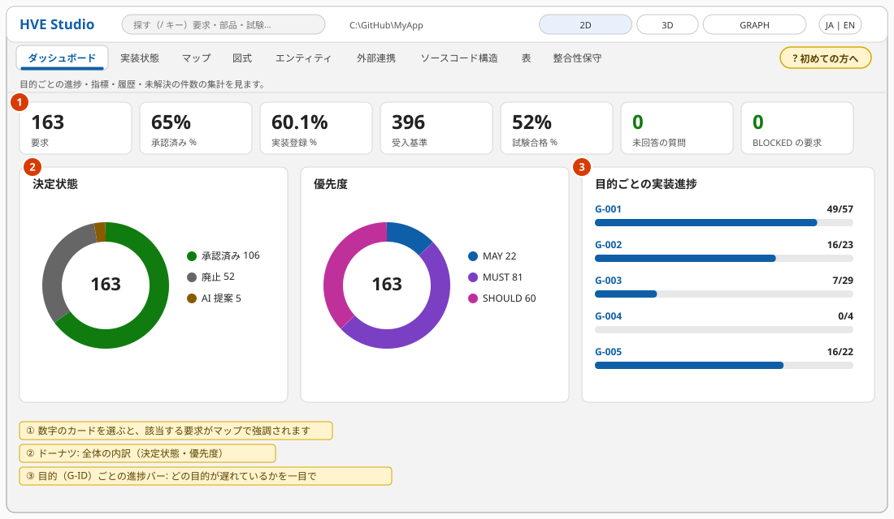
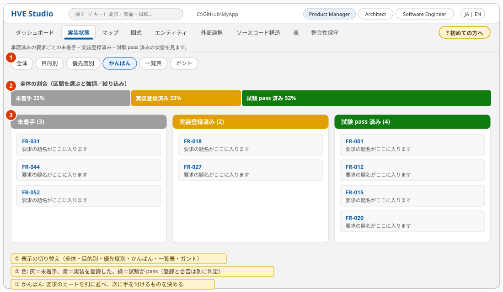
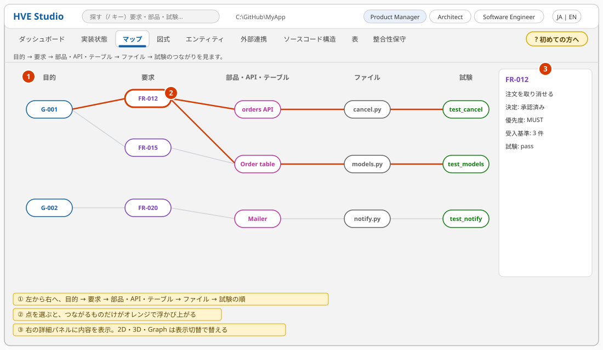
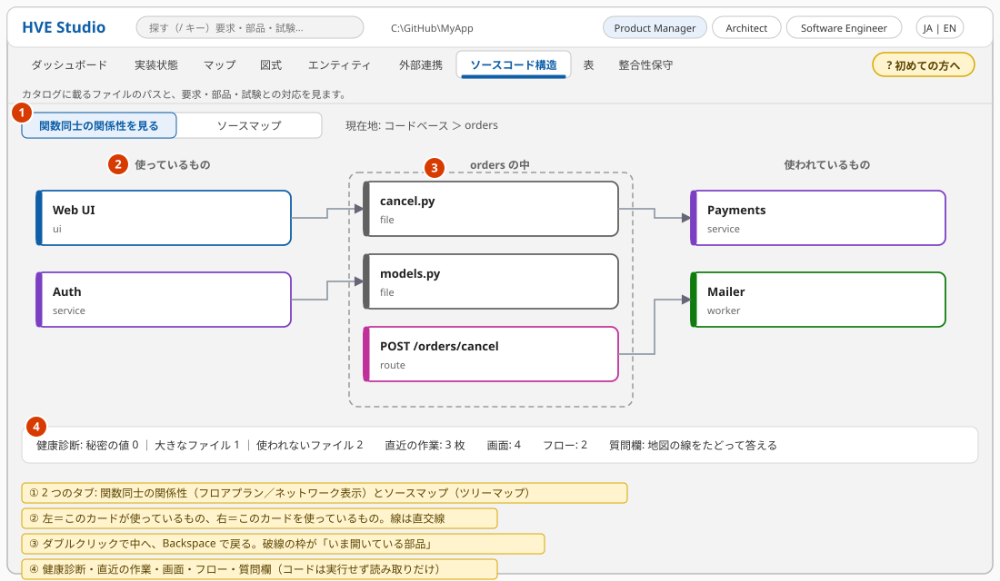
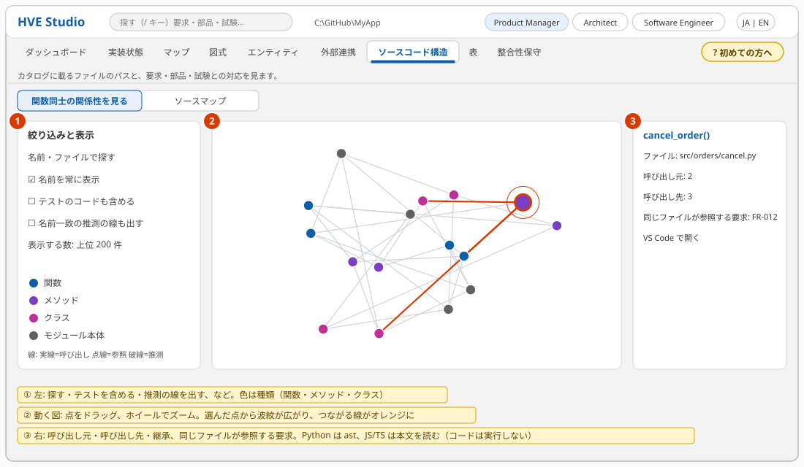
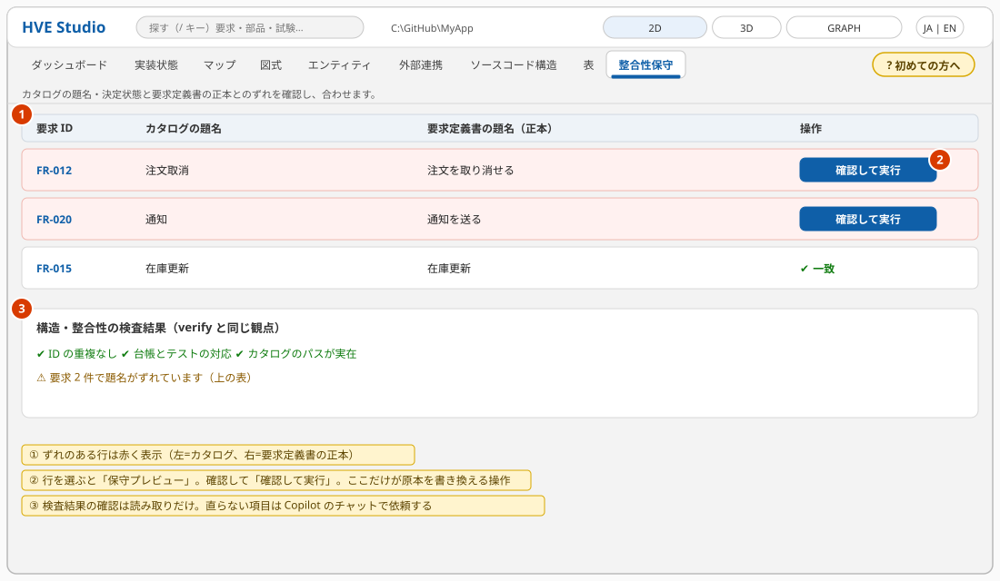

**日本語** | [English](09-visual-tour.en.md)

# S9 画面ツアー（図解）— 初めて使う方へ

HVE Studio を初めて開く方のために、**画面の構成と各画面の見かたを、図（SVG）つきで 1 画面ずつ説明する**章です。図は、画面の配置を分かりやすく描いた説明用のイラストです（数字は例です。実画面は [S2 画面の見かた](02-screens.md) の写真で確かめられます）。図の中の番号 ① ② ③ は、この章の本文の番号と対応しています。

> ナビゲーション: [← HVE Studio の索引](README.md) ・ [← ユーザーガイドの目次](../README.md) ・ [← リポジトリの README](../../README.md) ・ 次: [S1 はじめかた](01-first-steps.md) / [S2 画面の見かた](02-screens.md)

## 0. 3 分でつかむ全体像

Studio は「**見るだけ**」のアプリです。要求や実装を変えるときは、Studio ではなく Copilot のチャットに依頼します。全体の流れは次のとおりです。



1. Copilot に、ふだんどおり依頼します。
2. Copilot が、コードと同じ変更の中で、要求定義書・カタログ・テストを更新します。
3. `python scripts/verify.py` と CI が、決まりごとを機械的に検査します。
4. **Studio で、更新されたデータ層を図・表で確かめます。** ここが本章の対象です。

初めての方は、まず README の [Quickstart](../../README.md#quickstart) を終えてから、次の 3 ステップを試してください。



```bash
python HVE-Studio/studio.py --check      # データ層が読めるか確認
python HVE-Studio/studio.py              # ブラウザーが開く（作業ステップ 1 から）
```

## 1. 画面の全体像（どの画面でも共通）



| 番号 | 場所 | 何をする所か |
|---|---|---|
| ① | 左上のブランド | 「HVE Studio」の名前です。 |
| ② | 検索欄 | 語を入力すると、要求・部品・試験などを横断して探せます。`/` キーでも移れます。`Ctrl+K` でコマンド（画面の移動など）も出せます。 |
| ③ | 対象リポジトリ | いま見ているリポジトリのパスです。切り替えは右上のメニューからできます。 |
| ④ | ロール | `Product Manager`・`Architect`・`Software Engineer`。選ぶと最初に開く画面が変わります（PM はダッシュボード、Architect は 2D マップ、SWE は表）。いつでも切り替えられます。 |
| ⑤ | `JA \| EN` | 画面の言葉を日本語と英語で切り替えます（要求の本文は書かれたままです）。 |
| ⑥ | **初めての方へ** | いま開いている画面の使い方を、順番に案内します（[第 2 節](#2-初めての方への案内ウィザード)）。 |
| ⑦ | 画面の説明 | 選んだタブの目的が 1 行で出ます。 |
| ⑧ | 本体 | 選んだタブの内容です。 |
| ⑨ | 右の詳細パネル | 点・行・カードを選ぶと開き、中身と関連する要求・部品・試験が分かります。 |

画面タブは、左から **ダッシュボード・実装状態・マップ・図式・エンティティ・外部連携・ソースコード構造・表・整合性保守** の 9 つです。「何を知りたいか」で選びます。

| 知りたいこと | 開くタブ |
|---|---|
| 全体の進み具合・承認率・未回答の質問 | ダッシュボード |
| 承認済みの要求が、未着手・実装登録済み・試験 pass 済みのどこにあるか | 実装状態 |
| 目的から要求・部品・ファイル・試験までのつながり | マップ |
| コンテキスト・目的ツリー・状態遷移・データ関連・コンポーネント・実装配置の図 | 図式 |
| 業務データの種類と、ユースケースごとの作成・参照・更新・削除 | エンティティ |
| 外部のアプリ・データとの連携 | 外部連携 |
| ファイルと要求・部品・試験の対応、関数どうしの関係 | ソースコード構造 |
| 要求・試験ケース・質問・用語などの元の行 | 表 |
| カタログと要求定義書のずれの確認と修正 | 整合性保守 |

## 2. 「初めての方へ」の案内（ウィザード）

右上の黄色い **「初めての方へ」** ボタンを押すと、ページが暗くなり、**説明している場所だけが明るく枠で囲まれて**、カードで使い方を順に案内します。9 つの画面すべてで使えます。



- ① 明るい枠の中が、いま説明している場所です。
- ② カードに説明文があり、「戻る」「次へ」「閉じる」で進めます。**← → キーで移動、Esc で閉じる**こともできます。最後の手順では「完了」になります。
- ③ 手順は 5 つです。「画面の切り替え」→「この画面の見かた」→「ここから掘り下げる」→「検索とコマンド」→「表示の設定」。2 つ目・3 つ目の説明は、開いている画面ごとに変わります。
- 何度でも開き直せます。言語（JA / EN）を切り替えると、案内の文章も切り替わります。
- ソースコード構造のフロアプラン（第 7 節）には、同じ名前の別の案内（地図の使い方）があります。

## 3. ダッシュボード（Product Manager が最初に開く画面）



- ① **数字のカード**: 要求の件数、承認済み %、実装登録 %、受入基準、試験合格 %、未回答の質問、BLOCKED の要求。カードを選ぶと、該当する要求の一覧へ移ります。「未回答の質問」と「BLOCKED の要求」は **0 が望ましい**数字です。
- ② **ドーナツ**: 全体の内訳（決定状態・優先度）。中央の数字が合計です。
- ③ **目的ごとの進捗バー**: `G-001` などの目的（G-ID）ごとに、実装できた要求の数 / 全体の数が出ます。**短いバーの目的が、いま遅れている目的**です。
- 役割ごとの読み方は、画面上部の「ダッシュボード 分析」に書かれています。詳しい手順は [S5 Product Manager 向け](05-product-manager.md)。

## 4. 実装状態



- ① **表示の切り替え**: 全体・目的別・優先度別・かんばん・一覧表・ガント。
- ② **色**: 灰＝未着手、黄＝実装を登録した、緑＝試験が pass。**「実装の登録」と「試験の合否」は別に判定**します。区間を選ぶと、強調または絞り込みができます。
- ③ **かんばん**: 要求のカードを 3 列に並べます。次に手を付けるものを決めるときに使います。
- 承認待ち・保留・却下・廃止の要求は、この画面の対象外です。

## 5. マップ（Architect が最初に開く画面）



- ① 左から右へ **目的 → 要求 → 部品・API・テーブル → ファイル → 試験** の順に並びます。
- ② 点を選ぶと、**つながるものだけがオレンジで浮かび上がります**。「この要求を変えると、どのファイルとテストに影響するか」が分かります。
- ③ 右の詳細パネルに、題名・決定状態・優先度・受入基準・試験の状態が出ます。
- 画面右上などの切り替えで、2D・3D・Graph を替えられます。手順は [S6 Architect 向け](06-architect.md)。

## 6. 図式・エンティティ・外部連携・表（ひとこと説明）

| 画面 | 見かた | 詳しい説明 |
|---|---|---|
| 図式 | 上のタブで図の種類（コンテキスト・目的ツリー・状態遷移・データ関連・コンポーネント・実装配置）を選び、図の要素を選ぶと対応する要求へ移れます。 | [S2 の図式](02-screens.md#図式) |
| エンティティ | 行がエンティティ、列が要求・利用シナリオ。セルの記号が「作成・参照・更新・削除」のどれかを示します。 | [S2 のエンティティ](02-screens.md#エンティティ) |
| 外部連携 | 連携先・方向・方式・データ分類の一覧。選ぶと詳細が開きます。`docs/integrations.md` を読みます。 | [外部連携カタログ](../11-integration-catalog.md) |
| 表 | 種別のタブで切り替え、見出しで並べ替え、CSV で書き出せます。Software Engineer が最初に開く画面です。 | [S2 の表](02-screens.md#表) ・ [S7](07-software-engineer.md) |

## 7. ソースコード構造 — 関数同士の関係性・フロアプラン・ネットワーク表示

この画面には 2 つのタブがあります。**「関数同士の関係性を見る」**（フロアプランとネットワーク表示）と、**「ソースマップ」**（ファイルの面積で見るツリーマップ。要求・部品・試験との対応）です。

### 7.1 フロアプラン



- ① 2 つのタブで、関数同士の関係性（フロアプラン／ネットワーク表示）とソースマップを切り替えます。
- ② **左の列は、真ん中のカードが使っているもの、右の列は、真ん中のカードを使っているもの**です。線は直交線です。
- ③ **ダブルクリック（Enter）で中に入り、Backspace・パンくず・ブラウザーの戻るで戻ります**。破線の枠が「いま開いている部品」です。場所は URL（`#/floorplan?v=&s=`）で共有できます。
- ④ 下の欄: **健康診断**（秘密の値・大きなファイル・使われないファイルなどの簡易チェック。セキュリティ監査ではありません）、**直近の作業**（git の未コミットと直近のコミット）、**画面ごとの裏側**、**フロー**、**質問欄**（AI ではなく、地図の線をたどって答えます）。
- ズームで説明が消えて題名が大きくなります。`/` や `Ctrl+K` で探せます。部品の境界は、`floorplan/architecture.json` があれば読み、なければフォルダーから自動で分けます。
- **コードは実行せず、読み取りだけ**です。

### 7.2 ネットワーク表示（関数どうしの呼び出し）



- ① 左: 名前・ファイルで探す、テストのコードを含める、名前一致の推測の線を出す、参照の線を出す、表示する数。点の色は種類（関数・メソッド・クラス・モジュール本体）です。
- ② 中央: 動く図です。点のドラッグ、ホイールのズームができます。選んだ点から波紋が広がり、**つながる線がオレンジ**になります。
- ③ 右: 呼び出し元・呼び出し先・継承、同じファイルが参照する要求、「VS Code で開く」。
- Python は `ast`、JS/TS は文字列とコメントを除いた本文を読み、**解決できた関係だけ**を線にします。名前が一意なときの名前一致は「推測」の線（既定は非表示）で、動的な呼び出しは推測しません。キーボードで選べる一覧もあります。

## 8. 整合性保守



- ① カタログの題名・決定状態が、要求定義書（正本）とずれている行が赤く出ます。
- ② 内容を確認してから **「正本に合わせる」** を選びます。**Studio が原本を書き換えるのは、この確認済みの操作だけ**です。
- ③ 構造・整合性の検査結果の確認は読み取りだけです。直らないものは、Copilot のチャットで依頼するか、`python scripts/rdfix.py --full --apply` を使います（[検査項目と CI](../06-quality-gates.md)）。

## 9. 最初の 10 分のおすすめ手順

1. `python HVE-Studio/studio.py --check` で、データ層が読めることを確かめます。
2. `python HVE-Studio/studio.py` で開きます。
3. **「初めての方へ」** を押して、案内を最後まで進めます。
4. ダッシュボードで、「未回答の質問」と「BLOCKED の要求」が 0 か確かめます。
5. 気になる目的（G-ID）を選び、**実装状態**で未着手の要求を見ます。
6. 1 つの要求を **マップ**で選び、つながる部品・ファイル・試験を確かめます。
7. 迷ったら、検索欄（`/` キー）に要求 ID（例: `FR-012`）を入れます。

うまく動かないときは [S4 うまく動かないとき・用語集](04-troubleshooting.md) を見てください。

## 関連ドキュメント

| 目的 | 読む場所 |
|---|---|
| 実画面の写真つきで見たい | [S2 画面の見かた](02-screens.md) |
| 目的別の手順（報告・影響調査・承認待ちの確認） | [S3 こんなとき、どう見るか](03-tasks.md) |
| どの画面が、どのファイルを読むか | [S8 データリファレンス](08-data-reference.md) |
| インストールと Quickstart | [README.md](../../README.md#インストール) ・ [Quickstart](../../README.md#quickstart) |
| ユーザーガイド全体の目次 | [users-guide/README.md](../README.md) |
