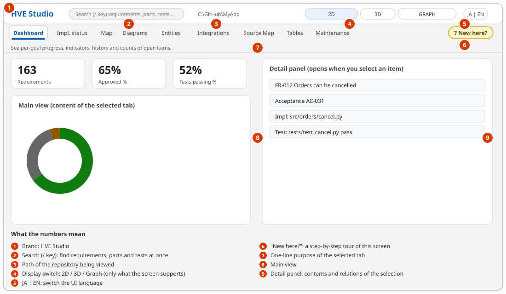

[日本語](README.md) | **English**

# HVE Studio User Guide (Part 2)

The full name is **Hypervelocity Engineering Studio** (HVE Studio for short), formerly EABK Studio. The folder moved from `EABK-Studio/` to `HVE-Studio/`, and the root launchers from `start-eabk-studio.*` to `start-hve-studio.*`. Saved display settings keep working. In a repository updated from an older version, the installer reports the leftover `EABK-Studio/` as orphaned files; `--clean` removes them.

This folder is Part 2 of the [HVE User Guide](../README.en.md) (HVE itself is chapters 1–11 in Part 1; the chapters in this part are S1–S9). HVE Studio is an app that runs only on your own computer and lets you browse the "record of requirements, catalog, and tests" managed by HVE (the data layer) through **diagrams, tables, and search**. Even if you can't read code, you can see "what we decided to build," "how far it has been built," and "where each component, piece of data, and API lives."

> **New here? Start with [S9 Visual tour](09-visual-tour.en.md).** It explains the layout and each screen, one at a time, with figures. The yellow **"New here?"** button at the top right of the screen also starts a tour of the current screen.
>
> Navigation: [← User guide contents](../README.en.md) · [← Repository README](../../README.en.md)

## Read by your role

| You are | Read first | Work step to choose | First screen |
|---|---|---|---|
| Product Manager (decides what to invest in) | [05-product-manager.en.md](05-product-manager.en.md) | Step 1 "Understand the whole" | Dashboard |
| Architect (checks design consistency and boundaries) | [06-architect.en.md](06-architect.en.md) | Step 3 "Check the impact" | Source Map (floorplan); the same step has Map and Diagrams |
| Software Engineer (looks for where implementation and tests are) | [07-software-engineer.en.md](07-software-engineer.en.md) | Steps 2 "Settle requirements" and 4 "Track progress" | Tables (requirements), Impl. status |

There are no role buttons (removed on 2026-11-20). Choosing a work step (1–6) at the top of the screen opens that step's default screen.

## Reading order (S9 → S1 → S2 → by role → S3 → S8 → S4)

| Chapter | File | Contents |
|---|---|---|
| S9 | [09-visual-tour.en.md](09-visual-tour.en.md) | **For first-time users.** A visual tour with figures (SVG), including the "New here?" wizard, the floorplan and the network view |
| S1 | [01-first-steps.en.md](01-first-steps.en.md) | How to launch, your first 10 minutes |
| S2 | [02-screens.en.md](02-screens.en.md) | What each screen tells you (with real screenshots) |
| S5–S7 | Role-specific guides (table above) | 15-minute tutorial, recommended links, what you can decide |
| S3 | [03-tasks.en.md](03-tasks.en.md) | A how-to collection: "In this situation, how do I look at it?" |
| S8 | [08-data-reference.en.md](08-data-reference.en.md) | Which screen reads what from which file, and how it calculates |
| S4 | [04-troubleshooting.en.md](04-troubleshooting.en.md) | When things don't work (`--check`) and glossary |

This guide lives in `users-guide/studio/` in the distribution source, and in `HVE-docs/studio/` in a repository where HVE was installed with `tools/install.py`. Technical specifications are in [HVE-Studio/README.md](../../HVE-Studio/README.md). The images are examples made by reading the data of the repository that built the tool itself (capture conditions are in [screen-images.json](screen-images.json); re-capture with `capture-screens.py`).

## Things to know first

- **Normal browsing is read-only**. Only confirmed catalog maintenance changes originals. Task edits use Studio-owned storage outside the repository.
- **Nothing is sent outside**. Communication stays inside your own computer (127.0.0.1). The only exceptions are reading Issues, PRs and Actions with the `gh` CLI when the remote is GitHub (stop it with `--no-remote`), and what you agree to send with "Ask AI" after setting up "AI settings". Explicit source references and TODOs are read, but repository code is not executed.
- **It stays up to date automatically**. When a data-layer file is updated, the screen reloads within a few seconds.
- With `JA | EN` at the top right of the screen, you can switch the screen's language between Japanese and English (requirement text and the like remain as written).
