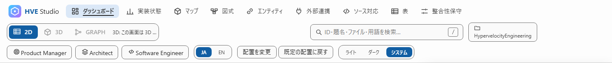

**日本語** | [English](README.en.md)

# HVE Studio ユーザーガイド（第 2 部）

正式名称は **Hypervelocity Engineering Studio** です。旧名は EABK Studio です。フォルダーは `EABK-Studio/` から `HVE-Studio/` に、ルートの起動スクリプトは `start-eabk-studio.*` から `start-hve-studio.*` に変わりました。保存済みの表示設定は引き続き使えます。旧版から更新したリポジトリに残る `EABK-Studio/` は、インストーラーが孤立ファイルとして報告します。`--clean` で削除できます。

このフォルダーは、[EABK ユーザーガイド](../README.md)の第 2 部です（EABK 本体は第 1 部の 1〜10。この部の章は S1〜S8）。HVE Studio は、EABK が管理している「要求・カタログ・試験の記録」（データ層）を、**図・表・検索**で見て回るための、あなたのパソコンだけで動くアプリです。コードを読めなくても、「何を作ると決めたか」「どこまで作ったか」「どの部品・データ・APIがどこにあるか」が分かります。

## あなたの役割から読む

| あなたは | 最初に読む | 起動 | 最初の画面 |
|---|---|---|---|
| Product Manager（何に投資するか決める） | [05-product-manager.md](05-product-manager.md) | `python HVE-Studio/studio.py --role pm` | ダッシュボード |
| Architect（設計の整合・境界を確かめる） | [06-architect.md](06-architect.md) | `python HVE-Studio/studio.py --role architect` | 2D マップ |
| Software Engineer（実装・テストの場所を探す） | [07-software-engineer.md](07-software-engineer.md) | `python HVE-Studio/studio.py --role swe` | 表 |

役割は、画面右上の `Product Manager`・`Architect`・`Software Engineer` のボタンでも、いつでも切り替えられます。

## 読む順（S1 → S2 → 役割別 → S3 → S8 → S4）

| 章 | ファイル | 内容 |
|---|---|---|
| S1 | [01-first-steps.md](01-first-steps.md) | 起動のしかた、最初の 10 分 |
| S2 | [02-screens.md](02-screens.md) | 画面で何が分かるか（実画面つき） |
| S5〜S7 | 役割別のガイド（上の表） | 15 分のチュートリアル、おすすめのリンク、判断できること |
| S3 | [03-tasks.md](03-tasks.md) | 「こんなとき、どう見るか」の手順集 |
| S8 | [08-data-reference.md](08-data-reference.md) | どの画面が、どのファイルの何を読んで、どう計算するか |
| S4 | [04-troubleshooting.md](04-troubleshooting.md) | うまく動かないとき（`--check`）・用語集 |

このガイドは配布元では `users-guide/studio/`、`tools/install.py` で EABK を入れたリポジトリでは `EABK-docs/studio/` に入ります。技術的な仕様は [HVE-Studio/README.md](../../HVE-Studio/README.md) にあります。画像は、ツールを作ったリポジトリ自身のデータを読んだ例です（採取条件は [screen-images.json](screen-images.json)、再採取は `capture-screens.py`）。

## 先に知っておくこと

- **通常の閲覧は読むだけです**。「整合性保守」で確認したカタログ更新以外は原本を変えません。タスク編集はリポジトリ外の Studio 専用保存先に分離します。
- **外へ送りません**。通信は自分のパソコン内（127.0.0.1）だけです。ソースの明示的な参照・TODO を読み取りますが、コードは実行しません。
- **自動で最新になります**。データ層のファイルが更新されると、数秒で画面が読み直されます。
- 画面右上の `JA | EN` で、画面の言葉を日本語と英語に切り替えられます（要求の本文などは書かれたままです）。
